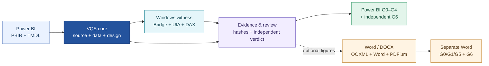

# Visual Quality System (VQS)

[](https://github.com/analienx/visual-quality-system/actions/workflows/ci.yml)
[](LICENSE)
[](pyproject.toml)

**Power BI quality is the product. Word assurance is an optional component.**
VQS identifies source-backed Power BI report issues by page and visual,
compares them with real semantic-model data and native Desktop evidence,
and can produce a typed repair plan for a disposable candidate. It
separately offers DOCX/Word pagination and content checks **without
making Word a dependency for a Power BI-only release**.

Real quality acceptance needs populated Desktop renders, source identity,
semantic checks, supported interactions and independent visual review.
Schema-valid JSON — or a pretty screenshot with wrong values — is not
an accepted report.

## 60 seconds

```bash
pip install -e ".[test]"
vqs --version
vqs triage tests/powerbi/fixtures/mini_report --out quality.md
vqs triage path/to/Existing.pbip --plan-out candidate-plan.json
vqs doctor                        # optional capability diagnostics
python -m pytest                  # full suite green plus ruff clean
```

The first command produces a prioritized human-readable report (exit 0)
and says that inherited slicer typography needs **render evidence**;
it does not invent a design defect or auto-fix it. A safe plan is
exported only when one can be synthesized. To apply it, use `vqs repair`
on a disposable candidate and `vqs verify`; source-only triage is not
visual approval. The low-level tools remain available for debugging —
see `docs/QUICKSTART.md`.

Real output (`vqs cycles`, exit 0):

```json
{
  "model_dir": "tests\\powerbi\\fixtures\\clean_model",
  "dax_objects": 2,
  "m_queries": 1,
  "dax_cycles": [],
  "m_cycles": [],
  "let_cycles": [],
  "acyclic": true
}
```

## The architecture at a glance



Static facts come from PBIR/TMDL. Microsoft's **Report Author CLI**
validates supported report content; **Modeling MCP** queries semantic
models; the **Desktop Bridge** captures actual pages and controls
reload/status; native **Windows UI Automation** invokes supported slicer
selection patterns and reads real rendered controls. Remote Desktop
Commander can orchestrate the authorized Windows host but is not
itself a Power BI data or accessibility API. WinApp CLI is a potential
future alternative and is **not integrated**.

Every observation is bound to source hash, tool version, data scope and
actual Desktop state. Independent review adjudicates the result.
`pass`, `fail`, and `blocked` remain distinct.

See the [illustrated Power BI-first architecture](docs/ARCHITECTURE.md)
for three detailed diagrams, responsibilities, deployment split, actual
status and release scopes.

## What runs today

| Command | Does | Status |
| --- | --- | --- |
| `vqs triage` | PBIP/Report → prioritized page/visual findings, missing evidence and optional typed repair plan | Implemented on this branch; static diagnosis, not visual approval |
| `vqs run` | One-command workflow: inspect → review → propose → repair → verify → remeasure | Implemented on this branch |
| `vqs measure` | PBIR/TMDL facts: contrast, cohorts, units, scoped bindings, page insights, duplication + chart-practice + layout checks | Implemented on this branch |
| `vqs cycles` | Static DAX/M/`let` acyclicity gate | Implemented on this branch |
| `vqs check` | Facts → sealed verdict under run roots (G0 observation) | Implemented on this branch |
| `vqs capture` | Bridge screenshots + capture manifest | Implemented on this branch; needs Desktop + Bridge |
| `vqs request-review` | Source-bound review template from renders | Implemented on this branch |
| `vqs bundle` | Portable fixer→reviewer evidence bundles | Implemented on this branch |
| `vqs adjudicate-bundle` | Independent static adjudication (never passes statically) | Implemented on this branch |
| `vqs doctor` | Capability + install-identity report (never installs or gates) | Implemented on this branch |
| `vqs inventory` / `status` | PBIR inventory / ledger snapshot | Implemented on this branch |
| Typed candidate repair | Allowlisted edits in disposable candidates + explicit authoring backends | Review candidate ([PR #31](https://github.com/analienx/visual-quality-system/pull/31), draft unmerged; [WP-09](https://github.com/analienx/visual-quality-system/issues/14)) |
| Windows native UIA | Real .NET `SelectionItemPattern` Year/Region actions, observed values and accessibility bounds | 🔶 P16 **unmerged candidate evidence** (9/9), **not independent G4** ([draft PR #56](https://github.com/analienx/visual-quality-system/pull/56)) |
| **Word/DOCX component (optional)** | OOXML inspection exists in main; native Word/page/TOC field evidence developed in stacked candidates, independent prose/figures incomplete | 🔶 separate, **not a Power BI core blocker** ([draft PR #62](https://github.com/analienx/visual-quality-system/pull/62), [WP-08](https://github.com/analienx/visual-quality-system/issues/13)) |
| Fabric Apps | React/TS adapter | ⏸ deferred ([WP-13](https://github.com/analienx/visual-quality-system/issues/18)) |

Implemented rows describe main-branch code; phase-labeled P16/P22
rows explicitly describe **unmerged** engineering candidates. None
is independently G6-accepted; the ledger reports zero verified work
packages. Trust boundaries: [ADR 0001](docs/adr/0001-r6-trust-boundaries.md).

### Separate release scopes

`vqs.acceptance.run_acceptance` accepts an explicit
`release_scope` field:

| Scope | Subjects and gates | Current release |
| --- | --- | --- |
| **`powerbi-core`** | Two unrelated PBIPs; G0–G4 plus independently bound G6 | **Blocked** on G2/G4/G6 evidence |
| **`word-docx`** | DOCX-only; G0/G1/G5 plus independently bound G6 | **Blocked** on Word pagination, figures, review |
| `combined` (default for old records) | Both report and document criteria | Backward-compatible, also blocked |

Word cannot block the **Power BI-only** scope; Power BI approval does
not automatically certify Word. Scope-specific evidence is
cryptographically domain-separated and still requires genuinely
independent reviewer/owner authority. Word's existing OOXML
inspection lives within the same Python package; the native
PDFium/page-renderer optional dependency extra appears in the
unmerged P19+ candidate stack and is **not** present in main.

Machine-readable status: [roadmap/STATUS.md](roadmap/STATUS.md) and [roadmap/work_packages.json](roadmap/work_packages.json). Program tracking: [issue #4](https://github.com/analienx/visual-quality-system/issues/4).

## Docs

- [Functionality-first priorities](docs/PRODUCT_VALUE_PRIORITIES_2026-10-11.md) — real visual, semantic and repair usability gaps
- [Developer journey](docs/JOURNEY.md) — the supported installed-command walk, oracle-tested
- [User guide](docs/USER_GUIDE.md) — end-to-end workflows with copy-paste commands
- [Command reference](docs/CLI.md) — every `vqs` command
- [Illustrated architecture](docs/ARCHITECTURE.md) — Power BI core, optional Word, Windows Bridge/API/UIA/remote layers, quality loop and release scopes
- [Acceptance matrix](docs/ACCEPTANCE_MATRIX.md) — falsifiable gates G0–G6
- [Contributing](CONTRIBUTING.md) — setup, gates, PR rules
- [Changelog](CHANGELOG.md)
- [Agent/protocol rules](docs/LEDGER_AND_AGENT_PROTOCOL.md) · [AGENTS.md](AGENTS.md)

## Ecosystem: VQS owns the quality decision

VQS parses source facts itself and uses first-party tools at arm's length:
Microsoft-guided `powerbi-report-author` (report authoring/validation,
with policy-controlled fallback), [Microsoft Power BI Modeling MCP](https://github.com/microsoft/powerbi-modeling-mcp)
(semantic models), [Desktop Bridge](https://learn.microsoft.com/en-us/power-bi/developer/agentic/power-bi-desktop-bridge-overview)
(exact-process screenshot/reload/state), and Windows .NET UI Automation
(P16 candidate native input/readback). VQS has no ADOMD dependency. The latter
is **not** interchangeable with the Bridge. Details:
[tool boundaries](docs/ARCHITECTURE.md#2-how-vqs-actually-interacts-with-power-bi-desktop).

## Security

Default runs are local and private. Never commit business data, real screenshots, caches (`.abf`), credentials, or machine-local Desktop state — see [AGENTS.md](AGENTS.md) and the ledger protocol. Report security issues privately to the repo owner.

## License

Apache-2.0 — see [LICENSE](LICENSE) and [NOTICE](NOTICE).
