<div align="center">
  
  <h2>Make every Power BI report worth trusting.</h2>
  <p><strong>Understand the source. Refine the design. Verify the actual experience.</strong></p>
  <p>Deterministic PBIP diagnostics, grounded premium-design feedback, safe candidate repairs, and evidence from real Power BI Desktop.</p>
  <p>
    <a href="#get-started">Get started</a> ·
    <a href="#inside-the-reports">See real screenshots</a> ·
    <a href="#how-vqs-works">How it works</a> ·
    <a href="docs/RELEASE_NOTES_2026-10-21.md">Release notes</a>
  </p>
  <p>
    <a href="https://github.com/analienx/visual-quality-system/actions/workflows/ci.yml"></a>
    
    
    <a href="docs/RELEASE_NOTES_2026-10-21.md"></a>
  </p>
</div>

<a href="docs/media/showcase/executive-overview.webp">
  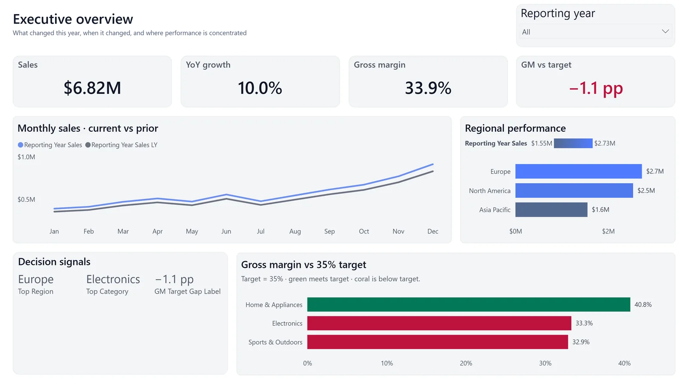
</a>
<p align="center"><sub><strong>REAL POWER BI DESKTOP RENDER</strong> · <a href="examples/contoso-retail/Contoso%20Retail.pbip"><strong>Open the exact matching PBIP</strong></a> · Fictional Contoso sample · Verified source and image hashes · <a href="docs/media/showcase/ASSET_PROVENANCE.md">Image provenance</a></sub></p>

> [!NOTE]
> **These five previews come from [the exact PBIP and self-contained semantic model committed in this repository](examples/contoso-retail/README.md)** — not mockups or a VQS GUI. Each screenshot's source digest matches the checked-in report. Open it in Power BI Desktop and click **Refresh now** on first use to populate its fictional data; private cache and raw screenshot evidence remain excluded. This is an **engineering preview**, not signed production acceptance.

## Inside the reports

<table>
  <tr>
    <td width="50%" valign="top">
      <a href="docs/media/showcase/deep-dive-map.webp">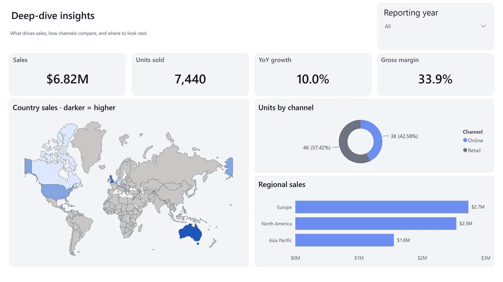</a>
      <p><strong>01 · Geography &amp; insight</strong><br><sub>Actual country shapes, regional ranking and channel breakdown—not a blank map placeholder.</sub></p>
    </td>
    <td width="50%" valign="top">
      <a href="docs/media/showcase/products-brands.webp">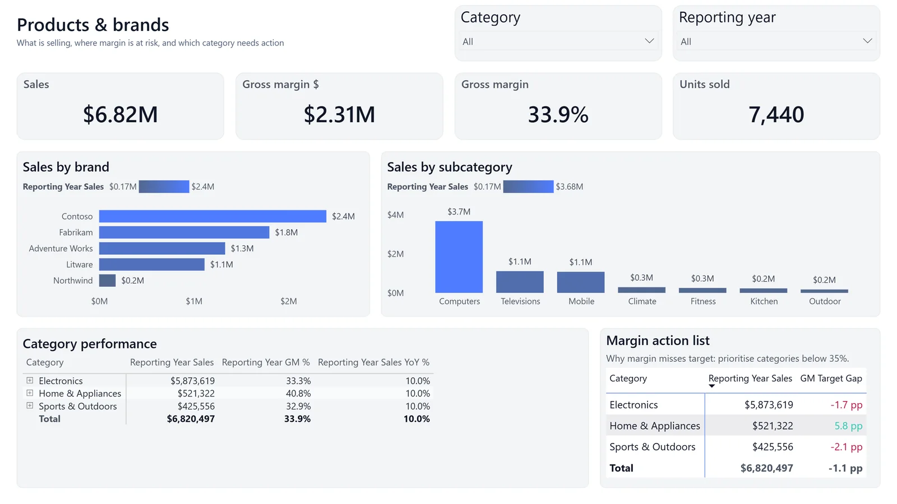</a>
      <p><strong>02 · Product performance</strong><br><sub>Ranked categories, margin context and readable analytical tables.</sub></p>
    </td>
  </tr>
  <tr>
    <td width="50%" valign="top">
      <a href="docs/media/showcase/stores-customers.webp">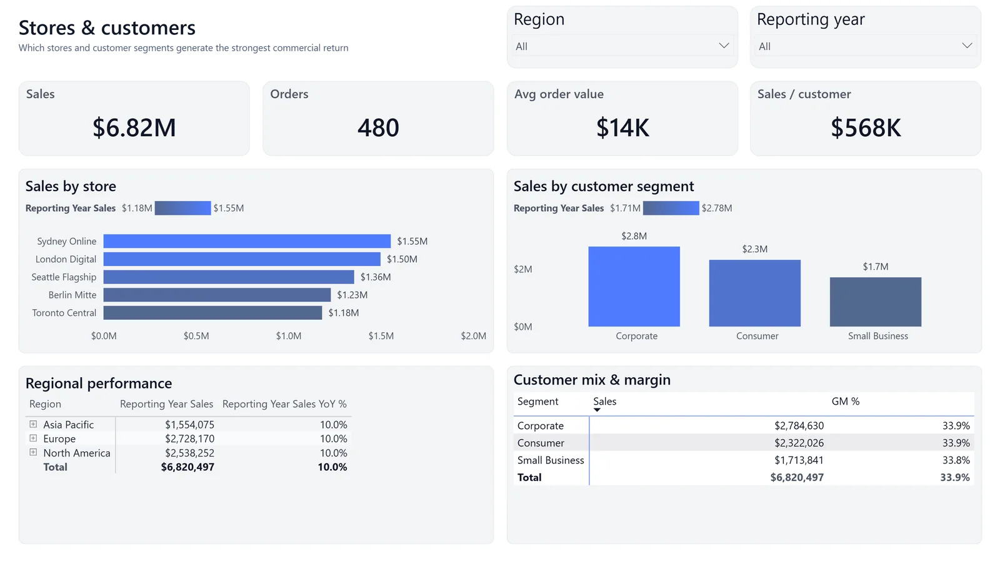</a>
      <p><strong>03 · Customer analytics</strong><br><sub>Native slicers, KPI hierarchy, peer visuals and source-backed matrices.</sub></p>
    </td>
    <td width="50%" valign="top">
      <a href="docs/media/showcase/markets-drivers.webp">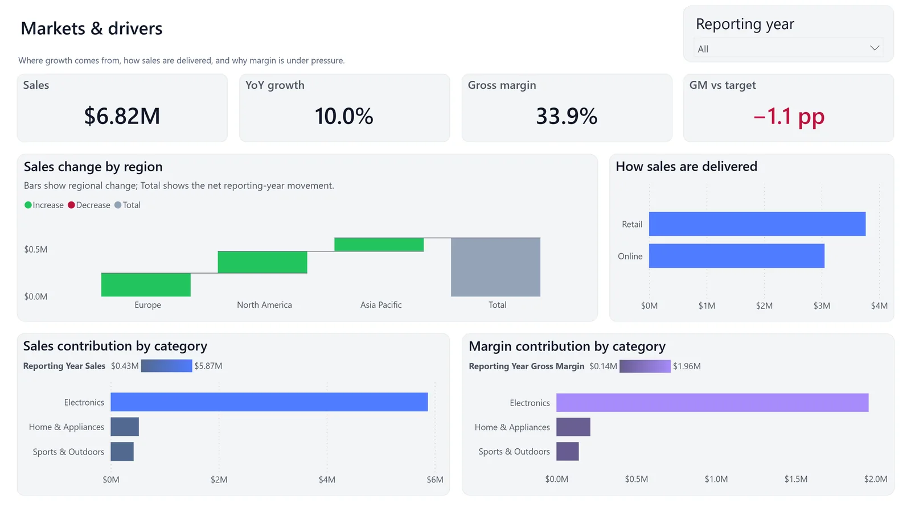</a>
      <p><strong>04 · Business drivers</strong><br><sub>Region waterfall, channel mix and contribution analysis across one consistent layout.</sub></p>
    </td>
  </tr>
</table>

<sub>**Every screenshot ↔ one committed project:** [Open Contoso Retail.pbip](examples/contoso-retail/Contoso%20Retail.pbip) · [Reproduction instructions](examples/contoso-retail/README.md) · [SHA-256 provenance](docs/media/showcase/ASSET_PROVENANCE.md). The public WebP previews come from source-identical real Power BI Desktop canvases; the private high-resolution PNGs and cache remain outside Git.</sub>

### Try the exact dashboard shown above

The complete five-page [Contoso Retail example](examples/contoso-retail/README.md) is part of this repository, with its matching PBIR report and self-generating Power Query/TMDL semantic model. Clone the repo, open [Contoso Retail.pbip](examples/contoso-retail/Contoso%20Retail.pbip) in Power BI Desktop, and select **Refresh now** on the first open. The default Executive overview reproduces the **$6.82M / 10.0% / 33.9%** headline values shown above; no separate sample download, private ABF cache or database is required.

A source-hash regression test locks the screenshots to the included PBIP, so future design changes cannot leave outdated marketing images behind.

## Why VQS exists

Power BI source files can be valid while the delivered report still has a clipped matrix, empty map, poor visual hierarchy, inconsistent measures, or broken filter interactions. VQS is designed to **separate what the source says from what the user actually sees**.

| | VQS gives you | Evidence boundary |
| --- | --- | --- |
| **Inspect** | Page-/visual-level PBIR checks, TMDL and DAX/M cycle diagnostics, prioritized findings | Deterministic source evidence; no UI needed |
| **Improve** | Owner-authored `premium` design contract, top-three grounded recommendations, bounded typed repairs | Your original report remains untouched |
| **Observe** | Populated Power BI Desktop captures, Modeling MCP live DAX probes, supported Windows UI Automation interaction witnesses | Needs a real authorized Windows/Power BI session |
| **Verify** | Source hashes, per-page image digests, measured report-only crops when possible, sealed review bundles | No self-awarded aesthetic or production approval |

### One engine, two execution environments

<a href="docs/ARCHITECTURE.md"></a>

**GitHub/Python** runs source checks. **Windows Power BI Desktop** supplies populated DAX, real screenshots and supported native interactions. An independent reviewer—not a model or CI job—makes the scoped release decision. See the [two-diagram architecture](docs/ARCHITECTURE.md) for the execution boundary and the optional Word/WinApp CLI distinction.

## Get started

**Static quality analysis works on Windows, macOS and Linux.** No Microsoft account, Power BI Desktop installation or upload is needed for the included fixture.

```bash
git clone https://github.com/analienx/visual-quality-system.git
cd visual-quality-system
python -m pip install -e ".[test]"

vqs triage tests/powerbi/fixtures/mini_report --out quality.md
```

Open `quality.md` for prioritized, source-located observations. The command **does not edit the PBIP**.

### Bring your own Power BI report

```bash
# Fast, grounded assessment of a local enhanced-format PBIP
vqs triage path/to/YourReport.pbip --out quality.md

# Define design intent once, then review the most useful deviations
vqs premium path/to/YourReport.pbip --init-contract intent.json
# Edit the generated intent.json for your audience, question and focal visual
vqs premium path/to/YourReport.pbip --contract intent.json --out premium.md

# Discover available optional Microsoft/Windows integrations
vqs doctor
```

VQS `premium` looks for measurable spacing, explicit typography and visual hierarchy problems. It is a **source-aware preflight**, not an automatic beauty rating or AI-led restyling of your report. [Premium quality guide](docs/PREMIUM_POWERBI.md).

### Verify in Power BI Desktop

```bash
# Private, live Windows instance; replace placeholders with real paths and PID
vqs capture MyReport.Report private-renders --pid <DESKTOP_PID> --live-data
vqs bundle pack MyReport.Report private-renders private-review-bundle --fixer-id reviewer-candidate
vqs bundle verify private-review-bundle --report MyReport.Report
```

Real captures are bound to the model process and report revision. Image-only claims don't substitute for real DAX answers. Unsupported operations and unproven pixel geometry remain explicitly **blocked**, not silently passed.

## Demonstrated on two unrelated PBIPs

| Evidence | Contoso Retail | Microsoft Corporate Spend |
| --- | --- | --- |
| Native captured pages | **5 / 5** | **3 / 3** including Tooltip |
| Real model readiness | Repeated populated DAX probes | Repeated populated DAX probes |
| Interaction witness | **9 native** Year/Region events | **Europe → Latin America → Europe**, DAX-matched |
| Public-safe report-only preview | **5 verified canvases** above | Not published; clean crop unproven |
| Known limits | Some map-country automation unsupported | Azure Maps prompts for sign-in |

A report can pass static diagnostics without looking premium. Independent G2 aesthetic acceptance, broader G4 country-map coverage and separate G6 release authority are **not** signed off. [Exact engineering evidence and open blockers](docs/RELEASE_NOTES_2026-10-21.md) · [Acceptance issue #16](https://github.com/analienx/visual-quality-system/issues/16).

## Who this is for

**Report authors** get a clear source-aware punch list before spending another design iteration. **BI platform and governance teams** can compare source, data, rendered pages and supported interactions without conflating their evidence. **Reviewers** receive sealable, verifiable artifacts rather than screenshots detached from the report revision.

Read the [user guide](docs/USER_GUIDE.md), [CLI reference](docs/CLI.md), [acceptance matrix](docs/ACCEPTANCE_MATRIX.md) and [contribution guide](CONTRIBUTING.md).

---

### Approved Light/Dark palette library — 28 selectable modes

**Fourteen newly approved families, each with distinct Dark and Light tokens:** Okabe–Ito Night, Petrol & Gold, Indigo Ember, Arctic Aurora, Mediterranean Terra, Saffron & Spruce, Autumn Editorial, Violet Ice, Electric Atelier, Riviera Pop, Bold Eclectic, Graphite Red, Organic Palette, and Sunny Palette.

**[View all 28 palette design previews →](docs/APPROVED_THEME_LIBRARY.md)** · [Approved palette selection](docs/APPROVED_THEME_SELECTION.json) · [Theme CLI](docs/THEME_ENGINE.md) · [Theme release-candidate notes](docs/RELEASE_NOTES_THEME_2026-10-24.md)

Try a source-preserving preview and candidate of the included synthetic Contoso report:

```bash
vqs theme presets
vqs theme preview "examples/contoso-retail/Contoso Retail.pbip" --mode dark --palette-preset organic-palette --out theme-plan.json
vqs theme apply "examples/contoso-retail/Contoso Retail.pbip" --mode light --palette-preset sunny-palette --candidate-root ./sunny-candidate
vqs theme audit ./sunny-candidate
```

The **14 new families add 28 mode combinations** to the original four
families. The source report is not modified, and no theme candidate is
automatically published to Fabric or merged into the example.

These new previews are **token-accurate design simulations, not Power BI screenshots**. Microsoft-hosted native authoring validates actual five-page report candidates separately. The following five-theme gallery still contains genuinely captured Power BI Desktop evidence for the original colorways.

### Adaptive Power BI themes — full report showcases

[**Chart-color redesign:** researched independent categorical/ramp
palettes are implemented for each dark colorway.](docs/CHART_COLOR_DESIGN.md)
*The four dark colorways show recaptured native Desktop evidence for
the researched chart palettes; the white/light theme remains unchanged.*


Five **previously captured** colorways, with **three different real report
pages per colorway** below (separate from the 28 new simulation previews). Each preview is a genuine synthetic Contoso report
capture from Power BI Desktop; for all five pages and full provenance see
the [interactive comparison gallery](docs/THEME_GALLERY.md).

**Executive Blue · Light**

| Executive overview | Products & brands | Deep-dive insights |
| :--- | :--- | :--- |
| [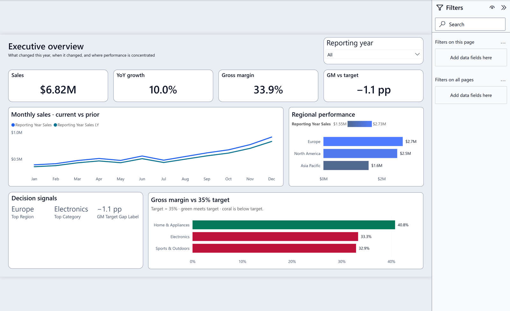](docs/THEME_GALLERY.md) | [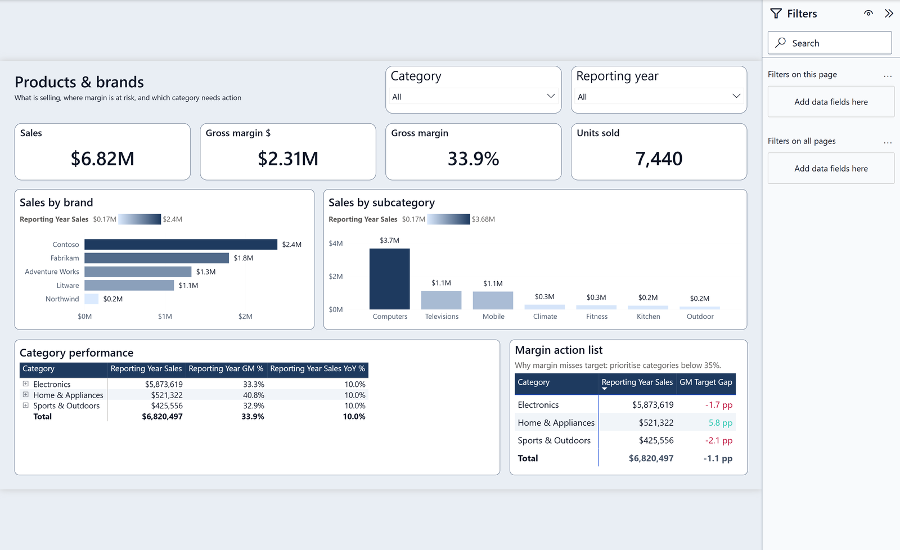](docs/THEME_GALLERY.md) | [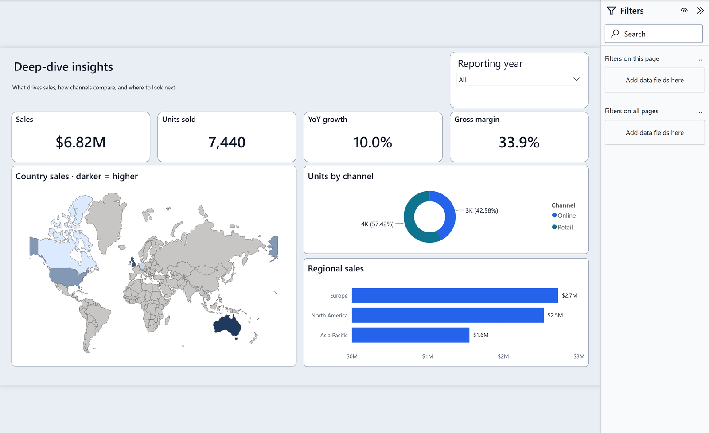](docs/THEME_GALLERY.md) |

**Executive Blue · Dark**

| Executive overview | Products & brands | Deep-dive insights |
| :--- | :--- | :--- |
| [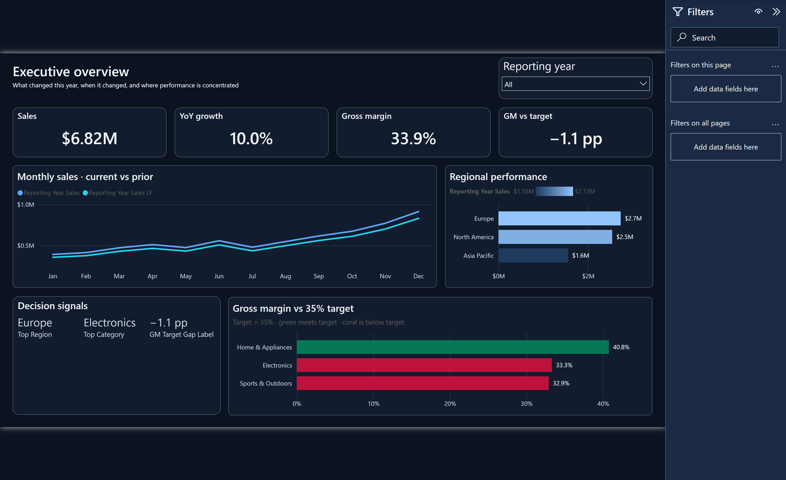](docs/THEME_GALLERY.md) | [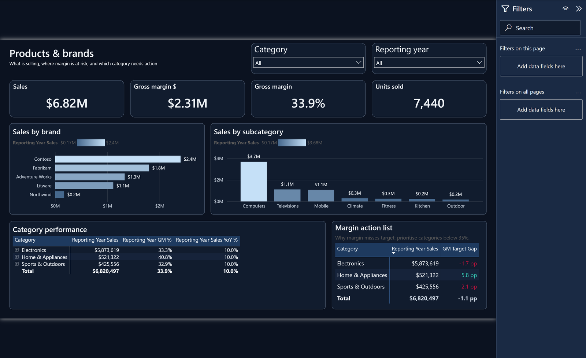](docs/THEME_GALLERY.md) | [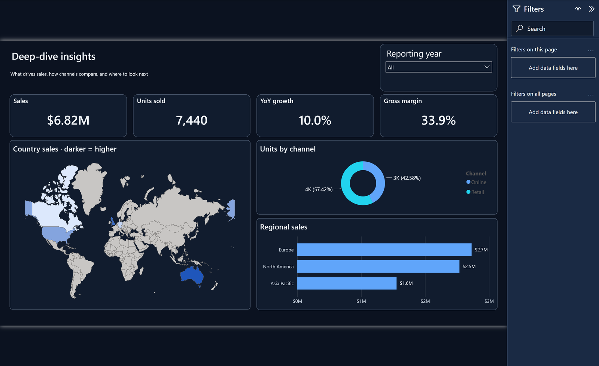](docs/THEME_GALLERY.md) |

**Graphite Mint**

| Executive overview | Products & brands | Deep-dive insights |
| :--- | :--- | :--- |
| [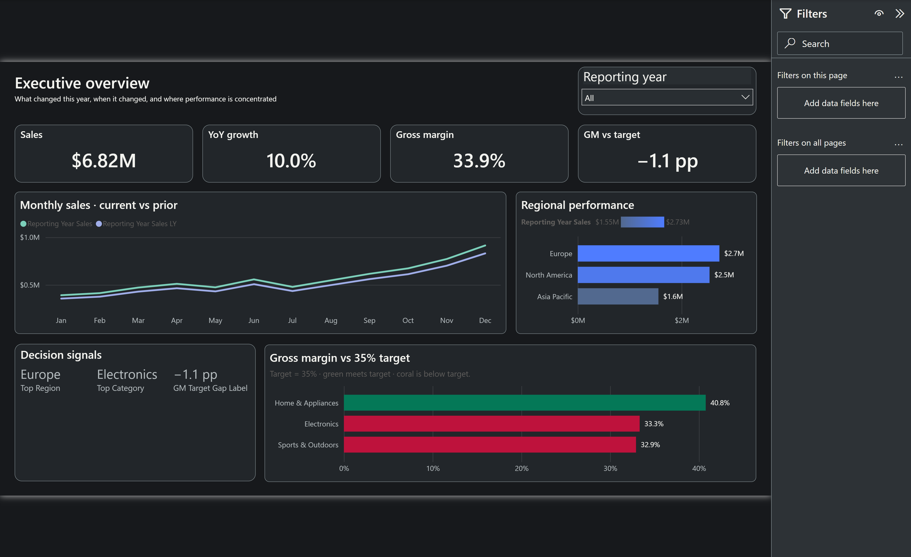](docs/THEME_GALLERY.md) | [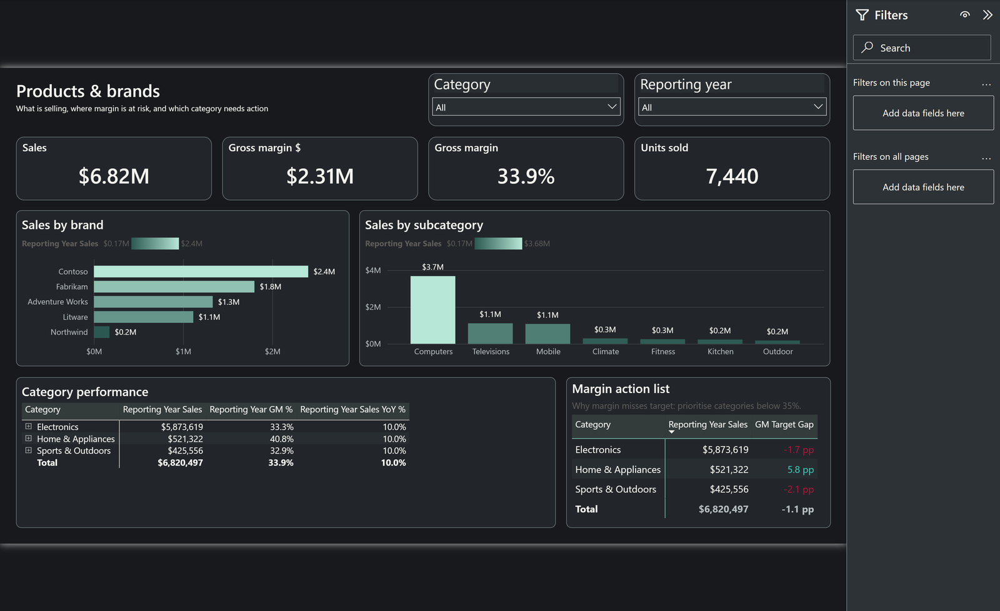](docs/THEME_GALLERY.md) | [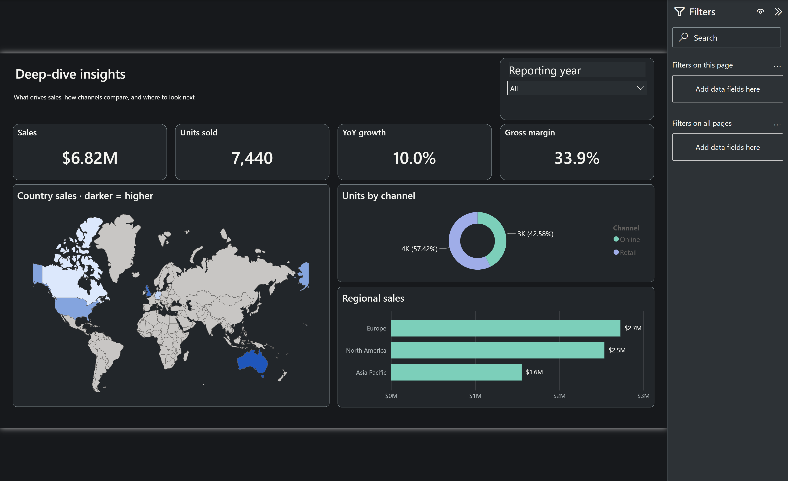](docs/THEME_GALLERY.md) |

**Warm Basalt**

| Executive overview | Products & brands | Deep-dive insights |
| :--- | :--- | :--- |
| [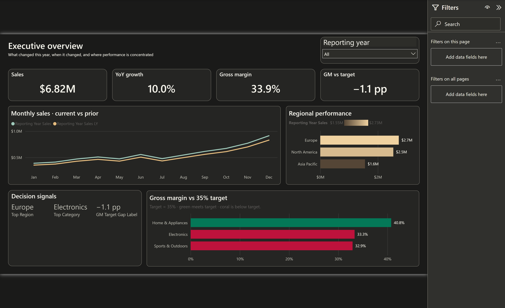](docs/THEME_GALLERY.md) | [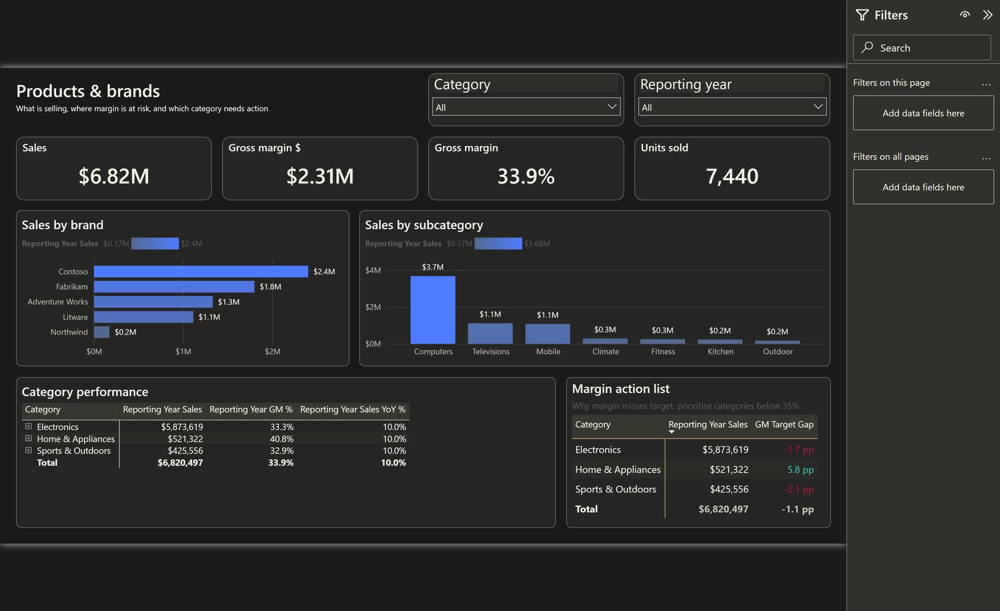](docs/THEME_GALLERY.md) | [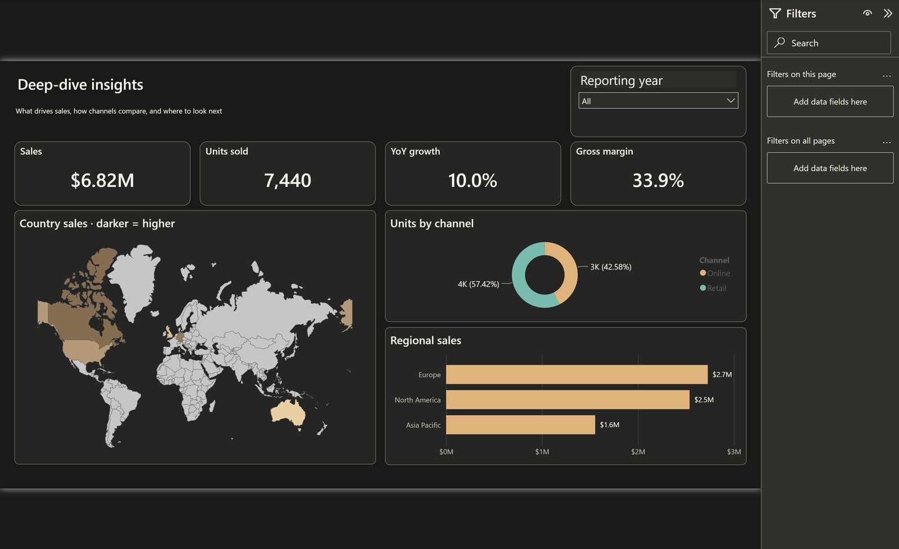](docs/THEME_GALLERY.md) |

**Slate Lavender**

| Executive overview | Products & brands | Deep-dive insights |
| :--- | :--- | :--- |
| [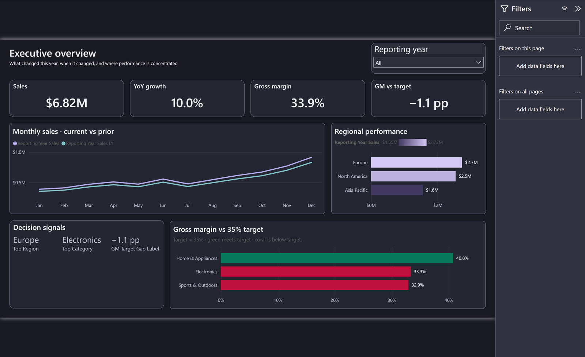](docs/THEME_GALLERY.md) | [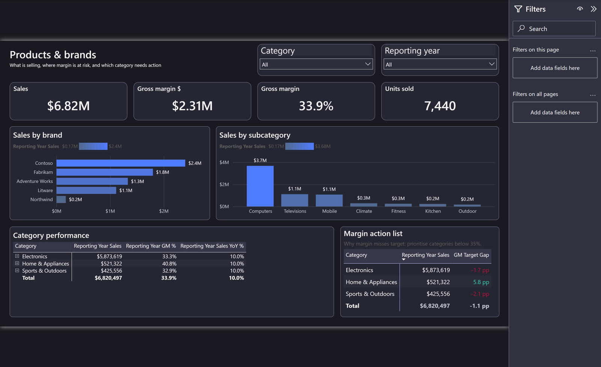](docs/THEME_GALLERY.md) | [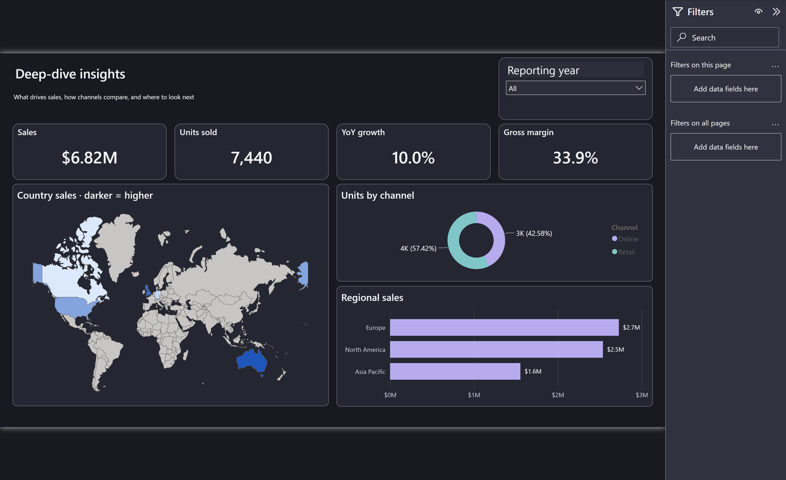](docs/THEME_GALLERY.md) |

The VQS palette also controls categorical chart series, numeric
bar/column/shape-map gradient stops and compatible slicer/filter-pane
surfaces. Data-bound business thresholds and positive/negative semantics
remain protected. All 25 public previews have now been re-captured from the validated
chart-color implementation; bars, map gradients and explicit line series
follow the chosen colorway while business conditional rules remain intact.

[See all **25 five-theme native previews**](docs/THEME_GALLERY.md) ·
[Theme CLI, safe adaptation and audit](docs/THEME_ENGINE.md)

**Power BI is the primary product.** Word/DOCX assurance is a separate optional component. Source diagnosis is local by default; remote image review needs explicit consent. Never commit private screenshots, `.pbi` caches, ABF files or business report data.

<sub>Apache-2.0 · Version `0.0.1a0` · Engineering preview · [Security and contribution rules](CONTRIBUTING.md) · [Changelog](CHANGELOG.md)</sub>
