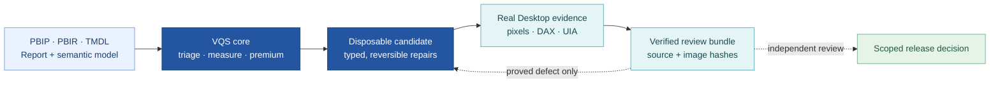

<div align="center">
  
  <h2>Make every Power BI report worth trusting.</h2>
  <p><strong>Understand the source. Refine the design. Verify the actual experience.</strong></p>
  <p>Deterministic PBIP diagnostics, grounded premium-design feedback, safe candidate repairs, and evidence from real Power BI Desktop.</p>
  <p>
    <a href="#get-started">Get started</a> ·
    <a href="#inside-the-reports">See real screenshots</a> ·
    <a href="#how-vqs-works">How it works</a> ·
    <a href="docs/RELEASE_NOTES_2026-10-21.md">Release notes</a>
  </p>
  <p>
    <a href="https://github.com/analienx/visual-quality-system/actions/workflows/ci.yml"></a>
    
    
    <a href="docs/RELEASE_NOTES_2026-10-21.md"></a>
  </p>
</div>

<a href="docs/media/showcase/executive-overview.webp">
  
</a>
<p align="center"><sub><strong>REAL POWER BI DESKTOP RENDER</strong> · Contoso Retail sample · Report-only crop, independently measured and hash-verified · <a href="docs/media/showcase/ASSET_PROVENANCE.md">Image provenance</a></sub></p>

> [!NOTE]
> **These are reports VQS inspected, not screenshots of a VQS GUI.** All five previews below show fictional Contoso sample data and are downscaled for public viewing. Original high-resolution runtime evidence, data models and customer files are not uploaded. This is an **engineering preview**, not signed production acceptance.

## Inside the reports

<table>
  <tr>
    <td width="50%" valign="top">
      <a href="docs/media/showcase/deep-dive-map.webp"></a>
      <p><strong>01 · Geography &amp; insight</strong><br><sub>Actual country shapes, regional ranking and channel breakdown—not a blank map placeholder.</sub></p>
    </td>
    <td width="50%" valign="top">
      <a href="docs/media/showcase/products-brands.webp"></a>
      <p><strong>02 · Product performance</strong><br><sub>Ranked categories, margin context and readable analytical tables.</sub></p>
    </td>
  </tr>
  <tr>
    <td width="50%" valign="top">
      <a href="docs/media/showcase/stores-customers.webp"></a>
      <p><strong>03 · Customer analytics</strong><br><sub>Native slicers, KPI hierarchy, peer visuals and source-backed matrices.</sub></p>
    </td>
    <td width="50%" valign="top">
      <a href="docs/media/showcase/markets-drivers.webp"></a>
      <p><strong>04 · Business drivers</strong><br><sub>Region waterfall, channel mix and contribution analysis across one consistent layout.</sub></p>
    </td>
  </tr>
</table>

<sub>**Showcase source:** fictitious Contoso Retail PBIP, captured in an actual Windows Power BI Desktop session on 21 October 2026. All five report-only canvases were independently remeasured from full-window captures. The public WebP previews are resized illustrations; the verified private PNGs and model cache remain outside Git. [Public image digests and provenance](docs/media/showcase/ASSET_PROVENANCE.md).</sub>

## Why VQS exists

Power BI source files can be valid while the delivered report still has a clipped matrix, empty map, poor visual hierarchy, inconsistent measures, or broken filter interactions. VQS is designed to **separate what the source says from what the user actually sees**.

| | VQS gives you | Evidence boundary |
| --- | --- | --- |
| **Inspect** | Page-/visual-level PBIR checks, TMDL and DAX/M cycle diagnostics, prioritized findings | Deterministic source evidence; no UI needed |
| **Improve** | Owner-authored `premium` design contract, top-three grounded recommendations, bounded typed repairs | Your original report remains untouched |
| **Observe** | Populated Power BI Desktop captures, Modeling MCP live DAX probes, supported Windows UI Automation interaction witnesses | Needs a real authorized Windows/Power BI session |
| **Verify** | Source hashes, per-page image digests, measured report-only crops when possible, sealed review bundles | No self-awarded aesthetic or production approval |

### A Power BI-first architecture



GitHub Actions runs reproducible source checks; an authenticated Windows Power BI Desktop session is required for real rendered and interactive evidence. [Full architecture and boundaries](docs/ARCHITECTURE.md).

## Get started

**Static quality analysis works on Windows, macOS and Linux.** No Microsoft account, Power BI Desktop installation or upload is needed for the included fixture.

```bash
git clone https://github.com/analienx/visual-quality-system.git
cd visual-quality-system
python -m pip install -e ".[test]"

vqs triage tests/powerbi/fixtures/mini_report --out quality.md
```

Open `quality.md` for prioritized, source-located observations. The command **does not edit the PBIP**.

### Bring your own Power BI report

```bash
# Fast, grounded assessment of a local enhanced-format PBIP
vqs triage path/to/YourReport.pbip --out quality.md

# Define design intent once, then review the most useful deviations
vqs premium path/to/YourReport.pbip --init-contract intent.json
# Edit the generated intent.json for your audience, question and focal visual
vqs premium path/to/YourReport.pbip --contract intent.json --out premium.md

# Discover available optional Microsoft/Windows integrations
vqs doctor
```

VQS `premium` looks for measurable spacing, explicit typography and visual hierarchy problems. It is a **source-aware preflight**, not an automatic beauty rating or AI-led restyling of your report. [Premium quality guide](docs/PREMIUM_POWERBI.md).

### Verify in Power BI Desktop

```bash
# Private, live Windows instance; replace placeholders with real paths and PID
vqs capture MyReport.Report private-renders --pid <DESKTOP_PID> --live-data
vqs bundle pack MyReport.Report private-renders private-review-bundle --fixer-id reviewer-candidate
vqs bundle verify private-review-bundle --report MyReport.Report
```

Real captures are bound to the model process and report revision. Image-only claims don't substitute for real DAX answers. Unsupported operations and unproven pixel geometry remain explicitly **blocked**, not silently passed.

## Demonstrated on two unrelated PBIPs

| Evidence | Contoso Retail | Microsoft Corporate Spend |
| --- | --- | --- |
| Native captured pages | **5 / 5** | **3 / 3** including Tooltip |
| Real model readiness | Repeated populated DAX probes | Repeated populated DAX probes |
| Interaction witness | **9 native** Year/Region events | **Europe → Latin America → Europe**, DAX-matched |
| Public-safe report-only preview | **5 verified canvases** above | Not published; clean crop unproven |
| Known limits | Some map-country automation unsupported | Azure Maps prompts for sign-in |

A report can pass static diagnostics without looking premium. Independent G2 aesthetic acceptance, broader G4 country-map coverage and separate G6 release authority are **not** signed off. [Exact engineering evidence and open blockers](docs/RELEASE_NOTES_2026-10-21.md) · [Acceptance issue #16](https://github.com/analienx/visual-quality-system/issues/16).

## Who this is for

**Report authors** get a clear source-aware punch list before spending another design iteration. **BI platform and governance teams** can compare source, data, rendered pages and supported interactions without conflating their evidence. **Reviewers** receive sealable, verifiable artifacts rather than screenshots detached from the report revision.

Read the [user guide](docs/USER_GUIDE.md), [CLI reference](docs/CLI.md), [acceptance matrix](docs/ACCEPTANCE_MATRIX.md) and [contribution guide](CONTRIBUTING.md).

---

**Power BI is the primary product.** Word/DOCX assurance is a separate optional component. Source diagnosis is local by default; remote image review needs explicit consent. Never commit private screenshots, `.pbi` caches, ABF files or business report data.

<sub>Apache-2.0 · Version `0.0.1a0` · Engineering preview · [Security and contribution rules](CONTRIBUTING.md) · [Changelog](CHANGELOG.md)</sub>
