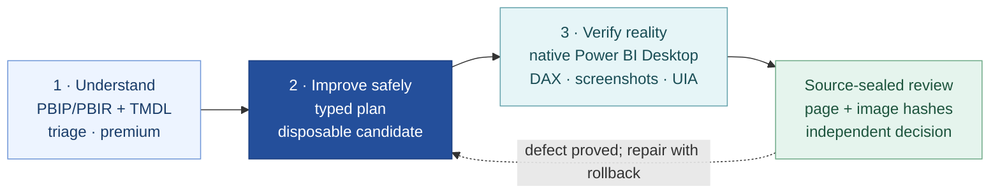

# Visual Quality System

**Build Power BI reports people can actually trust.**

Diagnose source defects. Improve visual consistency. Verify what Power BI Desktop **really renders and does**. Keep the original project safe.

[](https://github.com/analienx/visual-quality-system/actions/workflows/ci.yml)
[](pyproject.toml)
[](LICENSE)
[](docs/RELEASE_NOTES_2026-10-21.md)

**Power BI-first · Source-grounded · Privacy-conscious · Reviewable by design**

---

> [!IMPORTANT]
> **Engineering preview, not a production-certified quality gate.** The working code is merged and CI-tested; **two unrelated reports have real native evidence**, but independent design review, some geographic interactions, pixel-coordinate calibration, and authorized release approval remain open. [Read the current evidence and decision](docs/RELEASE_NOTES_2026-10-21.md).

## See value in one minute

No Power BI license, Microsoft sign-in, Windows Desktop, or business data is required for the included **static** demo. Python 3.11+ and Git are enough.

```bash
git clone https://github.com/analienx/visual-quality-system.git
cd visual-quality-system
python -m pip install -e ".[test]"

vqs triage tests/powerbi/fixtures/mini_report --out quality.md
```

Open `quality.md`: findings are prioritized by page and visual, with explanations of what can be proven from source and what still needs a real render. **No project edits.**

### Use your own PBIP

```bash
# Source-level defects and safe-plan opportunities
vqs triage path/to/YourReport.pbip --out quality.md

# Premium design: start from *your* audience, question and intended focal point
vqs premium path/to/YourReport.pbip --init-contract intent.json
# Edit intent.json, then:
vqs premium path/to/YourReport.pbip --contract intent.json --out premium.md

# See which optional Desktop/Modeling features this machine actually supports
vqs doctor
```

`premium.md` gives **at most three** grounded recommendations: peer-card spacing, explicit title scale, and owner-declared density/focal hierarchy. No fake “beautiful dashboard” score, no cloud dependency, and no style changes to your original report.

## One system, three useful stages



| Need | Working capability | What it **doesn't** claim |
| --- | --- | --- |
| **Find problems** | `triage`, `measure`, `cycles`: real page/visual identities, source bindings, formatting and layout diagnostics | Static checks cannot see actual clipping or a login-blocked map |
| **Make layouts feel intentional** | `premium`: source-hashed design intent, consistent peer spacing and roles, prioritized improvements | A clean preflight is **not** independent aesthetic acceptance |
| **Change safely** | `propose` → `repair` → `verify` on a disposable candidate, with an allowlisted diff | Never authorizes arbitrary report, DAX, filter or RLS changes |
| **Prove displayed behavior** | `capture --live-data`, Modeling MCP and Windows UIA for supported Desktop controls | A GitHub runner cannot replace an interactive, populated Desktop |
| **Hand evidence to another reviewer** | `bundle pack` / `verify`, `review-images` (explicit upload consent), `assurance` | An AI's opinion cannot issue its own G6 approval |

## Reality check: two real reports

The **21 October engineering run** covered a five-page Contoso Retail PBIP and a separate three-page Microsoft Corporate Spend PBIP, including a differently sized Tooltip. Both had live-model evidence, complete native-window captures, and bundles that verified against source and image hashes.

- **Contoso:** nine actual Year/Region UI Automation events agreed with a freshly executed DAX oracle. The Shape Map rendered country geography.
- **Corporate Spend:** selecting **Europe → Latin America → Europe** changed visible figures as predicted by DAX, and the restored screenshot matched the original **pixel for pixel**.
- **Real limitations:** Corporate Spend's Azure Maps visual requires sign-in. **Contoso's five report-only canvases are measured and verified** ([PR #71](https://github.com/analienx/visual-quality-system/pull/71)), while Corporate Spend's report-only crop and the Bridge's universal pixel-to-PBIR coordinate transform remain unproven. Not every map action is accessible. Independent visual and owner release approval are pending.

These are **specific verified engineering observations**, not a claim that every Power BI report works or that G2/G4/G6 is green. [Evidence summary and reproducible acceptance checklist](docs/RELEASE_NOTES_2026-10-21.md).

## Choose your path

<details>
<summary><strong>I'm a Power BI report author</strong></summary>

Start with `vqs triage`, then create an owner-edited `vqs premium` contract. Apply only verified typed edits to a disposable copy; compare the same measures/filters after a real Desktop render. See the [user guide](docs/USER_GUIDE.md), [premium guide](docs/PREMIUM_POWERBI.md), and [complete CLI reference](docs/CLI.md).

</details>

<details>
<summary><strong>I own a Windows validation machine</strong></summary>

Use the actual Power BI Desktop process, the Power BI Desktop Bridge and Microsoft's Modeling MCP. `vqs capture <Report> <private-renders> --pid <exact-pid> --live-data` collects page images and attempts model readiness; `vqs bundle pack` seals them for verification. A report with mixed-size pages is supported, but unproven pixel-to-PBIR calibration stays `blocked`. See [Windows/native workflow](docs/QUICKSTART.md) and [architecture](docs/ARCHITECTURE.md).

</details>

<details>
<summary><strong>I'm an independent reviewer or contributor</strong></summary>

Review the [G0–G6 evidence requirements](docs/ACCEPTANCE_MATRIX.md) and [release-candidate dossier](docs/RELEASE_NOTES_2026-10-21.md). Verify hashes and scope, inspect the actual full-page images privately, distinguish fail from missing evidence, and never approve your own repair. Contributors: read [CONTRIBUTING.md](CONTRIBUTING.md) and [AGENTS.md](AGENTS.md).

</details>

## Built to be honest about evidence

- **Local by default.** Source analysis never needs to upload the customer's PBIP or semantic model. Private screenshots and `.pbi/cache.abf` files must stay outside Git.
- **Three different claims.** `pass` means a narrowly defined check has proof; `fail` means a demonstrated issue; `blocked` means proof or capability is missing. Missing evidence never becomes a pass.
- **Correct division of labor.** GitHub Actions owns reproducible static tests. Power BI Desktop Bridge identifies/report-renders a real instance; Modeling MCP verifies actual DAX data; Windows UI Automation observes supported interactions. A reviewer then makes a separate decision.
- **Power BI is primary.** Word/DOCX is an optional, separately gated component, not a dependency for Power BI quality. Fabric/web adapters are deferred. See [component architecture](docs/ARCHITECTURE.md).

## Project references

[**Quickstart**](docs/QUICKSTART.md) · [**User guide**](docs/USER_GUIDE.md) · [**Premium design**](docs/PREMIUM_POWERBI.md) · [**Architecture**](docs/ARCHITECTURE.md) · [**CLI**](docs/CLI.md) · [**Acceptance matrix**](docs/ACCEPTANCE_MATRIX.md) · [**Engineering release notes**](docs/RELEASE_NOTES_2026-10-21.md) · [**Changelog**](CHANGELOG.md) · [**Issues**](https://github.com/analienx/visual-quality-system/issues)

**License:** [Apache 2.0](LICENSE) · Version `0.0.1a0` · No production release tag.
