<div align="center">
  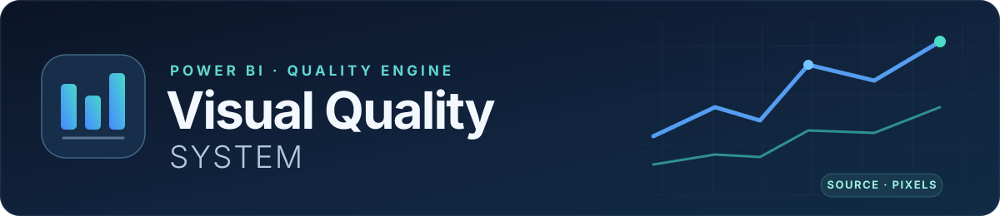
  <h2>Fix the report. Verify the fix.</h2>
  <p><strong>Give your AI agent a Power BI project. Get an independently checkable repair candidate—not another issues-only report.</strong></p>
  <p>Deterministic PBIR &amp; TMDL analysis · Reversible auto-fixes · Real Power BI Desktop evidence</p>
  <p>
    <a href="roadmap/README.md"><strong>Roadmap</strong></a> ·
    <a href="docs/AI_AGENT_QUICKSTART.md"><strong>Start with an AI agent</strong></a> ·
    <a href="docs/AGENT_AUTOFIX_ARCHITECTURE.md">How it works</a> ·
    <a href="#real-power-bi-showcase">Real report gallery</a> ·
    <a href="docs/CLI.md">CLI</a> ·
    <a href="docs/RELEASE_NOTES_v0.1.2.md">Latest release</a> ·
    <a href="docs/RELEASES.md">Release history</a> ·
    <a href="docs/README.md">All docs</a>
  </p>
  <p>
    <a href="https://github.com/analienx/visual-quality-system/actions/workflows/ci.yml"></a>
    
    
    
  </p>
</div>

## Latest release · v0.1.2

**Verifiable decisions and regression gates** · Published **7 November 2026** · Python 3.11+ · Local CLI/MCP

[**Download v0.1.2 and verify checksums**](https://github.com/analienx/visual-quality-system/releases/tag/v0.1.2) · [What's new and supported](docs/RELEASE_NOTES_v0.1.2.md) · [All published releases](docs/RELEASES.md)

VQS turns source-provable Power BI defects into **reversible repair candidates**. This release adds owner-answerable design questions, readable changes with explicit adoption, and a pull-request quality gate with SARIF. The original report is not silently changed.

### Get started

Download the wheel from the release above, verify its checksum, then run:

```bash
python -m pip install ./visual_quality_system-0.1.2-py3-none-any.whl
npm install --global @microsoft/powerbi-report-authoring-cli@0.5.0
vqs doctor
vqs fix "path/to/Sales.pbip"
```

If a fix needs your decision, VQS returns answerable options; edit the generated answers before rerunning:

```bash
vqs decisions template --run-id <fix-run-id> --out answers.json
# Choose the offered options in answers.json; never invent an answer.
vqs fix "path/to/Sales.pbip" --decisions answers.json
```

An agent can use the same engine through the `vqs-mcp` entrypoint. In CI, `vqs gate HEAD.pbip --baseline BASE.pbip --sarif vqs.sarif` flags *new* source findings, not every pre-existing issue.

[**5-minute agent quickstart**](docs/AI_AGENT_QUICKSTART.md) · [CLI reference](docs/CLI.md) · [Decisions and PR gate](docs/OWNER_DECISIONS_AND_PR_GATE.md)

**Supported boundary:** v0.1.2 is a **source-level** review and safe candidate-repair release. It does not certify arbitrary native Desktop rendering, interactions, live DAX parity, G2/G4/G6 signoff, or Word/DOCX. A blocked result is not a successful repair. [Read the exact limits and test evidence](docs/RELEASE_NOTES_v0.1.2.md#verified-release-scope).

## How VQS works

**Microsoft tooling** helps author and validate Power BI reports. **VQS** measures defects, applies allowed changes to a separate candidate, records evidence and exposes what still needs an owner's decision. These tools complement each other.

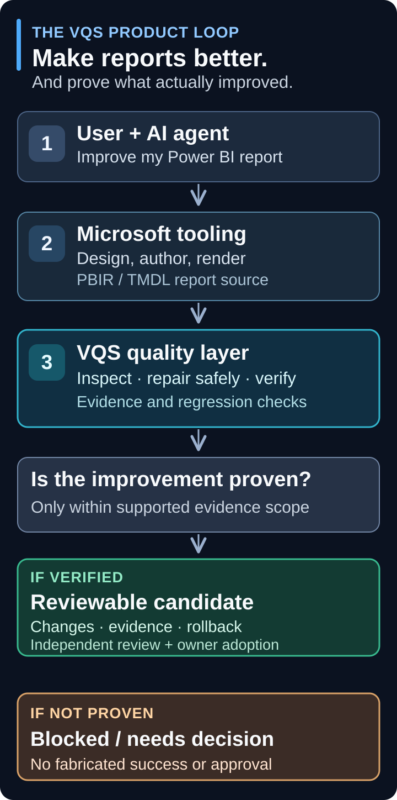

[**Full product roadmap**](roadmap/README.md) · [How the agent/repair architecture works](docs/AGENT_AUTOFIX_ARCHITECTURE.md)

```text
Inspect PBIR/TMDL → Propose bounded changes → Repair a copy → Verify → Review/adopt
```

A static source check proves only supported static properties; Desktop and modeling evidence require an available and authorized runtime. VQS does not promote a candidate or grant report-level approval by itself.

## Verified reference report · all five pages

**A real, native Power BI Desktop report you can run and inspect.** This fictional Contoso source was saved and exercised in Desktop with live four-KPI DAX, eight Year/Region interactions and a separate automated five-image visual review (zero observed P1/P2 defects). Its five screenshots, exact source revision and metadata-normalized PBIP are [published together with individual SHA-256 provenance](docs/VERIFIED_CONTOSO_SHOWCASE.md).

| Executive overview | Markets & drivers | Deep-dive insights |
| :--- | :--- | :--- |
| [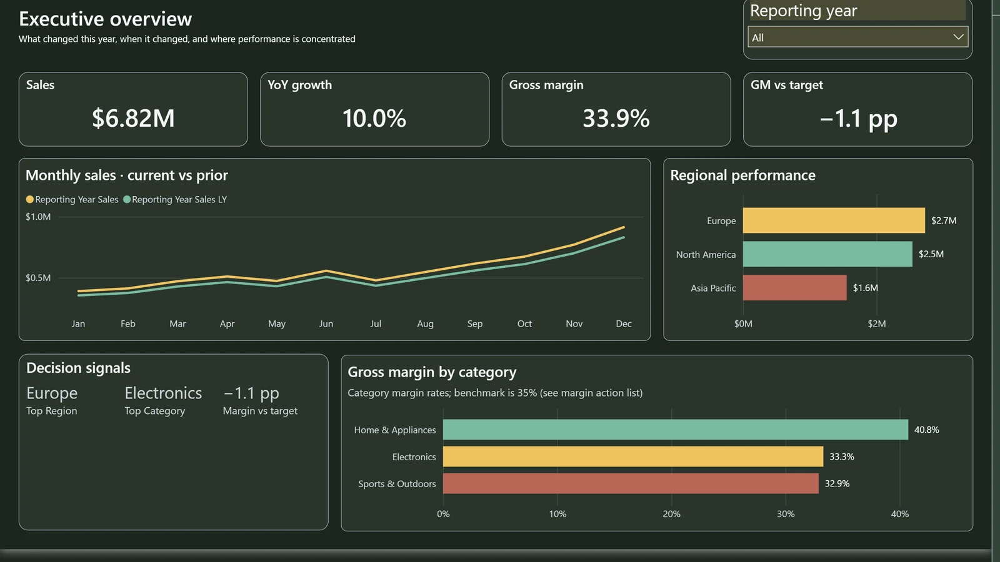](docs/VERIFIED_CONTOSO_SHOWCASE.md#executive-overview) | [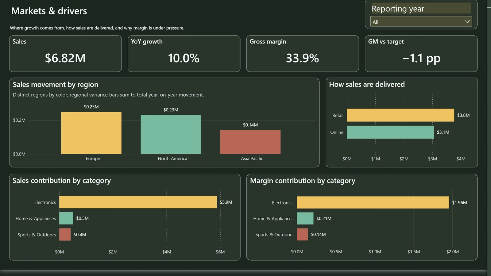](docs/VERIFIED_CONTOSO_SHOWCASE.md#markets--drivers) | [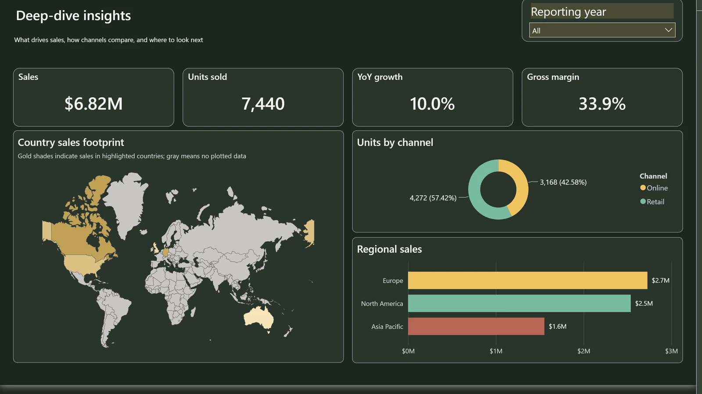](docs/VERIFIED_CONTOSO_SHOWCASE.md#deep-dive-insights) |

[**Open PBIP and reproduce the report**](examples/contoso-retail-verified/README.md) · [See all five native pages](docs/VERIFIED_CONTOSO_SHOWCASE.md) · [Read the validation boundaries](docs/POWER_BI_CORE_ACCEPTANCE_2026-10-28.md)

The original remains intact. Image review is automated, **not** formal independent human G2/G4 or owner G6 release approval. The two unsupported interaction cases—country-specific Shape Map click and hidden Tooltip hover—are not claimed to pass.

## Real Power BI showcase

**Seven curated families on the homepage. All 14 Light/Dark families in the full gallery.**
These are authentic, populated Power BI Desktop screenshots from the **historical 14-family theme-lab source**; none is a simulated dashboard. Each preview is bound to its own authored candidate/source and image hashes. The [current finished-reference pilot](docs/VERIFIED_CONTOSO_SHOWCASE.md) is a separate source revision and has its own complete five-page native capture.

[**Open the current, native-verified Contoso PBIP**](examples/contoso-retail-verified/Contoso%20Retail.pbip) · [See all five final pages](docs/VERIFIED_CONTOSO_SHOWCASE.md) · [Historical 14-theme source](examples/contoso-retail/Contoso%20Retail.pbip) · [Reproduction guide](examples/contoso-retail/README.md)

Every theme-gallery variant comes from its own source-bound historical candidate, **not** an invented mockup or the newer finished-reference PBIP. The [final source-bound five-page Contoso reference](docs/VERIFIED_CONTOSO_SHOWCASE.md) is deliberately kept separate, with its own screenshot hashes and tested model.

**[Explore the complete 14-family native gallery](docs/REAL_THEME_SHOWCASE.md)** ·
[Compare all color and control tokens](docs/APPROVED_THEME_LIBRARY.md) ·
[View the provenance](docs/images/adaptive-showcase/PROVENANCE.json)

**Jump to a featured theme:** [Sunny Palette](#sunny-palette) · [Organic Palette](#organic-palette) · [Graphite Red](#graphite-red) · [Indigo Ember](#indigo-ember) · [Petrol & Gold](#petrol-gold) · [Riviera Pop](#riviera-pop) · [Okabe–Ito Night](#okabe-ito-night)

<a id="sunny-palette"></a>
### Sunny Palette

Amber-orange and charcoal, with soft peach control surfaces.

| Light · actual report | Dark · actual report |
| :--- | :--- |
| [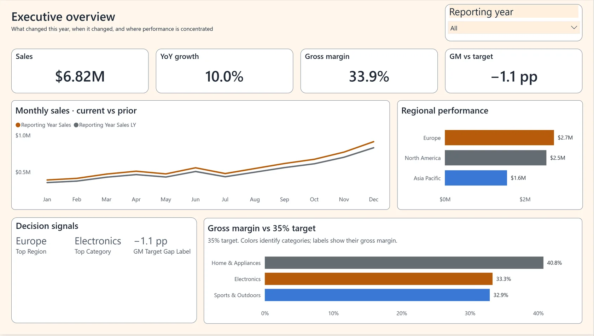](docs/REAL_THEME_SHOWCASE.md#sunny-palette) | [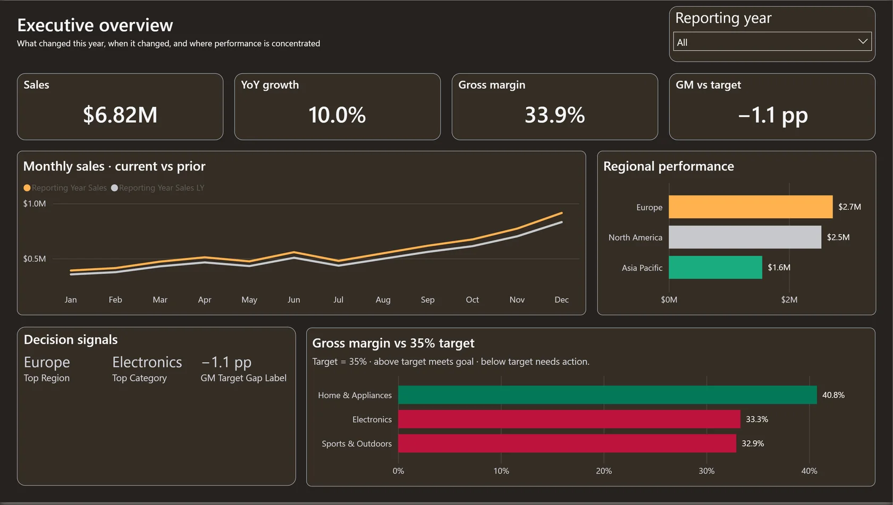](docs/REAL_THEME_SHOWCASE.md#sunny-palette) |

<a id="organic-palette"></a>
### Organic Palette

Cobalt, vivid magenta, green and cyan with differentiated controls.

| Light · actual report | Dark · actual report |
| :--- | :--- |
| [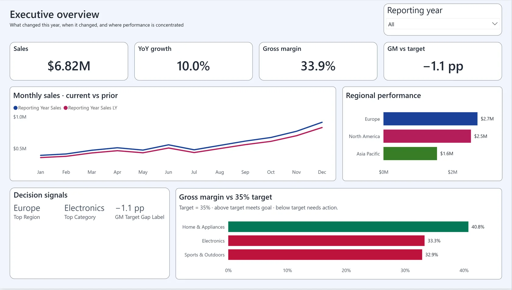](docs/REAL_THEME_SHOWCASE.md#organic-palette) | [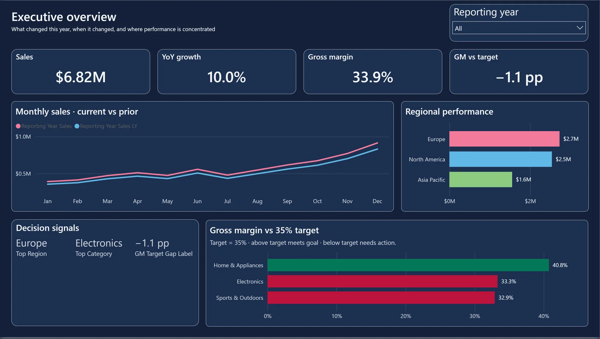](docs/REAL_THEME_SHOWCASE.md#organic-palette) |

<a id="graphite-red"></a>
### Graphite Red

Graphite, ruby and carefully contrasted supporting hues — no green.

| Light · actual report | Dark · actual report |
| :--- | :--- |
| [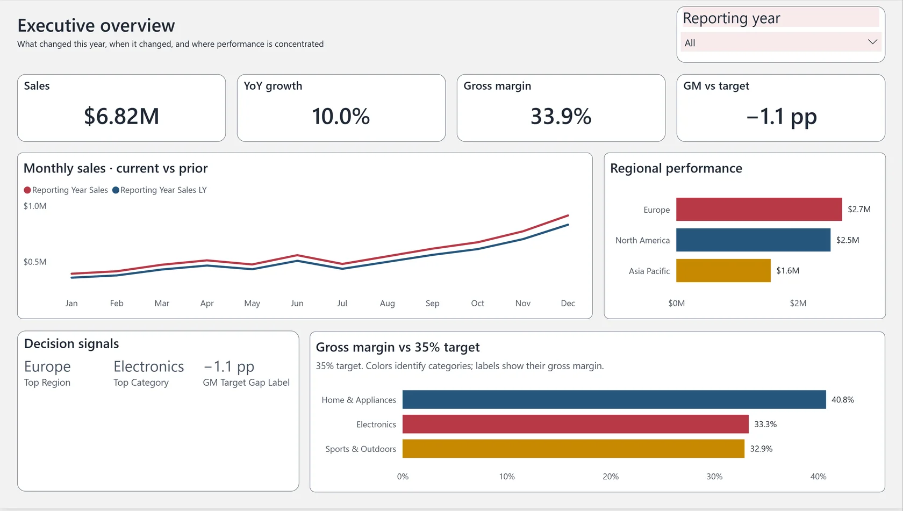](docs/REAL_THEME_SHOWCASE.md#graphite-red) | [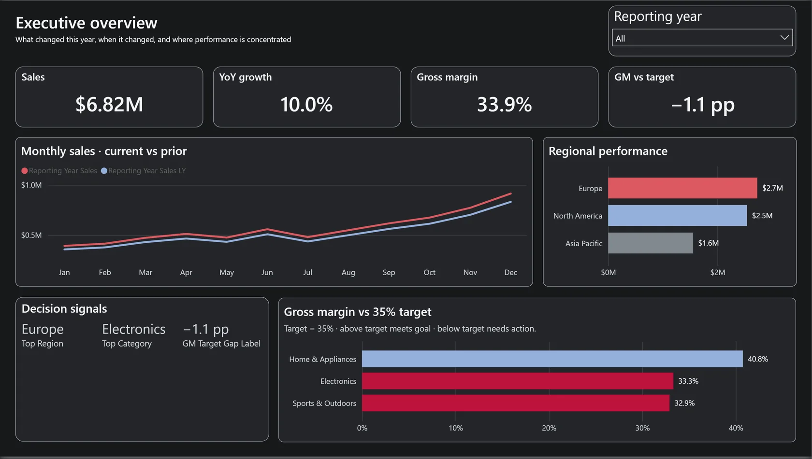](docs/REAL_THEME_SHOWCASE.md#graphite-red) |

<a id="indigo-ember"></a>
### Indigo Ember

Indigo-violet balanced with warm editorial accents.

| Light · actual report | Dark · actual report |
| :--- | :--- |
| [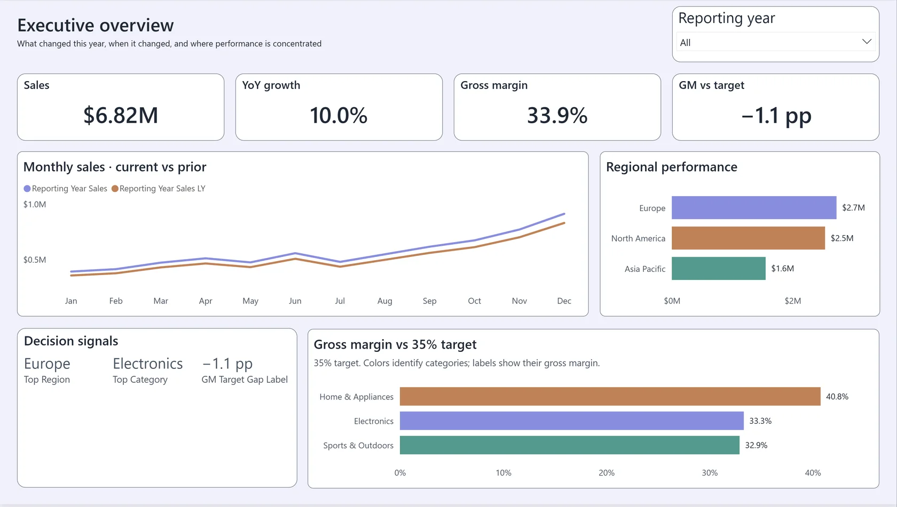](docs/REAL_THEME_SHOWCASE.md#indigo-ember) | [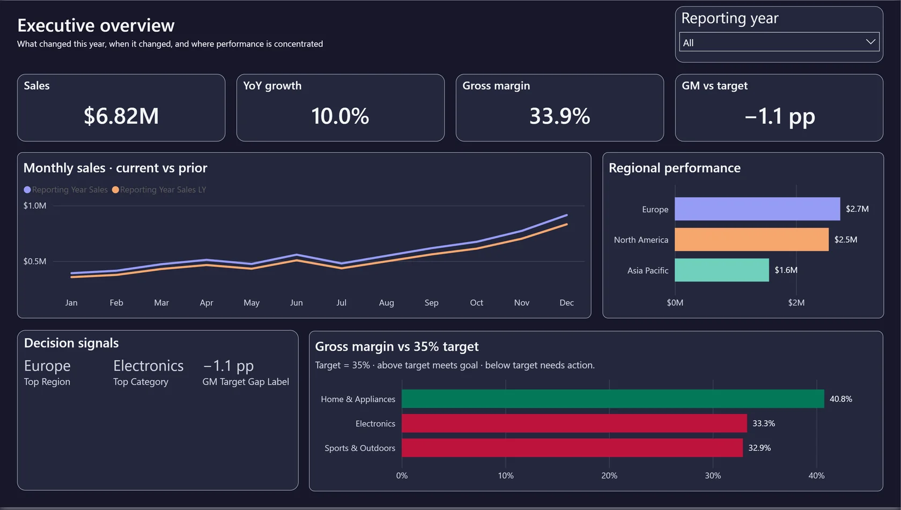](docs/REAL_THEME_SHOWCASE.md#indigo-ember) |

<a id="petrol-gold"></a>
### Petrol & Gold

Petrol and warm gold for a confident executive dashboard.

| Light · actual report | Dark · actual report |
| :--- | :--- |
| [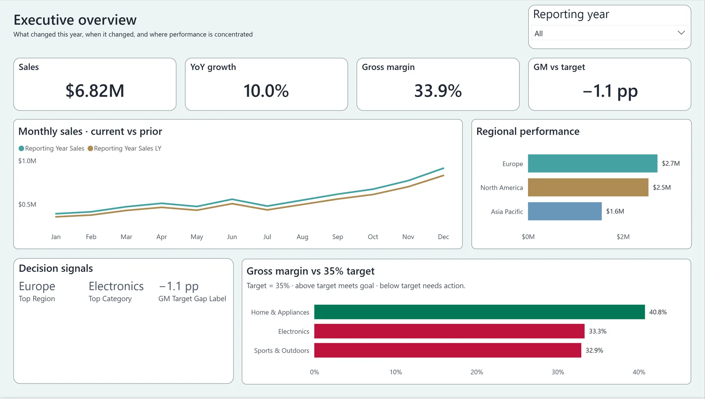](docs/REAL_THEME_SHOWCASE.md#petrol-gold) | [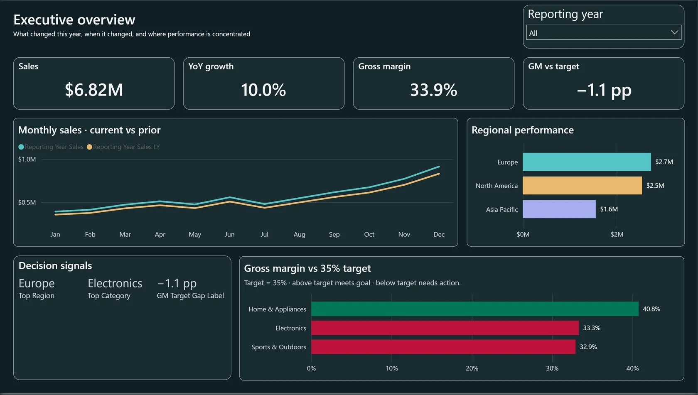](docs/REAL_THEME_SHOWCASE.md#petrol-gold) |

<a id="riviera-pop"></a>
### Riviera Pop

Expressive seaside color, controlled by a disciplined layout.

| Light · actual report | Dark · actual report |
| :--- | :--- |
| [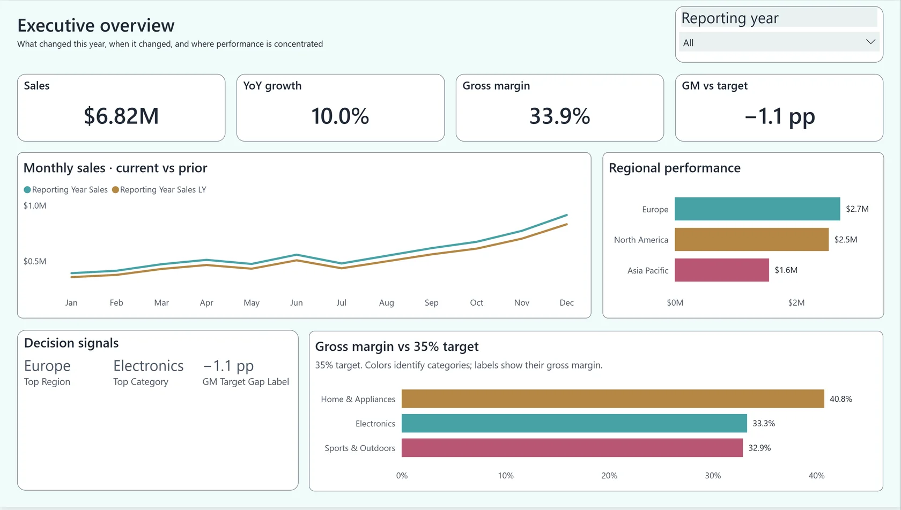](docs/REAL_THEME_SHOWCASE.md#riviera-pop) | [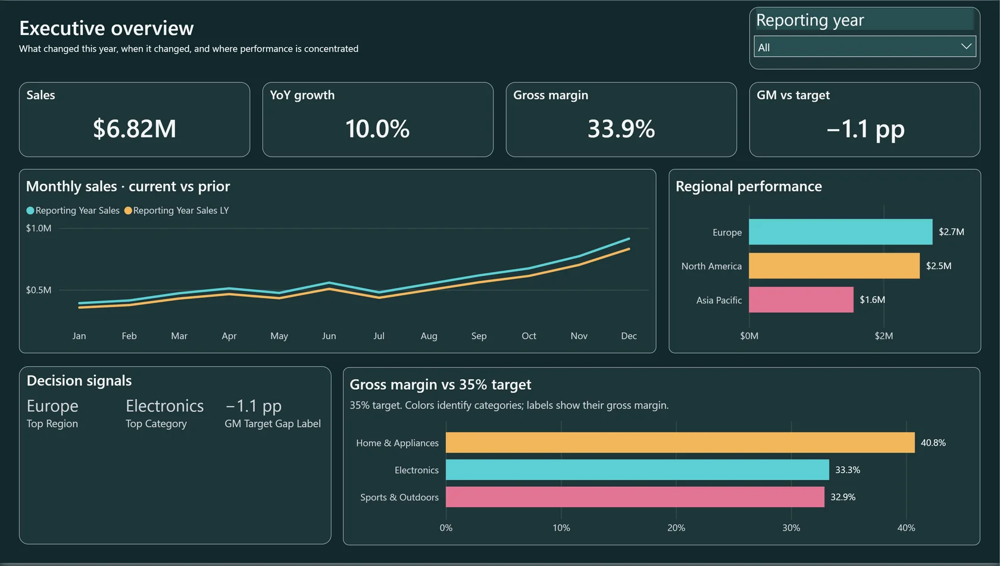](docs/REAL_THEME_SHOWCASE.md#riviera-pop) |

<a id="okabe-ito-night"></a>
### Okabe–Ito Night

Clear categorical hues and understated interface chrome.

| Light · actual report | Dark · actual report |
| :--- | :--- |
| [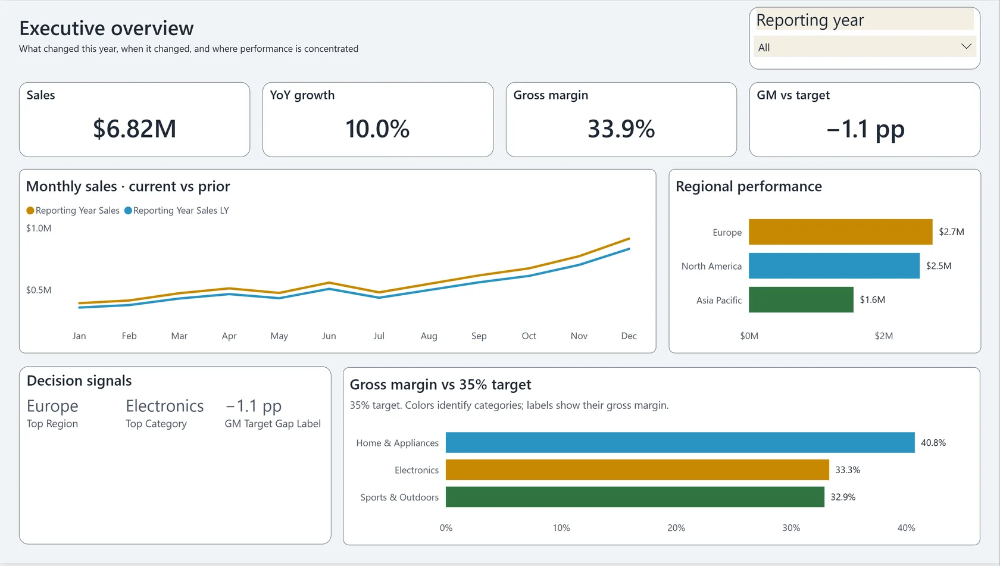](docs/REAL_THEME_SHOWCASE.md#okabe-ito-night) | [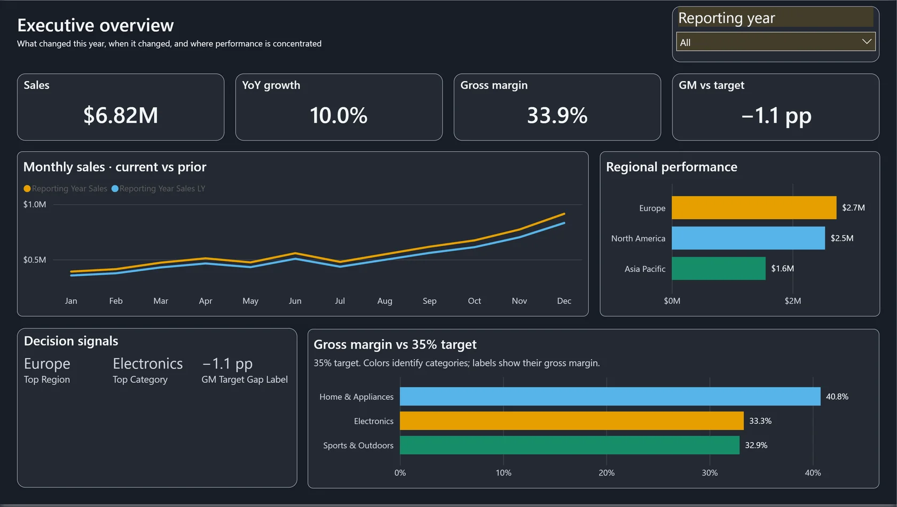](docs/REAL_THEME_SHOWCASE.md#okabe-ito-night) |

**[See all 14 palettes and 56 authentic report previews](docs/REAL_THEME_SHOWCASE.md)**

The gallery also shows Products & Brands, making all seven subcategory
colors easy to compare. Each control palette includes themed dropdown,
filter and selection surfaces. Interactive flyouts remain separately
reviewable; static screenshots are not interaction certification.

## Other ways to use VQS

If you prefer the CLI without an agent, install and inspect a source report locally:

```bash
git clone https://github.com/analienx/visual-quality-system.git
cd visual-quality-system
python -m pip install -e ".[test]"
vqs doctor
vqs triage tests/powerbi/fixtures/mini_report --out quality.md
```

`triage` is a **read-only source check**, not the autonomous repair command. To fix supported issues in a disposable candidate, use the `vqs run --mode repair` example above.

**Light and Dark themes** can be generated and audited separately using the theme CLI:

```bash
vqs theme presets
vqs theme preview "examples/contoso-retail/Contoso Retail.pbip" --mode dark --palette-preset sunny-palette --out theme-plan.json
vqs theme apply "examples/contoso-retail/Contoso Retail.pbip" --mode light --palette-preset organic-palette --candidate-root ./organic-candidate
vqs theme audit ./organic-candidate
```

`preview` is read-only; `apply` creates a separate PBIP candidate. Its source/model bindings and category colors must be checked before claiming native quality. [Theme guide](docs/THEME_ENGINE.md) · [Approved palettes](docs/APPROVED_THEME_LIBRARY.md) · [CLI commands](docs/CLI.md).

## Trustworthy checks, with honest limits

| Quality layer | What VQS verifies | What it cannot infer |
| :--- | :--- | :--- |
| **Source** | Layout, categorical color distinctness, supported formatting, bindings and checks with exact file evidence | Actual Desktop pixels or arbitrary dynamic state |
| **Candidate** | Declared typed edits, unchanged original, rollback path, source diff and supported authoring validation | That every unrelated issue has disappeared |
| **Native** | Authenticated, source-bound full-page renders and supported interaction/DAX checks when available | Unsupported visuals, inaccessible controls or unverified sign-in |
| **Release** | Sealed evidence suitable for independent human/agent review | A production approval without an authorized separate decision |

The 14 approved theme families include **28 Light/Dark modes** with real source-bound native previews. Their default-state capture and color checks do **not** certify every dropdown state, cross-report interaction, or production G2/G4/G6. [Latest engineering release notes](docs/RELEASE_NOTES_2026-10-26.md) · [Evidence and acceptance](docs/ACCEPTANCE_MATRIX.md) · [Open release gates](https://github.com/analienx/visual-quality-system/issues/16).

## Documentation

| For | Start here |
| :--- | :--- |
| **AI agents and report owners** | [5-minute auto-fix quickstart](docs/AI_AGENT_QUICKSTART.md) · [Complete component architecture](docs/AGENT_AUTOFIX_ARCHITECTURE.md) |
| **Power BI report authors** | [Getting started](docs/USER_GUIDE.md) · [Premium design guide](docs/PREMIUM_POWERBI.md) · [Theme palette library](docs/APPROVED_THEME_LIBRARY.md) |
| **BI platform engineers** | [Architecture](docs/ARCHITECTURE.md) · [CLI](docs/CLI.md) · [Power BI integration & native evidence](docs/VISUAL_QA_V2_P16_NATIVE_DESKTOP_UIA.md) |
| **Quality reviewers** | [Acceptance matrix](docs/ACCEPTANCE_MATRIX.md) · [Screenshot provenance](docs/images/adaptive-showcase/PROVENANCE.json) · [Native gallery](docs/REAL_THEME_SHOWCASE.md) |
| **Releases and history** | [Latest v0.1.2 release notes](docs/RELEASE_NOTES_v0.1.2.md) · [All published releases](docs/RELEASES.md) · [Development changelog](CHANGELOG.md) |
| **Contributors** | [Product roadmap](roadmap/README.md) · [Contributor guide](CONTRIBUTING.md) · [All documentation](docs/README.md) |

VQS focuses on **Power BI**. Word/DOCX assurance is a separate optional component, not a blocker for a Power BI-only release. Source inspection is local by default; private customer screenshots and caches must not be checked in or uploaded without explicit authorization.

<sub>Apache-2.0 · Engineering preview · Power BI first (Word/DOCX separately scoped) · [Security and contribution](CONTRIBUTING.md) · [Legacy theme gallery](docs/THEME_GALLERY.md)</sub>
