<div align="center">
  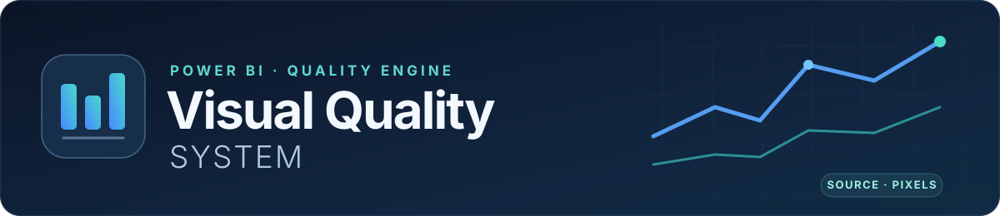
  <h2>Fix the report. Verify the fix.</h2>
  <p><strong>Give your AI agent a Power BI project. Get an independently checkable repair candidate—not another issues-only report.</strong></p>
  <p>Deterministic PBIR &amp; TMDL analysis · Reversible auto-fixes · Real Power BI Desktop evidence</p>
  <p>
    <a href="docs/AI_AGENT_QUICKSTART.md"><strong>Start with an AI agent</strong></a> ·
    <a href="docs/AGENT_AUTOFIX_ARCHITECTURE.md">How it works</a> ·
    <a href="#real-power-bi-showcase">Real report gallery</a> ·
    <a href="docs/CLI.md">CLI</a> ·
    <a href="docs/RELEASE_NOTES_2026-10-26.md">Release notes</a> ·
    <a href="docs/README.md">All docs</a>
  </p>
  <p>
    <a href="https://github.com/analienx/visual-quality-system/actions/workflows/ci.yml"></a>
    
    
    
  </p>
</div>

## AI-driven improvement, with evidence at every step

**Your goal:** *“Make this Power BI report clearer, more consistent and reliable. Fix what you can safely, validate the result, and show me the candidate.”*

**VQS already supports that workflow for its allowlisted repair operations.** The agent chooses the work; VQS makes source-grounded changes in an **isolated candidate**, checks them, and records what cannot yet be verified. The original report is never silently overwritten.

**01 / Understand** — Inspect actual PBIR/TMDL pages, fields, layouts and color assignments.

**02 / Repair** — Synthesize supported typed fixes and apply them **only to an isolated candidate**.

**03 / Verify** — Check the exact diff, remeasure quality, and gather native Power BI/DAX evidence where available.

**04 / Deliver** — Return **Fixed · Verified · Still blocked**, backed by private evidence and a separate candidate.

**Agent connected through MCP?** Use `vqs_run` with `mode=repair`. **Agent with terminal access?** Use the same engine:

```bash
vqs run "path/to/Sales.Report" --mode repair --scope static \
  --run-root "./private-vqs-runs" --run-id "sales-autofix-001"
```

`scope=static` proves only supported source checks. Native Power BI Desktop validation needs a separately authorized Windows runtime. A passing candidate edit **does not** mean all visual, filter or release checks passed.

**[Get started in 5 minutes · MCP setup and a one-prompt auto-fix workflow](docs/AI_AGENT_QUICKSTART.md)**

**[Understand the system · Component responsibilities, architecture and why they exist](docs/AGENT_AUTOFIX_ARCHITECTURE.md)**

### The system behind the agent

<a href="docs/AGENT_AUTOFIX_ARCHITECTURE.md">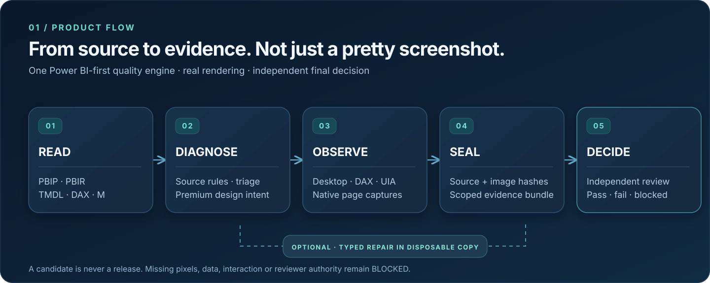</a>

**Agent** orchestrates → **VQS** measures, proposes and repairs → **Microsoft tooling** validates supported changes → **Desktop/Modeling MCP** supplies native evidence → **reviewer** makes the release decision. [Explore each component and its limits](docs/AGENT_AUTOFIX_ARCHITECTURE.md).

## Real Power BI showcase

**Seven curated families on the homepage. All 14 Light/Dark families in the full gallery.**
These are real, populated Power BI Desktop screenshots captured from one
fictional Contoso Retail report; none is a simulated dashboard.
Each screenshot is bound to the generating GitHub candidate and source hash.

[Open the exact fictional Contoso PBIP source](examples/contoso-retail/Contoso%20Retail.pbip) · [Run the five-page sample report](examples/contoso-retail/README.md)

Every gallery variant comes from that actual source, not a screenshot-only mockup.

**[Explore the complete 14-family native gallery](docs/REAL_THEME_SHOWCASE.md)** ·
[Compare all color and control tokens](docs/APPROVED_THEME_LIBRARY.md) ·
[View the provenance](docs/images/adaptive-showcase/PROVENANCE.json)

**Jump to a featured theme:** [Sunny Palette](#sunny-palette) · [Organic Palette](#organic-palette) · [Graphite Red](#graphite-red) · [Indigo Ember](#indigo-ember) · [Petrol & Gold](#petrol-gold) · [Riviera Pop](#riviera-pop) · [Okabe–Ito Night](#okabe-ito-night)

<a id="sunny-palette"></a>
### Sunny Palette

Amber-orange and charcoal, with soft peach control surfaces.

| Light · actual report | Dark · actual report |
| :--- | :--- |
| [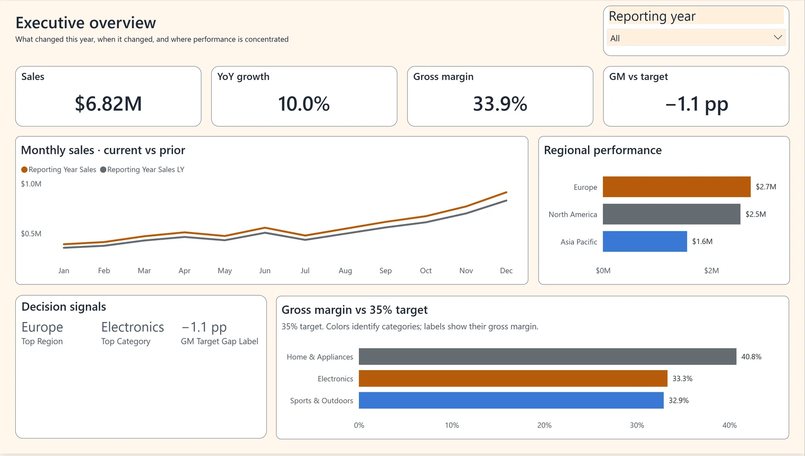](docs/REAL_THEME_SHOWCASE.md#sunny-palette) | [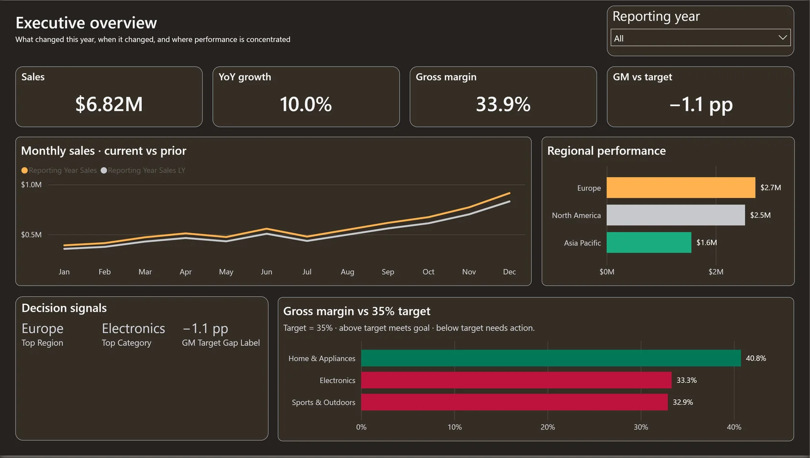](docs/REAL_THEME_SHOWCASE.md#sunny-palette) |

<a id="organic-palette"></a>
### Organic Palette

Cobalt, vivid magenta, green and cyan with differentiated controls.

| Light · actual report | Dark · actual report |
| :--- | :--- |
| [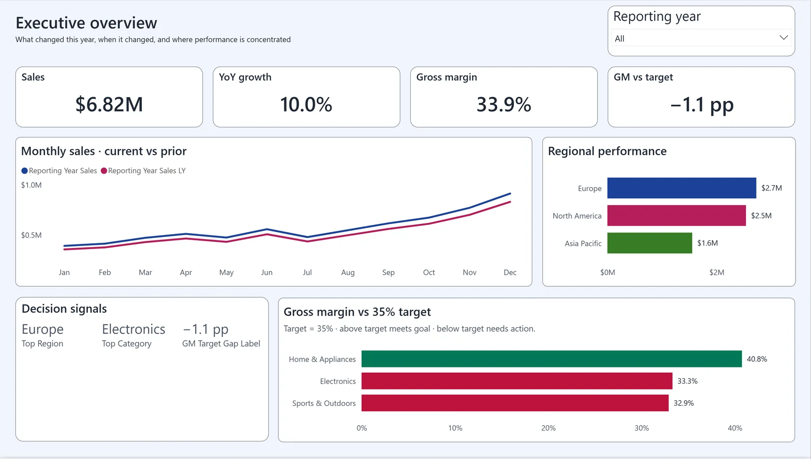](docs/REAL_THEME_SHOWCASE.md#organic-palette) | [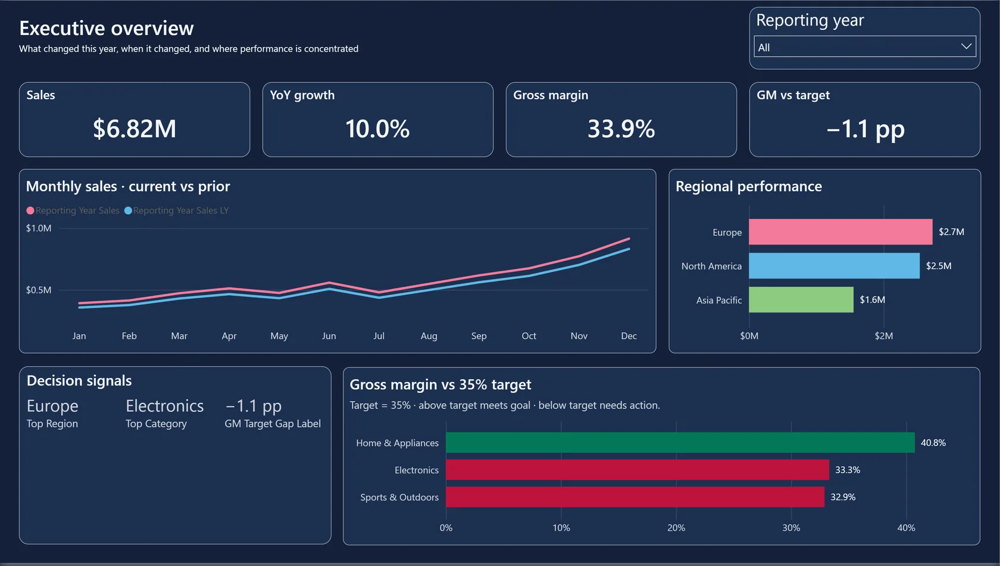](docs/REAL_THEME_SHOWCASE.md#organic-palette) |

<a id="graphite-red"></a>
### Graphite Red

Graphite, ruby and carefully contrasted supporting hues — no green.

| Light · actual report | Dark · actual report |
| :--- | :--- |
| [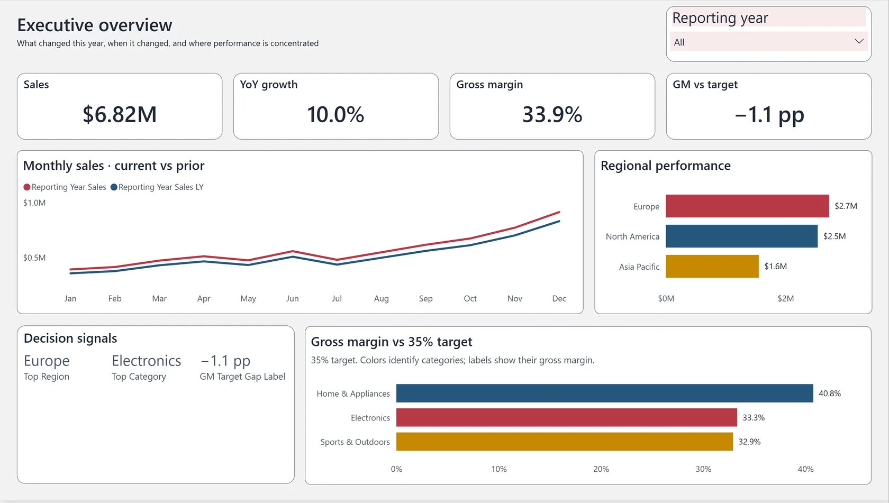](docs/REAL_THEME_SHOWCASE.md#graphite-red) | [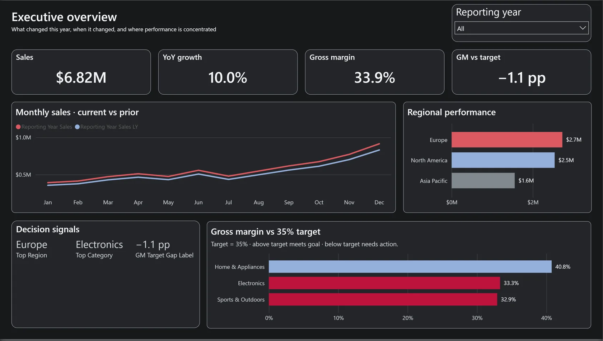](docs/REAL_THEME_SHOWCASE.md#graphite-red) |

<a id="indigo-ember"></a>
### Indigo Ember

Indigo-violet balanced with warm editorial accents.

| Light · actual report | Dark · actual report |
| :--- | :--- |
| [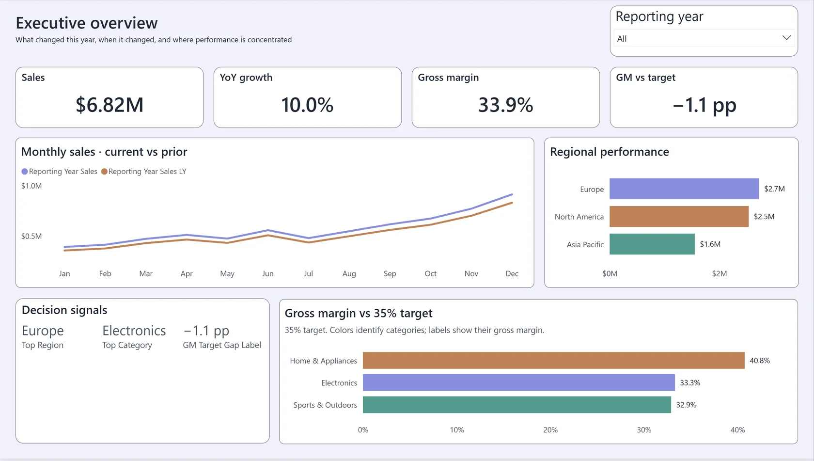](docs/REAL_THEME_SHOWCASE.md#indigo-ember) | [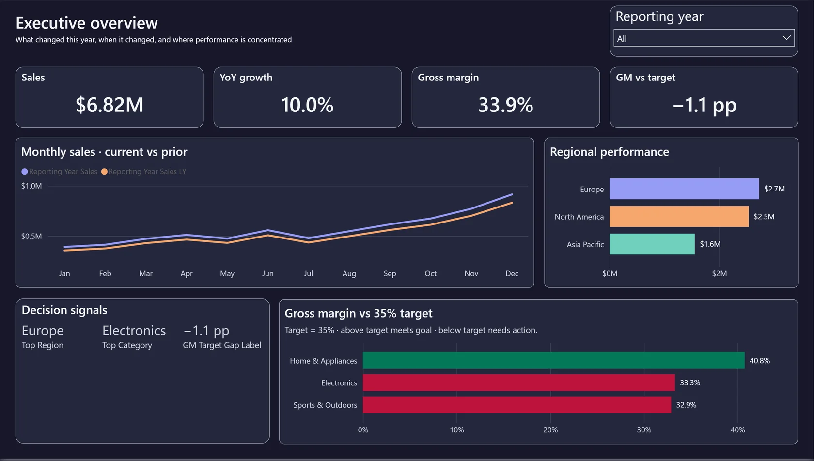](docs/REAL_THEME_SHOWCASE.md#indigo-ember) |

<a id="petrol-gold"></a>
### Petrol & Gold

Petrol and warm gold for a confident executive dashboard.

| Light · actual report | Dark · actual report |
| :--- | :--- |
| [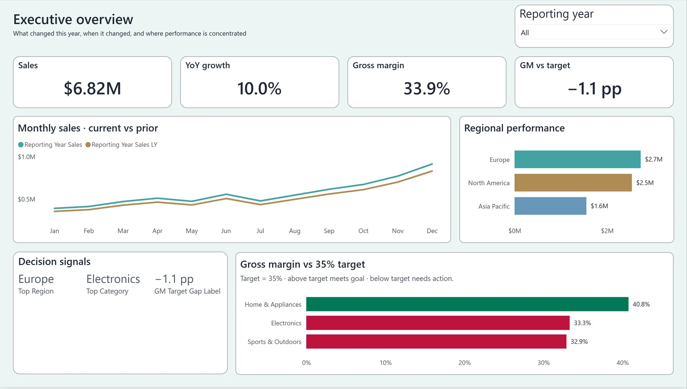](docs/REAL_THEME_SHOWCASE.md#petrol-gold) | [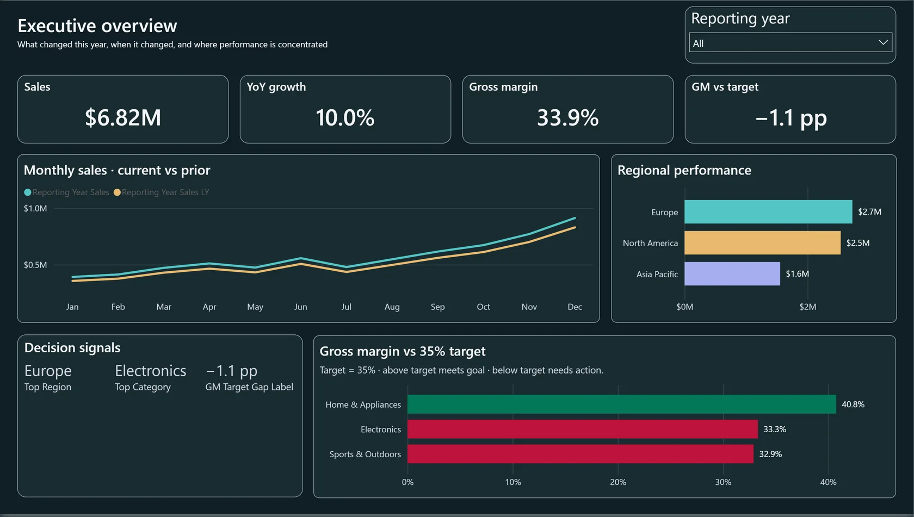](docs/REAL_THEME_SHOWCASE.md#petrol-gold) |

<a id="riviera-pop"></a>
### Riviera Pop

Expressive seaside color, controlled by a disciplined layout.

| Light · actual report | Dark · actual report |
| :--- | :--- |
| [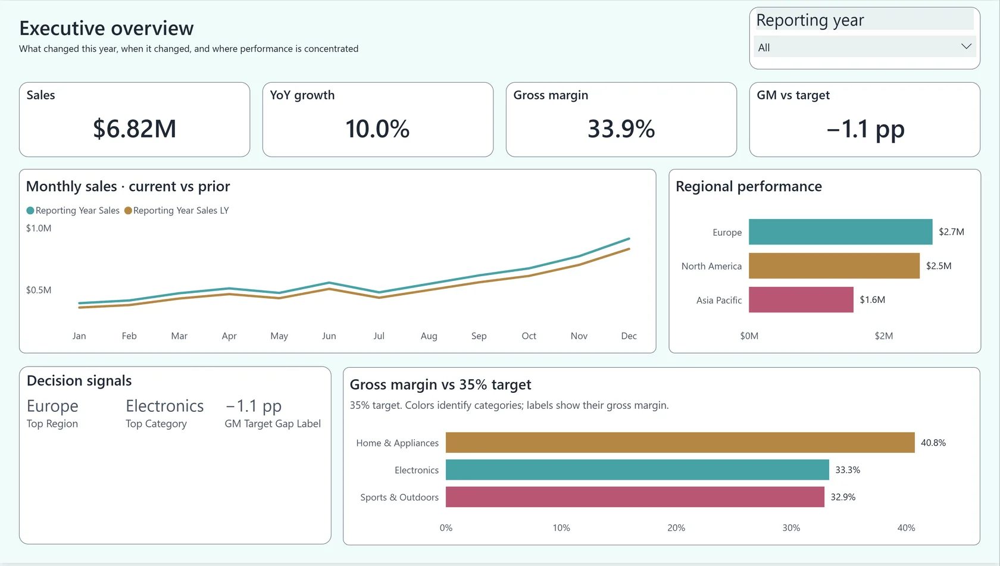](docs/REAL_THEME_SHOWCASE.md#riviera-pop) | [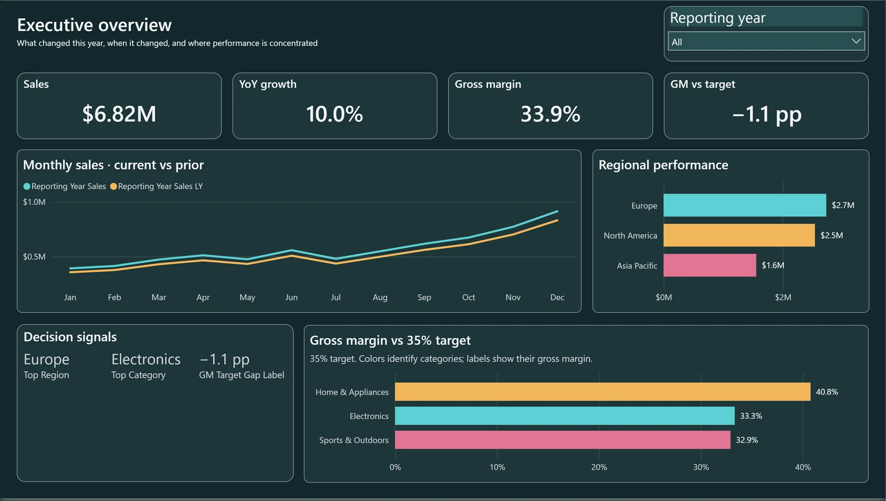](docs/REAL_THEME_SHOWCASE.md#riviera-pop) |

<a id="okabe-ito-night"></a>
### Okabe–Ito Night

Clear categorical hues and understated interface chrome.

| Light · actual report | Dark · actual report |
| :--- | :--- |
| [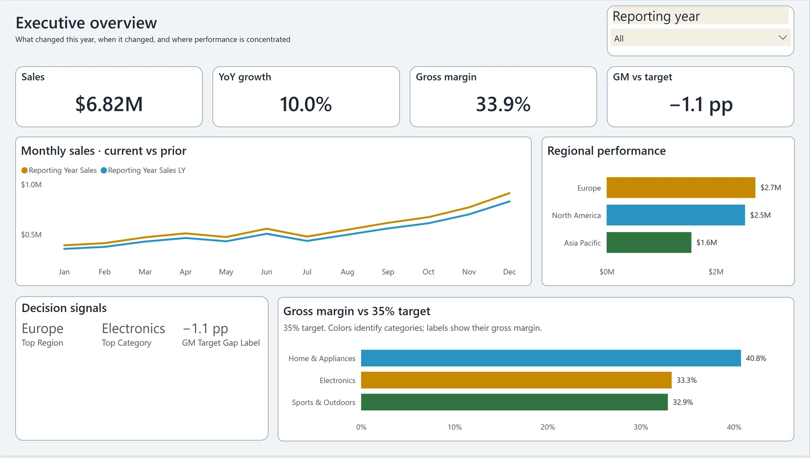](docs/REAL_THEME_SHOWCASE.md#okabe-ito-night) | [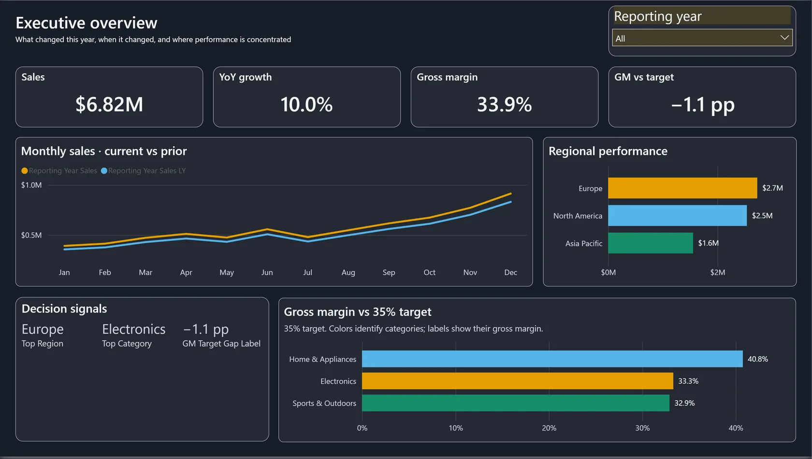](docs/REAL_THEME_SHOWCASE.md#okabe-ito-night) |

**[See all 14 palettes and 56 authentic report previews](docs/REAL_THEME_SHOWCASE.md)**

The gallery also shows Products & Brands, making all seven subcategory
colors easy to compare. Each control palette includes themed dropdown,
filter and selection surfaces. Interactive flyouts remain separately
reviewable; static screenshots are not interaction certification.

## Other ways to use VQS

If you prefer the CLI without an agent, install and inspect a source report locally:

```bash
git clone https://github.com/analienx/visual-quality-system.git
cd visual-quality-system
python -m pip install -e ".[test]"
vqs doctor
vqs triage tests/powerbi/fixtures/mini_report --out quality.md
```

`triage` is a **read-only source check**, not the autonomous repair command. To fix supported issues in a disposable candidate, use the `vqs run --mode repair` example above.

**Light and Dark themes** can be generated and audited separately using the theme CLI:

```bash
vqs theme presets
vqs theme preview "examples/contoso-retail/Contoso Retail.pbip" --mode dark --palette-preset sunny-palette --out theme-plan.json
vqs theme apply "examples/contoso-retail/Contoso Retail.pbip" --mode light --palette-preset organic-palette --candidate-root ./organic-candidate
vqs theme audit ./organic-candidate
```

`preview` is read-only; `apply` creates a separate PBIP candidate. Its source/model bindings and category colors must be checked before claiming native quality. [Theme guide](docs/THEME_ENGINE.md) · [Approved palettes](docs/APPROVED_THEME_LIBRARY.md) · [CLI commands](docs/CLI.md).

## Trustworthy checks, with honest limits

| Quality layer | What VQS verifies | What it cannot infer |
| :--- | :--- | :--- |
| **Source** | Layout, categorical color distinctness, supported formatting, bindings and checks with exact file evidence | Actual Desktop pixels or arbitrary dynamic state |
| **Candidate** | Declared typed edits, unchanged original, rollback path, source diff and supported authoring validation | That every unrelated issue has disappeared |
| **Native** | Authenticated, source-bound full-page renders and supported interaction/DAX checks when available | Unsupported visuals, inaccessible controls or unverified sign-in |
| **Release** | Sealed evidence suitable for independent human/agent review | A production approval without an authorized separate decision |

The 14 approved theme families include **28 Light/Dark modes** with real source-bound native previews. Their default-state capture and color checks do **not** certify every dropdown state, cross-report interaction, or production G2/G4/G6. [Latest engineering release notes](docs/RELEASE_NOTES_2026-10-26.md) · [Evidence and acceptance](docs/ACCEPTANCE_MATRIX.md) · [Open release gates](https://github.com/analienx/visual-quality-system/issues/16).

## Documentation

| For | Start here |
| :--- | :--- |
| **AI agents and report owners** | [5-minute auto-fix quickstart](docs/AI_AGENT_QUICKSTART.md) · [Complete component architecture](docs/AGENT_AUTOFIX_ARCHITECTURE.md) |
| **Power BI report authors** | [Getting started](docs/USER_GUIDE.md) · [Premium design guide](docs/PREMIUM_POWERBI.md) · [Theme palette library](docs/APPROVED_THEME_LIBRARY.md) |
| **BI platform engineers** | [Architecture](docs/ARCHITECTURE.md) · [CLI](docs/CLI.md) · [Power BI integration & native evidence](docs/VISUAL_QA_V2_P16_NATIVE_DESKTOP_UIA.md) |
| **Quality reviewers** | [Acceptance matrix](docs/ACCEPTANCE_MATRIX.md) · [Screenshot provenance](docs/images/adaptive-showcase/PROVENANCE.json) · [Native gallery](docs/REAL_THEME_SHOWCASE.md) |
| **Contributors** | [Contributor guide](CONTRIBUTING.md) · [Changelog](CHANGELOG.md) · [All documentation](docs/README.md) |

VQS focuses on **Power BI**. Word/DOCX assurance is a separate optional component, not a blocker for a Power BI-only release. Source inspection is local by default; private customer screenshots and caches must not be checked in or uploaded without explicit authorization.

<sub>Apache-2.0 · Engineering preview · Power BI first (Word/DOCX separately scoped) · [Security and contribution](CONTRIBUTING.md) · [Legacy theme gallery](docs/THEME_GALLERY.md)</sub>
