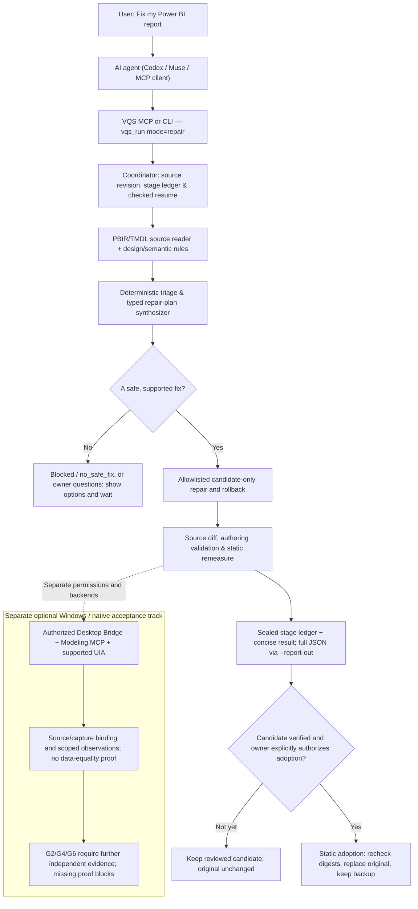

# How AI agents fix Power BI reports with VQS

**Product goal:** give an AI agent a PBIP project and ask it to **fix the report**, not produce a diagnostic essay. The agent chooses and executes supported repairs; VQS provides deterministic checks and verifiable boundaries. The original report stays unchanged until the owner explicitly promotes a reviewed candidate.

**Published v0.2.0 · 18 November 2026.** The shipped scope is static source review and allowlisted candidate repair, owner decisions, capture-readiness hardening, experimental render observations and stage-ledger reporting. Native report acceptance remains a separate track; this version claims **no G2, G4 or G6 acceptance**. [Release evidence and limits](RELEASE_NOTES_v0.2.0.md).

[Product roadmap](../roadmap/README.md) · [Start in 5 minutes](AI_AGENT_QUICKSTART.md) · [CLI commands](CLI.md) · [Architecture](ARCHITECTURE.md) · [Full acceptance boundaries](ACCEPTANCE_MATRIX.md) · [**Real five-page PBIP and proven Desktop results**](VERIFIED_CONTOSO_SHOWCASE.md)

## The actual architecture

The solid path is the **published static workflow**: inspect → review → propose → repair → verify → remeasure → summary. Native stages are conditional on scope, permissions and backends; source verification never implies that a Desktop reload, live answer comparison or native review passed. Those lanes can remain blocked while the source workflow reports what it actually did. [Track native acceptance](https://github.com/analienx/visual-quality-system/issues/16).

The seal covers the **stage ledger**, not the complete returned JSON envelope. `vqs evidence-report` summarizes that ledger and **does not list the edit set**. Use `vqs fix ... --report-out <file>` or `vqs run ... --report-out <file>` to retain the full returned JSON; it is not sealed in `run_dir`. Compact output is capped at 6,000 UTF-8 bytes, may omit counted optional detail, and refuses to present partial unanswered questions when they cannot fit. Read the full result before answering an overflow. Complete-envelope binding is deferred as [#149](https://github.com/analienx/visual-quality-system/issues/149).

`vqs compare-renders` reports changed-pixel rectangle containment from existing captures. Its **overall result is always `blocked` / exit 2** in this version. Source/capture binding, a successful readiness probe or matching `COUNTROWS` hashes establish neither equal loaded data nor equal report answers; [#131](https://github.com/analienx/visual-quality-system/issues/131) remains on the separate acceptance track.

## Which components are used, and why?

| Component | Why it exists | What it really does |
| --- | --- | --- |
| **Your AI agent** | Makes an autonomous improvement task useful, not an endless findings list | Chooses goals, decides priorities, invokes tools, interprets evidence and attempts bounded repairs. It **doesn't** manufacture findings or self-award production approval |
| **VQS MCP server** (`vqs-mcp`, `vqs.mcp`) or **CLI** | One stable interface regardless of agent provider | Exposes `vqs_run` plus inspect, propose, repair and verify; theme operations are available through `vqs_theme` and `vqs theme`; CLI also exposes `premium` and bounded native capture |
| **Coordinator** (`vqs/coordinator.py`) | Prevents every agent from reinventing sequencing and replaying stale results | Runs the stages, seals their ledger, checks recorded bindings and supports provenance-checked resume. The full returned envelope is separate. Use `mode=repair` for candidate fixes; `mode=review` **does not fix** |
| **PBIR/TMDL readers + deterministic quality engine** (`vqs/pbir.py`, `vqs/powerbi/*`, `vqs/visual/*`) | AI guesses cannot establish exact visuals, measures or layout | Locates actual page/visual IDs, source measures, formatting, geometry, color categories, duplicates and supported conditions. Unknown remains unknown |
| **Triage, typed plan, repair allowlist** (`vqs/repair/*`) | Makes automated edits predictable and reversible | Synthesizes available fixes for supported defects, rejects shell/DAX/RLS smuggling, validates exact write targets and puts edits in an **isolated candidate**. Unsupported fixes require a grounded owner plan, not a fabricated operation |
| **Theme engine** (`vqs/theme.py`, `vqs/palettes/*`) | Provides explicit Light/Dark theme operations | Generates audited source-safe PBIP candidates through CLI or `vqs_theme` MCP; application requires an explicit separate candidate. Category differentiation and dropdown surfaces need their own checks |
| **Microsoft Power BI Report Author CLI** + pinned report skill | Microsoft's authoring contract is different from VQS's heuristics | Validates PBIR format and approved source edits. Rejecting an authoring-invalid candidate is better than shipping a visually plausible broken file |
| **Microsoft Modeling MCP** + **Desktop Bridge** + **Windows UI Automation** | Source JSON cannot establish populated pixels or usable native controls | Separate authorized Windows path for scoped DAX probes, exact PID/source capture and supported slicer observations. These do not prove complete data/answer parity; unsupported maps, sign-in or unsaved state **block** the relevant evidence |
| **GitHub runners + private evidence + independent reviewer** | Portable checks should not occupy the Desktop; the repair should be auditable | CI can run source/schema/unit checks, while native pixels remain on authorized Windows. Hash-bound evidence is handed off for a reviewer; G6 production release cannot be self-approved |

VQS is Power BI-first. Word/DOCX quality is an optional separate component, **not** needed for an agent repairing a PBIP.

## The preferred autonomous loop

The user supplies **a goal, report location, and permission to edit disposable candidates**. The agent does not stop after diagnostics or request confirmation for every harmless candidate edit:

1. **Preflight:** verify source/project, writable private evidence path, capabilities and Git/working-tree state. Capture a source digest; protect original and business data. Use `vqs doctor` and the pinned Microsoft skill when editing.
2. **Prioritize:** request `vqs_run` with **`mode=repair`, `scope=static`** for source-safe problems, a unique run ID and private run root. The coordinator itself inspects, proposes, repairs, verifies and remeasures. The agent may choose a VQS theme candidate via CLI if design is the main problem.
3. **Apply supported changes to a candidate:** execute a typed, source-grounded plan, such as a supported `spacing.adjust` operation for a measured overlap. Show owner questions and options when the desired edit is ambiguous; never answer them for the owner. Never silently change DAX, RLS, relationships, business meaning or the original source. If no safe plan is available, **stop that repair lane as `no_safe_fix` or `blocked`** and surface the precise constraint.
4. **Verify immediately:** validate the exact source diff and model invariants, Microsoft authoring format, and fresh VQS remeasure. Optional Windows observations have their own permissions and evidence requirements. Source checks, captures and readiness probes alone establish neither data/answer parity nor a complete user-visible report test.
5. **Retry only when evidence directs it:** at most **two evidence-driven candidate revisions** per defect, each in a fresh candidate/run (don't churn or override a structural validator). Stop for unfixable, unsupported or ambiguous requirements rather than introducing new defects.
6. **Report outcomes, not a diagnostic novel:** provide a concise summary: **source-fixed and verified**, **native proof pending**, **still blocked / needs decision**, **regressions**, and a path to the separate candidate. Include what changed and the returned adoption step where available. Save the full result with `--report-out`; compact omissions and stage-ledger reporting are not a complete edit record.
7. **Promote separately:** only for a verified candidate after explicit owner authorization. Static adoption rechecks bindings and keeps a backup; it is not G6 report acceptance. The coordinator **never automatically overwrites the source**.

**Autonomy boundary:** permission to create/modify a **disposable** candidate is different from permission to publish, overwrite, deploy or perform tenant actions. Ask only at genuine decision boundaries: business meaning changes, new external data access, cloud screenshot disclosure, or promotion. For other supported candidate repairs, the agent should proceed and verify.

## One instruction your agent can follow

> Fix the Power BI PBIP project at `C:/Reports/Sales.pbip` end to end using VQS. Prioritize premium dashboard usability and correctness, not a long findings report. You may autonomously generate and modify **separate disposable candidates**, never my original. Use `vqs_run(mode=repair, scope=static)` / `vqs run --mode repair --scope static` with private sealed evidence, a fresh run ID, and a safe candidate root. Let VQS automatically synthesize supported repair plans, apply allowed edits, verify changes and remeasure. If a meaningful theme redesign helps, use the CLI theme engine and audit it as a separate candidate. When authorized Desktop is available, run the Microsoft authoring, native render, interaction and DAX checks; don't convert missing native evidence into success. Iterate on evidence up to two times; preserve all regressions, never invent a fix. Give me a short **Fixed / Verified / Still blocked** summary and ask only before semantic changes, sharing private data or promoting the original.

## Example: what is already automatic, and what is not

An existing automated integration test (`tests/test_u2_run.py::test_repair_mode_static_end_to_end`) demonstrates a detected overlapping visual, a synthesized `spacing.adjust` operation, candidate-only modification and a passing repair-diff verification. The final **remeasure is blocked**, because another inherited formatting state remains unknown; it does **not** misreport the overall report as accepted.

**Historical reproduction, 26 October 2026:** that behavior was independently reproduced on a disposable synthetic report. The Microsoft authoring backend also rejected that legacy fixture; the static `direct` backend demonstrates a **portable typed repair** but must **not** substitute for mandatory Microsoft-backed/native acceptance. This dated fixture exercise does not certify the published version or a user's report. Current package evidence is in the [v0.2.0 release notes](RELEASE_NOTES_v0.2.0.md).

What is *not* automatically solved today: every unsupported chart/map, Azure Maps sign-in, inaccessible control, native Desktop saved-state issue, real-image aesthetics, or independent production certification. Those remain explicit blockers. Avoid promising a magic one-call production-fix service until the evidence exists.

For the exact MCP setup and prompt, continue with [AI Agent Quickstart](AI_AGENT_QUICKSTART.md). For the wider runtime boundaries see [architecture](ARCHITECTURE.md).
