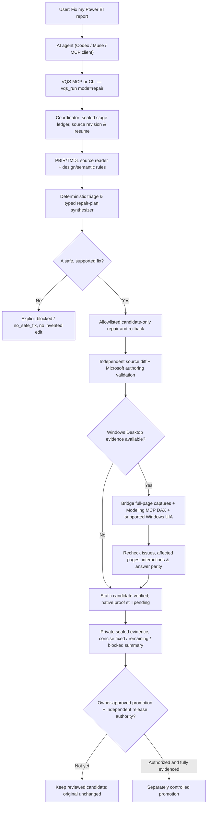

# How AI agents fix Power BI reports with VQS

**Product goal:** give an AI agent a PBIP project and ask it to **fix the report**, not produce a diagnostic essay. The agent chooses and executes supported repairs; VQS provides deterministic checks and verifiable boundaries. The original report stays unchanged until the owner explicitly promotes a reviewed candidate.

[Start in 5 minutes](AI_AGENT_QUICKSTART.md) · [CLI commands](CLI.md) · [Architecture](ARCHITECTURE.md) · [Full acceptance boundaries](ACCEPTANCE_MATRIX.md) · [**Real five-page PBIP and proven Desktop results**](VERIFIED_CONTOSO_SHOWCASE.md)

## The actual architecture

The diagram is **conditional**, not a claim that all runtime capabilities are connected today. `vqs_run` (or `vqs run`) already orchestrates **inspect → review → optional readiness/capture → propose → repair → verify → optional Desktop reload/DAX regression/recapture → reviewer handoff → remeasure → summary**. Some native/UI interactions and trusted production-release approval are still blocked in the current engineering preview. [Track release validation](https://github.com/analienx/visual-quality-system/issues/16).

## Which components are used, and why?

| Component | Why it exists | What it really does |
| --- | --- | --- |
| **Your AI agent** | Makes an autonomous improvement task useful, not an endless findings list | Chooses goals, decides priorities, invokes tools, interprets evidence and attempts bounded repairs. It **doesn't** manufacture findings or self-award production approval |
| **VQS MCP server** (`vqs-mcp`, `vqs.mcp`) or **CLI** | One stable interface regardless of agent provider | Exposes `vqs_run` plus inspect, propose, repair, verify; CLI additionally exposes `vqs theme`, `premium` and native capture |
| **Coordinator** (`vqs/coordinator.py`) | Prevents every agent from reinventing sequencing and replaying stale results | Runs the stages, records sealed state, matches hashes and supports provenance-checked resume. Use `mode=repair` for autonomous candidate fixes; `mode=review` **does not fix** |
| **PBIR/TMDL readers + deterministic quality engine** (`vqs/pbir.py`, `vqs/powerbi/*`, `vqs/visual/*`) | AI guesses cannot establish exact visuals, measures or layout | Locates actual page/visual IDs, source measures, formatting, geometry, color categories, duplicates and supported conditions. Unknown remains unknown |
| **Triage, typed plan, repair allowlist** (`vqs/repair/*`) | Makes automated edits predictable and reversible | Synthesizes available fixes for supported defects, rejects shell/DAX/RLS smuggling, validates exact write targets and puts edits in an **isolated candidate**. Unsupported fixes require a grounded owner plan, not a fabricated operation |
| **Theme engine** (`vqs/theme.py`, `vqs/palettes/*`) | Premium light/dark redesign often gives more value than minor lint | Generates audited source-safe Light/Dark PBIP candidates. **CLI only today**, not a `vqs_theme` MCP tool; category differentiation and dropdown surfaces need their own checks |
| **Microsoft Power BI Report Author CLI** + pinned report skill | Microsoft's authoring contract is different from VQS's heuristics | Validates PBIR format and approved source edits. Rejecting an authoring-invalid candidate is better than shipping a visually plausible broken file |
| **Microsoft Modeling MCP** + **Desktop Bridge** + **Windows UI Automation** | Source JSON cannot prove the actual report shows correct populated data or usable controls | On an authorized Windows Desktop, check live DAX, exact PID/source, render **real** pages, exercise supported slicer states and compare before/after. Unsupported maps, sign-in or unsaved state **block** relevant evidence |
| **GitHub runners + private evidence + independent reviewer** | Portable checks should not occupy the Desktop; the repair should be auditable | CI can run source/schema/unit checks, while native pixels remain on authorized Windows. Hash-bound evidence is handed off for a reviewer; G6 production release cannot be self-approved |

VQS is Power BI-first. Word/DOCX quality is an optional separate component, **not** needed for an agent repairing a PBIP.

## The preferred autonomous loop

The user supplies **a goal, report location, and permission to edit disposable candidates**. The agent does not stop after diagnostics or request confirmation for every harmless candidate edit:

1. **Preflight:** verify source/project, writable private evidence path, capabilities and Git/working-tree state. Capture a source digest; protect original and business data. Use `vqs doctor` and the pinned Microsoft skill when editing.
2. **Prioritize:** request `vqs_run` with **`mode=repair`, `scope=static`** for source-safe problems, a unique run ID and private run root. The coordinator itself inspects, proposes, repairs, verifies and remeasures. The agent may choose a VQS theme candidate via CLI if design is the main problem.
3. **Apply supported changes to a candidate:** prefer genuine fixes over commentary: fix a measured overlap, incorrect padding/axis formatting, categorical-color collisions, missing visible titles or another allowlisted defect. Never silently change DAX, RLS, data relationships, business meaning or the original source. If no safe plan is available, **stop that repair lane as `no_safe_fix` or `blocked`** and surface the precise constraint.
4. **Verify immediately:** validate the exact source diff and model invariants, Microsoft authoring format, and fresh VQS remeasure. When permitted and available, validate full-page native Power BI pixels, controls and DAX on Windows. Static checks alone are not a complete user-visible report test.
5. **Retry only when evidence directs it:** at most **two evidence-driven candidate revisions** per defect, each in a fresh candidate/run (don't churn or override a structural validator). Stop for unfixable, unsupported or ambiguous requirements rather than introducing new defects.
6. **Report outcomes, not a diagnostic novel:** provide a concise summary: **fixed and verified**, **improved but native proof pending**, **still blocked / needs decision**, **regressions**, and a link/path to the separate candidate. Explain only the blockers and meaningful trade-offs.
7. **Promote separately:** after verified before/after and explicit owner authorization. Production G6 also needs independent reviewer authority. The coordinator **never automatically overwrites the source**.

**Autonomy boundary:** permission to create/modify a **disposable** candidate is different from permission to publish, overwrite, deploy or perform tenant actions. Ask only at genuine decision boundaries: business meaning changes, new external data access, cloud screenshot disclosure, or promotion. For other supported candidate repairs, the agent should proceed and verify.

## One instruction your agent can follow

> Fix the Power BI PBIP project at `C:/Reports/Sales.pbip` end to end using VQS. Prioritize premium dashboard usability and correctness, not a long findings report. You may autonomously generate and modify **separate disposable candidates**, never my original. Use `vqs_run(mode=repair, scope=static)` / `vqs run --mode repair --scope static` with private sealed evidence, a fresh run ID, and a safe candidate root. Let VQS automatically synthesize supported repair plans, apply allowed edits, verify changes and remeasure. If a meaningful theme redesign helps, use the CLI theme engine and audit it as a separate candidate. When authorized Desktop is available, run the Microsoft authoring, native render, interaction and DAX checks; don't convert missing native evidence into success. Iterate on evidence up to two times; preserve all regressions, never invent a fix. Give me a short **Fixed / Verified / Still blocked** summary and ask only before semantic changes, sharing private data or promoting the original.

## Example: what is already automatic, and what is not

An existing automated integration test (`tests/test_u2_run.py::test_repair_mode_static_end_to_end`) demonstrates a detected overlapping visual, a synthesized `spacing.adjust` operation, candidate-only modification and a passing repair-diff verification. The final **remeasure is blocked**, because another inherited formatting state remains unknown; it does **not** misreport the overall report as accepted.

That behavior was independently reproduced on a disposable synthetic report on 26 October 2026. The Microsoft authoring backend also rejected that legacy fixture; the static `direct` backend can demonstrate a **portable typed repair** but must **not** be substituted for mandatory Microsoft-backed/native acceptance. This is the crucial distinction between **“the fix code executed”** and **“the report is proven good.”**

What is *not* automatically solved today: every unsupported chart/map, Azure Maps sign-in, inaccessible control, native Desktop saved-state issue, real-image aesthetics, or independent production certification. Those remain explicit blockers. Avoid promising a magic one-call production-fix service until the evidence exists.

For the exact MCP setup and prompt, continue with [AI Agent Quickstart](AI_AGENT_QUICKSTART.md). For the wider runtime boundaries see [architecture](ARCHITECTURE.md).
