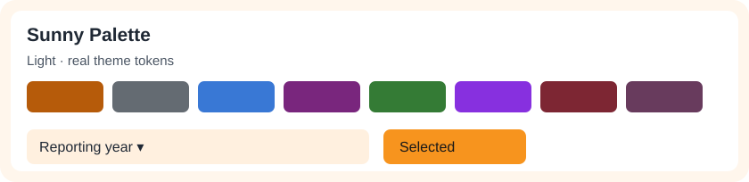
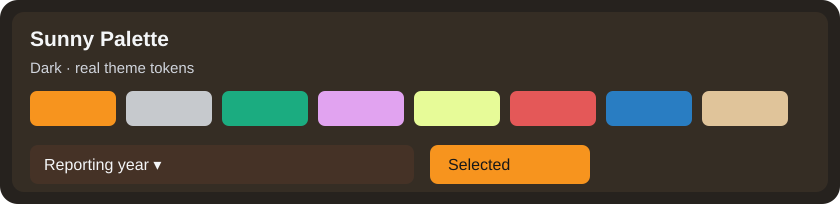
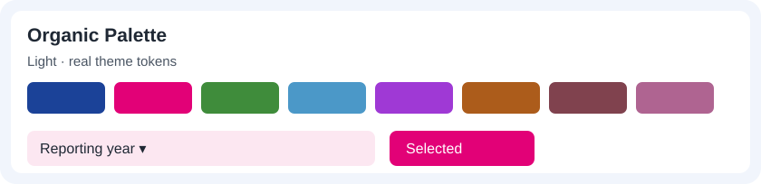
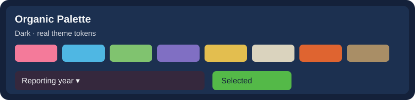
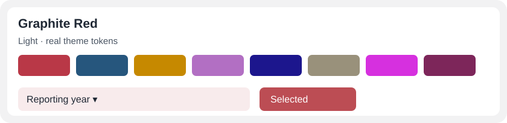
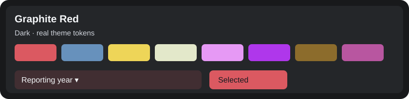

# Approved Power BI theme library — 14 families, 28 modes

All 14 themes are registered as distinct native Light and Dark presets;
four older compatibility presets remain unchanged. This compact reference
shows genuine **palette and control tokens**, including dropdown surfaces
and selected states. For **actual Power BI Desktop screenshots of every
family**, use the [full gallery](REAL_THEME_SHOWCASE.md).

| Family / screenshots | Light · palette and controls | Dark · palette and controls |
| :--- | :--- | :--- |
| **[Sunny Palette](REAL_THEME_SHOWCASE.md#sunny-palette)** |  |  |
| **[Organic Palette](REAL_THEME_SHOWCASE.md#organic-palette)** |  |  |
| **[Graphite Red](REAL_THEME_SHOWCASE.md#graphite-red)** |  |  |
| **[Indigo Ember](REAL_THEME_SHOWCASE.md#indigo-ember)** |  |  |
| **[Petrol & Gold](REAL_THEME_SHOWCASE.md#petrol-gold)** |  |  |
| **[Riviera Pop](REAL_THEME_SHOWCASE.md#riviera-pop)** |  |  |
| **[Okabe–Ito Night](REAL_THEME_SHOWCASE.md#okabe-ito-night)** |  |  |
| **[Arctic Aurora](REAL_THEME_SHOWCASE.md#arctic-aurora)** |  |  |
| **[Mediterranean Terra](REAL_THEME_SHOWCASE.md#mediterranean-terra)** |  |  |
| **[Saffron & Spruce](REAL_THEME_SHOWCASE.md#saffron-spruce)** |  |  |
| **[Autumn Editorial](REAL_THEME_SHOWCASE.md#autumn-editorial)** |  |  |
| **[Violet Ice](REAL_THEME_SHOWCASE.md#violet-ice)** |  |  |
| **[Electric Atelier](REAL_THEME_SHOWCASE.md#electric-atelier)** |  |  |
| **[Bold Eclectic](REAL_THEME_SHOWCASE.md#bold-eclectic)** |  |  |

## Safe use

Use `vqs theme inspect/preview/apply/audit` for source-safe candidates.
For screen-visible proof, open the generated PBIP in Power BI Desktop,
refresh the model, then capture and review the actual target state.
Colors are generic palette designs, not claims of external affiliation.
The color-vision checks are engineering screening thresholds, not a
guarantee of accessibility or live interaction behavior.
