# Approved Power BI theme library — 14 families, 28 modes

All fourteen approved families are selectable as actual Power BI report
theme presets in both Light and Dark, in addition to four legacy presets.
The three highlighted examples below are **real native Power BI Desktop screenshots**.
The other eleven are deliberately **color swatches only**, not simulated dashboards.
The same Contoso source report is used consistently for the real screenshots.

## Three featured palettes — authentic Power BI Desktop

[**Full gallery · three report pages per mode →**](REAL_THEME_SHOWCASE.md)
 · [Raw screenshot hashes and candidate digests](images/adaptive-showcase/PROVENANCE.json)

### Sunny Palette

| Light | Dark |
| :--- | :--- |
| [](REAL_THEME_SHOWCASE.md) | [](REAL_THEME_SHOWCASE.md) |

### Organic Palette

| Light | Dark |
| :--- | :--- |
| [](REAL_THEME_SHOWCASE.md) | [](REAL_THEME_SHOWCASE.md) |

### Graphite Red

| Light | Dark |
| :--- | :--- |
| [](REAL_THEME_SHOWCASE.md) | [](REAL_THEME_SHOWCASE.md) |

## Remaining eleven color families — true palette swatches

Each chip represents a packaged `dataColors` token from its selected mode;
the canvas/surface/text colors are taken directly from the same palette JSON.
These are not report screenshots or claims of independent native acceptance.

| Dark | Light |
| :--- | :--- |
| **#05 Okabe–Ito Night · Dark**<br>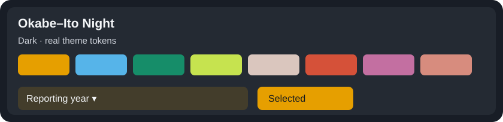 | **#05 Okabe–Ito Night · Light**<br>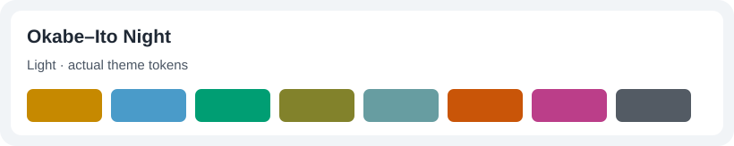 |
| **#08 Petrol & Gold · Dark**<br>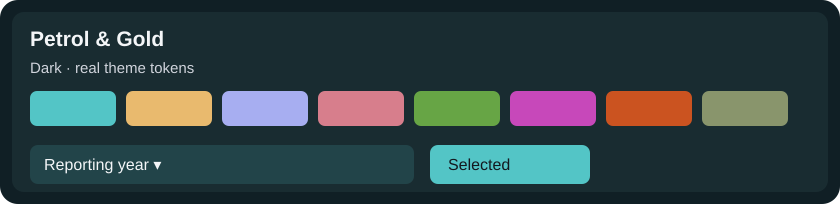 | **#08 Petrol & Gold · Light**<br>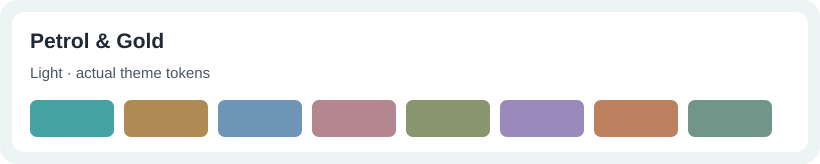 |
| **#09 Indigo Ember · Dark**<br>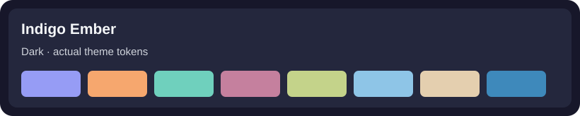 | **#09 Indigo Ember · Light**<br>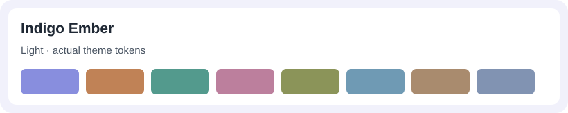 |
| **#12 Arctic Aurora · Dark**<br>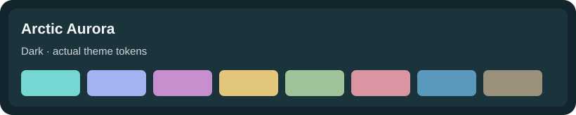 | **#12 Arctic Aurora · Light**<br>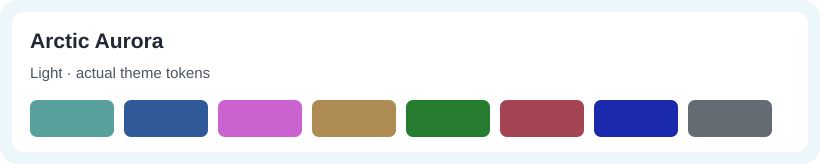 |
| **#14 Mediterranean Terra · Dark**<br>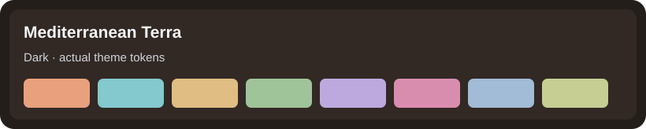 | **#14 Mediterranean Terra · Light**<br>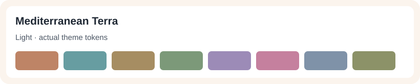 |
| **#15 Saffron & Spruce · Dark**<br>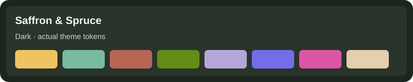 | **#15 Saffron & Spruce · Light**<br>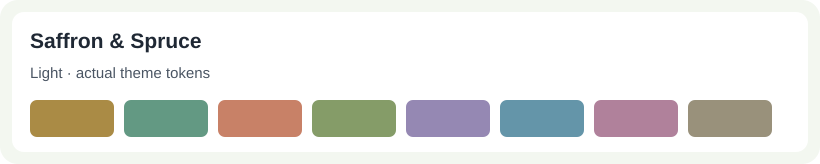 |
| **#18 Autumn Editorial · Dark**<br>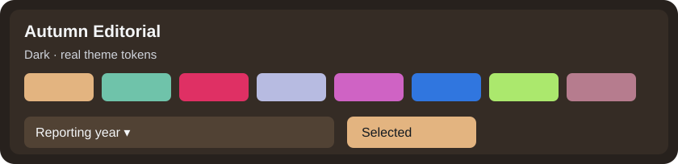 | **#18 Autumn Editorial · Light**<br>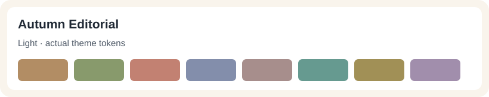 |
| **#19 Violet Ice · Dark**<br>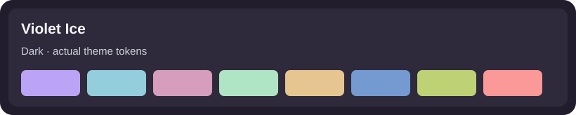 | **#19 Violet Ice · Light**<br>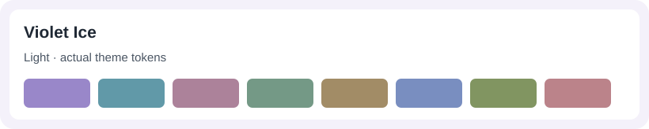 |
| **#25 Electric Atelier · Dark**<br>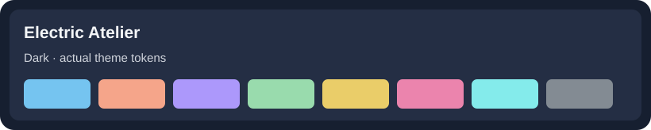 | **#25 Electric Atelier · Light**<br>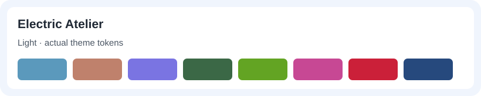 |
| **#26 Riviera Pop · Dark**<br>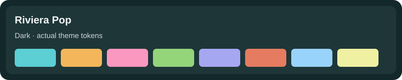 | **#26 Riviera Pop · Light**<br>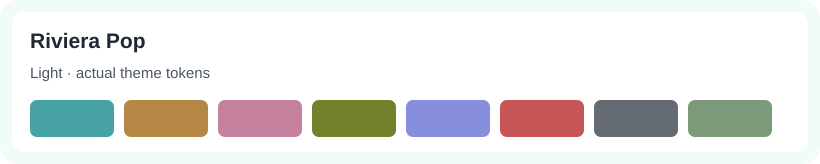 |
| **#30 Bold Eclectic · Dark**<br>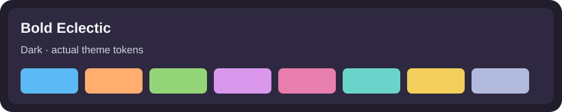 | **#30 Bold Eclectic · Light**<br>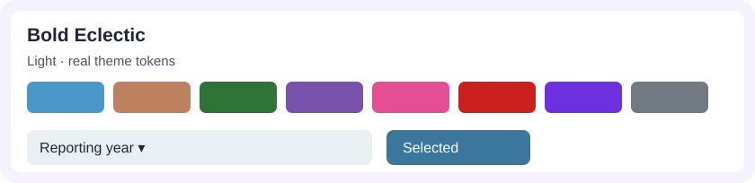 |

## Apply a palette without altering the source

```bash
vqs theme presets
vqs theme preview "examples/contoso-retail/Contoso Retail.pbip" --mode dark --palette-preset sunny-palette --out plan.json
vqs theme apply "examples/contoso-retail/Contoso Retail.pbip" --mode light --palette-preset organic-palette --candidate-root ./organic-candidate
vqs theme audit ./organic-candidate
```

Candidates are isolated and source-bound. Dynamic business rules are preserved;
literal category and supported numeric gradient colors are recolored under
the documented safety registry. See [theme engine](THEME_ENGINE.md) and
[approval manifest](APPROVED_THEME_SELECTION.json).
Native screenshots do not prove interaction-state styling or independent release
approval; those remain separate review gates.
