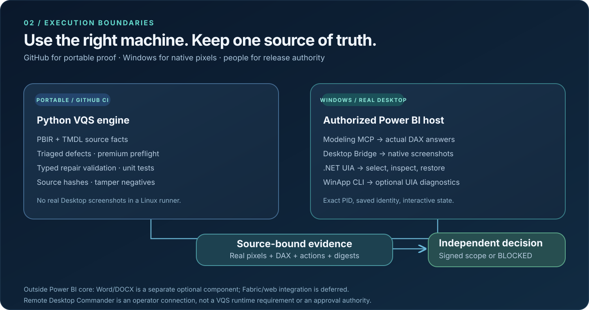

# Visual Quality System · Architecture

**Power BI-first. One engine, two execution environments, one independent verdict.**
Updated **22 October 2026** · [Product README](../README.md) · [Release evidence](RELEASE_NOTES_2026-10-21.md) · [Acceptance gates](ACCEPTANCE_MATRIX.md)

VQS is a **quality and safe-repair engine**, not an alternative Power BI report authoring application. It compares PBIP/PBIR/TMDL source facts, a populated semantic model and real Power BI Desktop behavior. It reports **pass**, **fail** or **blocked** against a defined scope; missing evidence never becomes a pass. The current version is an **engineering preview**, not an independently certified release.

## 1 · How the product works

[Editable flowchart source](diagrams/product-flow.mmd) · Dark-background vector image, readable on GitHub light/dark themes.

| Step | Responsibility | User value |
| --- | --- | --- |
| **Read** | Parse PBIP/PBIR visuals and TMDL/DAX/M source; bind the exact report revision | Diagnostics refer to real pages, visuals and measures |
| **Diagnose** | \`vqs triage\`, deterministic layout/data rules and owner-declared \`vqs premium\` design intent | Ranked, actionable issues rather than a made-up beauty score |
| **Observe** | Query a real populated model; capture native Desktop pixels and supported UI Automation interactions | Catches blank maps, stale values and broken slicers source lint misses |
| **Seal** | Source and image hashes, scoped data/oracle evidence, \`vqs bundle pack/verify\` | Another reviewer can check that evidence belongs to the reported PBIP |
| **Decide** | Independent review plus explicit owner G6 promotion; reject, accept or remain blocked | A tool never approves its own repair |

**Repair is optional, not the default.** Typed, allowlisted edits run against a **disposable candidate** with preconditions and rollback. They require a fresh source/visual/data/interaction comparison before any independent release decision. VQS never silently edits the original PBIP or changes semantic meaning to improve appearances.

## 2 · Where each part runs

[Editable execution-boundary source](diagrams/execution-boundaries.mmd).

| Location / dependency | Purpose | Not evidence of |
| --- | --- | --- |
| **Python + GitHub Actions** | PBIR/TMDL parsing, design checks, premium preflight, typed patch tests, linting, fixture and tamper-negative controls | Real populated Desktop pixels or Windows native interactions |
| **Microsoft Power BI Report Author CLI** (optional authoring dependency) | Supported report metadata validation and schema/authoring preflight | Live DAX truth, screenshot appearance or native UIA state |
| **Microsoft Modeling MCP** on authorized Desktop host | Read-only live semantic/model state and DAX queries with defined scope | Report-layout or displayed-pixel correctness |
| **Power BI Desktop Bridge** on Windows | Exact Desktop PID/path/state, serial per-PID capture/reload, source-bound real screenshots | Generic visual clicking or independent quality judgment |
| **.NET Windows UI Automation** | Native slicer selection, observed text, control geometry and baseline restoration on supported controls | Country glyphs that Power BI does not expose to accessibility |
| **Microsoft WinApp CLI** · *optional diagnostic* | Exact-PID control search/property inspection and element-scoped waits. The real A/B showed stale generic ComboBox values and lacked the required \`RemoveFromSelection\` path | A replacement for the complete existing .NET UIA interaction engine. [Tested decision](WINAPPCLI_POWERBI.md) |
| **Remote Desktop Commander** · *operator only* | Authorized Windows process/file access and job orchestration | VQS's runtime API, a lock-screen bypass or an acceptance authority |
| **Independent reviewer / release owner** | Per-artifact G2/G4 evidence review, scoped G6 decision, risk acceptance | Automatic approval from CI or a vision model |

**Rule of thumb:** GitHub owns everything it can run reproducibly without a GUI. Windows Desktop owns only the native tasks that actually need Power BI. A reviewer makes the release decision. A locally rendered page screenshot is not a public CI assertion, and a live DAX query does not certify what a viewer can see.

## 3 · Concrete modules, without extra platforms

| Code / component | Main responsibility |
| --- | --- |
| \`vqs/pbir.py\`, \`vqs/powerbi/*\` | PBIR/TMDL source identity, report facts, typed modeling/authoring adapters and Desktop-bound probes |
| \`vqs/visual/*\`, \`vqs/design_rules.py\`, \`vqs/premium.py\` | Report-page geometry, verified report-only crop where provable, deterministic and premium design findings |
| \`vqs/repair/*\` | Allowlisted, reversible candidate repair and validation |
| \`vqs/capture.py\`, \`vqs/evidence.py\`, \`vqs/review/*\` | Native capture, manifests, hashes, private review bundles and image review interfaces |
| \`vqs/acceptance.py\`, \`vqs/components.py\` | Distinct Power BI and Word scopes, fail-closed G0–G6 and independently authorized promotion |
| \`vqs/document/*\` | **Optional Word/DOCX component**, separately gated; native Word/TOC draft work is not merged as a Power BI prerequisite |

There is **one Python package** today, with logical release components—not a deployed microservice architecture, not several mutually dependent agents and not a mandatory second Windows automation engine. Fabric Apps/web is **deferred**. PBIPDocumenter is a **downstream consumer**, not a second authoritative VQS implementation.

## 4 · What is proven—and what is not

- **Code in main:** Power BI scope (#63), integrated native assurance (#64), premium preflight (#69), mixed report/Tooltip capture (#70), doubled-DPI Contoso canvas proof (#71), reproducible five-page demo source (#74), WinApp CLI A/B decision (#76).
- **Native engineering evidence:** Five populated Contoso pages, verified report-only canvases and nine Year/Region UIA events; three independent Corporate Spend pages with a DAX-matched Europe → Latin America → Europe selection and pixel-identical restoration. Demo screenshots in the README match the [actual committed Contoso PBIP](../examples/contoso-retail/README.md).
- **Still blocked for full production scope:** independent G2 visual approval, complete map/country G4 support, corporate clean-canvas calibration, separate G6 reviewer/owner authority. Corporate Spend's Azure Maps sign-in placeholder is a visible environment-dependent limitation, not a hidden pass.
- **Honest limitations:** source geometry and UIA observations do not prove exact glyph clipping or real country-shape interactions. WinApp CLI uses UIA too and cannot magically expose controls absent from the accessibility tree. A failed or missing image-model review must remain blocked.

See the [actual two-report engineering dossier](RELEASE_NOTES_2026-10-21.md), [current acceptance issue #16](https://github.com/analienx/visual-quality-system/issues/16), and [premium contract](PREMIUM_POWERBI.md).

## 5 · Deeper implementation details

The historic [execution blueprint](EXECUTION_ARCHITECTURE.md) documents earlier planned coordinators, web adapters, workers, and security alternatives. It is a **design archive, not the shipped topology**. The current code and diagrams here are the primary reference. The [CLI reference](CLI.md) and [user guide](USER_GUIDE.md) describe runnable commands; [WinApp CLI A/B](WINAPPCLI_POWERBI.md) explains why the optional inspection tool is not a mandatory adapter.

**Core invariant:** \`source revision + data scope + real native pixels + interaction state + reviewer identity\` must all match the claim being made. If one cannot be verified, the verdict remains **blocked**.
