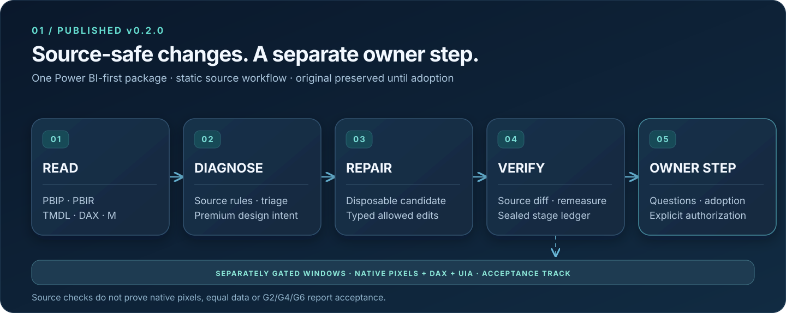
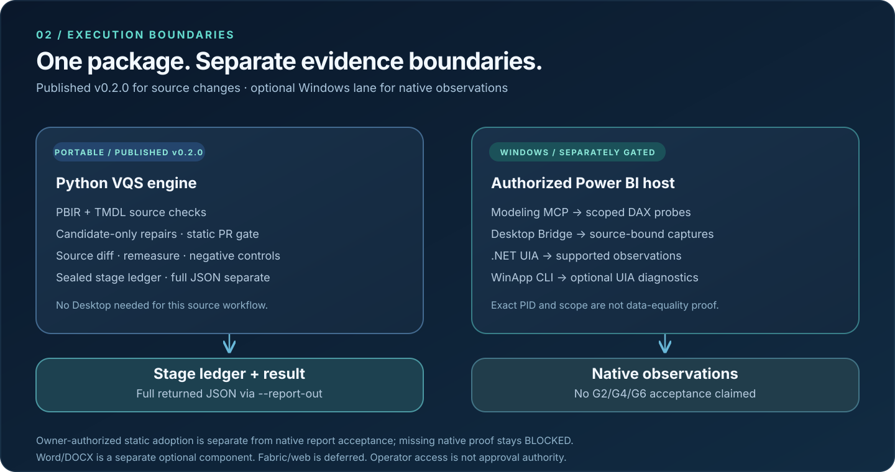

# Visual Quality System · Architecture

**Power BI-first. One package, source-safe candidate repairs, explicit evidence boundaries.**
Updated **18 November 2026** · [Product README](../README.md) · [Documentation hub](README.md) · [Published v0.2.0](RELEASE_NOTES_v0.2.0.md) · [Theme candidate gallery](REAL_THEME_SHOWCASE.md) · [Acceptance gates](ACCEPTANCE_MATRIX.md)

VQS **v0.2.0 is published**. Its supported release scope is static Power BI source review, allowlisted repair in a disposable candidate, owner decisions and the evidence around that workflow. VQS reports **pass**, **fail** or **blocked** against the scope actually checked; a passing source check is not report acceptance. This release claims **no G2, G4 or G6 acceptance** of any report.

The package also contains bounded Windows Desktop integrations and earlier native engineering work. Those are a **separate, permission- and evidence-gated path**, not a prerequisite for portable source review and not new native capability certified by v0.2.0. VQS is a quality and safe-repair engine, not an alternative Power BI report authoring application.

## 1 · How the product works

[Editable flowchart source](diagrams/product-flow.mmd) · Dark-background vector image, readable on GitHub light/dark themes.

| Step | Responsibility | User value |
| --- | --- | --- |
| **Read** | Parse PBIP/PBIR visuals and TMDL/DAX/M source; bind the report revision | Diagnostics refer to actual pages, visuals and source definitions |
| **Diagnose** | `vqs triage`, deterministic source rules and owner-declared `vqs premium` design intent | Supported issues and explicit unknowns; no invented beauty score |
| **Repair** | Apply typed, allowlisted operations only to a disposable candidate, with preconditions and rollback | Supported edits preserve the original; ambiguous choices become owner questions |
| **Verify** | Check the source diff, authoring format and remeasure; record the stages in a sealed ledger | The result distinguishes execution, remaining findings and missing evidence |
| **Owner step** | Show offered questions; provide the exact adoption step when a candidate is verified | The owner chooses answers and separately authorizes replacement of the original |

**Repair is optional, not the default.** Review mode is read-only. When the right fix is a design choice, VQS returns an answerable question (stable `decision_id`, pre-compiled options or an `accept` waiver). The agent must show those options and wait for the owner; an answer authorizes the scoped candidate edit or waiver, never native acceptance. `vqs gate` uses the same finding identity to detect newly introduced source findings in a pull request ([owner decisions and gate](OWNER_DECISIONS_AND_PR_GATE.md)).

**The stage ledger is not a complete sealed result.** `vqs evidence-report` reads recorded stage statuses, comparable check names, owner questions and the candidate path; it **does not list the edit set**. Save the full returned JSON with `vqs fix ... --report-out <file>` or `vqs run ... --report-out <file>`. That returned envelope is **not sealed in `run_dir`**. Compact output may omit counted optional detail or return an explicit overflow; read the full output before answering in that case. Complete-envelope binding remains deferred as [#149](https://github.com/analienx/visual-quality-system/issues/149).

`vqs compare-renders` can inspect existing, source-bound captures and report changed-pixel **rectangle containment**, not attribution or causation. Its **overall verdict is always `blocked` (exit 2)** in v0.2.0: no input supplies the missing data/answer-parity evidence. Source binding, capture consistency and equal single-table `COUNTROWS` probe hashes do **not** establish equal data or report answers ([release limits](RELEASE_NOTES_v0.2.0.md)).

## 2 · Where each part runs

[Editable execution-boundary source](diagrams/execution-boundaries.mmd).

| Location / dependency | Purpose | Not evidence of |
| --- | --- | --- |
| **Python + GitHub Actions** | PBIR/TMDL parsing, source checks, premium preflight, typed repair tests, installed-wheel checks and tamper-negative controls | Real populated Desktop pixels or native interactions |
| **Microsoft Power BI Report Author CLI** (pinned authoring dependency) | Supported report metadata validation and authoring preflight; required for the Microsoft-backed editing route | Live DAX truth, screenshot appearance or native UIA state |
| **Microsoft Modeling MCP** on authorized Desktop host | Read-only live semantic/model state and scoped DAX probes | Equality of all loaded data or report answers, layout or displayed-pixel correctness |
| **Power BI Desktop Bridge** on Windows | Exact Desktop PID/path/state, serial per-PID capture/reload and source-bound screenshots where supported | Generalized native repair reload, arbitrary visual clicking or independent quality judgment |
| **.NET Windows UI Automation** | Native slicer selection, observed text, control geometry and baseline restoration on supported controls | Country glyphs that Power BI does not expose to accessibility |
| **Microsoft WinApp CLI** · *optional diagnostic* | Exact-PID control search/property inspection and element-scoped waits. The real A/B showed stale generic ComboBox values and lacked the required `RemoveFromSelection` path | A replacement for the existing .NET UIA interaction engine. [Tested decision](WINAPPCLI_POWERBI.md) |
| **Remote Desktop Commander** · *operator only* | Authorized Windows process/file access and job orchestration | VQS's runtime API, a lock-screen bypass or acceptance authority |
| **Independent reviewer / report owner** | Separate per-artifact G2/G4 evidence review and owner-controlled G6 acceptance when the required evidence exists | Automatic report approval from CI, an owner answer or a package version release |

Portable source checks run without a Desktop. Native observations require an authorized Windows host, suitable backends and current evidence. Missing prerequisites block that native lane; they do not transform source checks into native proof. Static adoption is an explicit owner action and is distinct from G6 report acceptance.

## 3 · Concrete modules, without extra platforms

| Code / component | Main responsibility |
| --- | --- |
| `vqs/pbir.py`, `vqs/powerbi/*` | PBIR/TMDL source identity, report facts, typed modeling/authoring adapters and Desktop-bound probes |
| `vqs/visual/*`, `vqs/design_rules.py`, `vqs/premium.py` | Report-page geometry, verified report-only crop where provable, deterministic and premium findings; experimental render comparison stays blocked overall |
| `vqs/repair/*` | Allowlisted, reversible candidate repair and validation |
| `vqs/coordinator.py`, `vqs/agent_summary.py`, `vqs/evidence_report.py` | Workflow stages, bounded decision-facing summaries and readable sealed stage-ledger reports |
| VQS theme engine (`vqs/theme.py`, `vqs/palettes/*`) | 18 family identifiers (four legacy + 14 approved), deterministic Light/Dark PBIP candidate theming and source-bound audit; native interactive validation stays separate |
| `vqs/capture.py`, `vqs/evidence.py`, `vqs/review/*` | Bounded native capture, manifests, hashes, private review bundles and image-review interfaces |
| `vqs/acceptance.py`, `vqs/components.py` | Distinct Power BI and Word scopes and fail-closed G0–G6 consumers; their presence is not a v0.2.0 acceptance claim |
| `vqs/document/*` | **Optional Word/DOCX component**, separately gated; native Word/TOC draft work is not a Power BI prerequisite |

There is **one Python package** today, with logical release components—not a deployed microservice architecture or a mandatory second Windows automation engine. Fabric Apps/web is **deferred**. PBIPDocumenter is a **downstream consumer**, not a second authoritative VQS implementation.

## 4 · What is proven—and what is not

- **Published v0.2.0 source scope:** static review, safe candidate repair, owner decisions, capture-readiness hardening, shell-safe guided adoption, the copyable CI gate, experimental render observations and stage-ledger reporting. [Release notes](RELEASE_NOTES_v0.2.0.md) record the release checks and limits.
- **Historical native engineering evidence, recorded by 24 October 2026:** five populated Contoso pages, verified report-only canvases and nine Year/Region UIA events; three Corporate Spend pages with a DAX-matched Europe → Latin America → Europe selection and pixel-identical restoration. These are dated demonstrations, not fresh v0.2.0 native acceptance. The README's fictional demo images link to the [committed Contoso PBIP](../examples/contoso-retail/README.md).
- **Separate v0.3 / acceptance track:** data/answer parity [#131](https://github.com/analienx/visual-quality-system/issues/131), analytical critique [#142](https://github.com/analienx/visual-quality-system/issues/142), complete-envelope binding [#149](https://github.com/analienx/visual-quality-system/issues/149) and the native two-report demonstration. The [owner's scope freeze #159](https://github.com/analienx/visual-quality-system/issues/159) excludes these from the v0.2.0 release conditions; it does not mark them accepted.
- **Native limits remain:** independent G2 visual approval, complete map/country G4 support, Corporate Spend clean-canvas calibration and separate G6 authority are not established by this version. The Corporate Spend Azure Maps sign-in placeholder is an environment-dependent limitation. Source geometry and UIA cannot prove exact glyph clipping or unavailable country-shape interactions; missing image review remains blocked.

See the [historical two-report engineering dossier](RELEASE_NOTES_2026-10-21.md), [native acceptance issue #16](https://github.com/analienx/visual-quality-system/issues/16), and [premium contract](PREMIUM_POWERBI.md).

## 5 · Deeper implementation details

The historic [execution blueprint](EXECUTION_ARCHITECTURE.md) documents earlier planned coordinators, web adapters, workers and security alternatives. It is a **design archive, not the shipped topology**. The current code and diagrams here are the primary architecture reference. The [CLI reference](CLI.md) and [user guide](USER_GUIDE.md) describe runnable commands; [WinApp CLI A/B](WINAPPCLI_POWERBI.md) explains why that inspection tool is optional.

**Core invariant:** evidence must match the claim's source revision, data scope, native pixels, interaction state and reviewer authority wherever that claim requires them. An unavailable or unverifiable requirement remains **blocked**; a package release never fills it in.