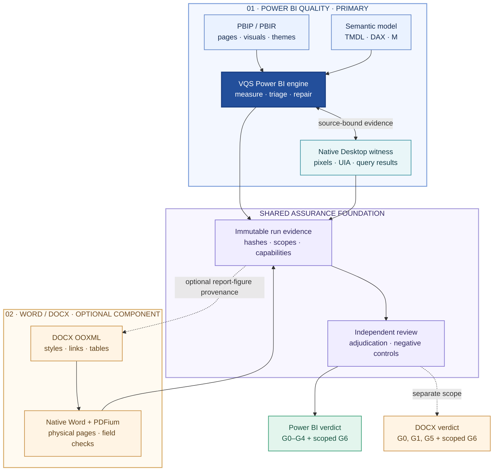
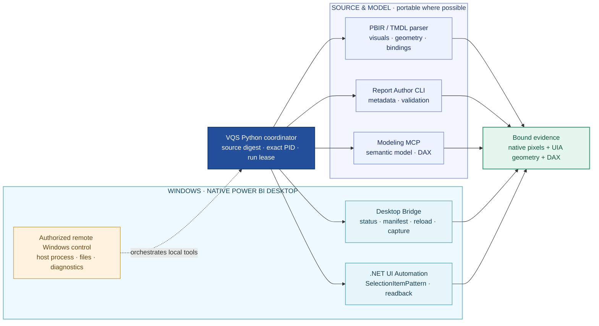
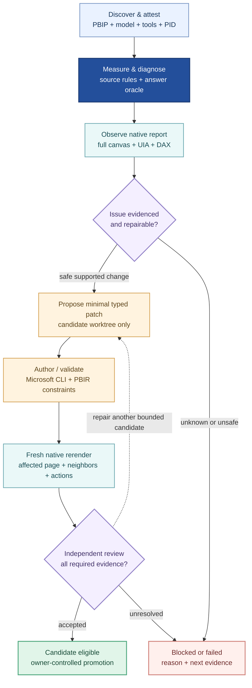

# Visual Quality System — Power BI-first architecture

**Architecture revision:** 2026-10-21 · current merged Power BI core

**Primary product:** VQS for Power BI reports and semantic models

**Optional component:** VQS Word/DOCX assurance, separately gated and not released
**Implementation status:** pre-alpha engineering integration on `main`; **not** a G6-approved release

VQS is an independent **quality and safe-repair engine**, not a competing report
authoring tool. Its primary object is an actual Power BI report, the semantic
model behind it, what a viewer sees on each populated page, and how that view
responds to real interactions. It may consume a Word deliverable later, but
**a broken DOCX cannot block a Power BI-only release**; conversely, a successful
Power BI review never constitutes Word acceptance.

This page distinguishes the **merged Power BI engineering core** (including the premium preflight and mixed-canvas capture), **unmerged optional Word candidates**, and **future tools**. The Power BI-first scope
was merged in [PR #63](https://github.com/analienx/visual-quality-system/pull/63);
the source-bound P13/P14/P15/P16/P18 native Power BI integration was merged
in [PR #64](https://github.com/analienx/visual-quality-system/pull/64)
(base `main` `f24660c`). Earlier draft PRs are historical work branches,
**not evidence that their integrated Power BI functionality is absent from main**.
The compact [premium preflight (#65)](https://github.com/analienx/visual-quality-system/issues/65) **is merged into `main` in [PR #69](https://github.com/analienx/visual-quality-system/pull/69)**, and [PR #70](https://github.com/analienx/visual-quality-system/pull/70) adds mixed-size report/Tooltip page support, and [PR #71](https://github.com/analienx/visual-quality-system/pull/71) verifies doubled-DPI report-only crops. None implies independent visual approval. The older
[execution blueprint](EXECUTION_ARCHITECTURE.md) remains historical design,
not a claim of a finished release.
Follow the [acceptance matrix](ACCEPTANCE_MATRIX.md) for the actual gates.

## 1. Product boundaries

**Reality vs design:** `vqs/powerbi/`, `vqs/visual/`, `vqs/repair/`,
`vqs/capture.py`, `vqs/review/`, basic `vqs/document/`, and evidence/
acceptance code exist on main. **P16 Windows UIA and P18 composition
repair were integrated by PR #64.** The native Word/TOC/PDFium work in
older P19–P23 Word draft branches is **not** part of that integration.
The Word component is **logically isolated by capabilities and release
scope** but remains in the same Python distribution. Its optional
`word-pages` PDFium/Pillow extra is in an unmerged document branch,
**not current main**.

## 2. How VQS actually interacts with Power BI Desktop

There is **no single universal Power BI Desktop automation API** for
report/model authoring, screenshots, control interactions and desktop process
management. VQS composes distinct capabilities:

### Capability and responsibility matrix

| Tool / layer | Real supported responsibility | Cannot establish by itself | Current VQS status |
| --- | --- | --- | --- |
| **PBIR/TMDL parser** (`vqs/powerbi/measure.py`, etc.) | Source layout, visual IDs, field bindings, formatting, DAX/M cycles | Populated visual or correct native pixels | Implemented |
| **Microsoft Power BI Report Author CLI** | Report metadata/structural validation, supported authoring workflow | Live slicer click or semantic-model edits | Pinned integration and validation guards implemented; verify installed version |
| **Microsoft Power BI Modeling MCP** | Authorized local semantic model and live DAX queries | Report page layout/visual edits | Integration/probes exist; live Contoso DAX witness used |
| **Desktop Bridge API/CLI** | Actual Desktop instance status, open file/unsaved state, manifest, PBIR reload and page screenshots | Arbitrary visual click/selection/drillthrough | Implemented capture/identity checks; exact PID and current source required |
| **Native Windows UI Automation (UIA)** | Real accessibility rectangles, supported selection patterns, KPI labels/values, slicer action/readback | Generalized country-level Shape Map target when the provider exposes only “Plot area”; true glyph-ink clipping | **Integrated in PR #64**; 9/9 Contoso Year/Region engineering actions; independent G4 release still blocked |
| **Remote Desktop Commander** | Remote execution, file/process inspection, controlled Windows tool orchestration on an authorized host | Desktop Bridge data/model API, independent VQS proof, bypass of locked interactive GUI | Operator/infrastructure tool, **not** a runtime dependency inside VQS |
| **Microsoft WinApp CLI** | Potential future Windows UIA querying/clicking/waits/screenshot wrapper | Guaranteed Power BI country map child exposure or locked-session pointer access | **Not integrated** and not found on Windows host at 2026-10-20 probe |
| **Independent visual reviewer** | Perceptual composition, text ink/clipping, hierarchy, suspicious whitespace and blank visuals | DAX truth, source identity, safe mutation on its own | Partial evidence/review tooling; G2 independent acceptance blocked |

The **Desktop Bridge is a local named-pipe JSON-RPC service per Desktop PID**,
not a remote cloud API. Microsoft documents its methods as
`bridge.manifest`, `application.state.get/v1`,
`report.snapshot.capture/v1`, and `file.reload/v1`. It serializes
operations per Desktop instance. The separate Report Author CLI validates
source/report metadata; the Modeling MCP works on semantic models, not
PBIR page layout. VQS must verify the actual installed manifest and tool
versions rather than assume all preview methods exist.

The **merged** P16 native UIA witness calls
`scripts/windows/contoso_native_uia.ps1` from
`vqs/powerbi/desktop_uia.py` and verifies `SelectionItemPattern`
actions and observed DAX-matched values. It can handle supported controls
even with the workstation locked **when UIA providers permit**. This is not
authorization to simulate unsupported map clicks on the lock screen.
See the [integrated Power BI core PR #64](https://github.com/analienx/visual-quality-system/pull/64)
and the [native engineering evidence](POWER_BI_CORE_NATIVE_EVIDENCE_2026-10-20.md).

## 3. End-to-end quality and repair loop

A reviewer looking at pixels should use separate **composition**, **text and
padding**, **content and values**, **interaction**, and **cross-page consistency**
passes. Source geometry detects deterministic collisions, native UIA checks
real control bounds, PDF/PNG pixels show glyph ink and blank regions, and
semantic DAX gives numerical truth. A general multimodal review is additive,
never a substitute for attested source/data.

For Contoso, P18 reduced four KPI card heights **140 → 108** on a 720-unit
canvas, removed repeated reporting-year wording and aligned tiles with
lower panels; P16 showed **9/9 Year/Region** native actions. Remaining gaps:
independent G2 screenshot review, **generalized and independently
verified** Shape Map country selection, and independent loaded-file
identity acceptance. The built-in **Shape Map** replaced account-dependent/
blank Azure Maps attempts. It does not require an Azure Maps trial.
A one-off U.S. country select/clear was observed with foreground-PID,
model, DAX and screenshot parity, but does **not** establish a reusable
country locator or independent G4 approval.

## 4. Separate acceptance scopes — product policy and implemented contract

`vqs/components.py` defines three explicit release scopes. They apply to
the **release adjudicator** `vqs.acceptance.run_acceptance`, not to the
ordinary `vqs triage` CLI and **not** to repair-promotion authorization.

| Release scope | Minimum independent subjects | Mandatory subject gates | Separate suite gate |
| --- | --- | --- | --- |
| **`powerbi-core`** — preferred | Two unrelated PBIPs, distinct layouts; **no DOCX** | **G0/G1/G2/G3/G4** for every PBIP | **G6** and Power BI negative controls |
| **`word-docx`** — optional | One real DOCX; **no PBIP subject** | **G0/G1/G5** for every DOCX | **G6** and Word negative controls |
| `combined` — compatibility | Two unrelated PBIPs **plus** DOCX | All applicable **G0–G5** | **G6** and union of controls |

Callers set `record["release_scope"]` to one of these exact values. Omitting
the field continues the old **combined** contract, so existing acceptance
records are not weakened. Any unknown scope **blocks**, mixed artifact kinds
in a single-component scope **fail**, and the new component-specific suite
digests bind scope name to prevent cross-component evidence replay. The
`combined` digest is intentionally legacy-compatible. Every scope still
requires sealed producer evidence, negative controls, independently
authenticated G6 review, and separately authorized promotion.

**Security truth:** the current independent G6 publisher and owner authority
registries are empty, and static `vqs.check/1` produces **G0 only**.
Consequently adding release scopes does **not** manufacture a passing release
or waive missing visual/native evidence. G2/G4 remain blocked for the
Power BI core. Word G5 remains blocked without genuine current figures,
prose review and stable physical pagination.

The Word component can consume a **typed exported report evidence bundle**
to compare document figures, but must not import the Desktop worker, open
another Desktop PID implicitly, or add Word-only native costs to Power BI
triage. PBIPDocumenter remains a **downstream consumer**; its application
must not be silently rewritten while VQS contracts change.

## 5. Actual module ownership

| Location | Responsibility | Release component |
| --- | --- | --- |
| `vqs/powerbi/*`, `vqs/pbir.py` | PBIR/TMDL semantics, Desktop PID, report authoring; native UIA integrated through #64 | **Power BI core** |
| `vqs/visual/*`, `vqs/design_rules.py` | Source- and screenshot-grounded visual/design analysis | **Power BI core** |
| `vqs/repair/*` | Typed allowlisted disposable PBIR repair / verify | **Power BI core** |
| `vqs/coordinator.py`, `vqs/pipeline.py`, `vqs/evidence.py`, `vqs/run_store.py` | Orchestration, sealed evidence, traceability, roles | Shared foundation |
| `vqs/acceptance.py`, `vqs/components.py` | Independent per-component release scope, negative controls and G6 | Shared foundation |
| `vqs/document/*` (main), `scripts/word_p*.py` / `scripts/windows/native_word_*.ps1` (drafts) | OOXML; Word COM, TOC/fields and PDFium physical pages are unmerged | **Optional Word** |
| `vqs/review/*` | Independent evidence bundles and adjudication | Shared foundation |
| Future `adapters/web` / Fabric | TSX/CSS/Playwright and staged authenticated Fabric | Deferred, not Power BI core blocker |

Today most direct imports remain intra-`vqs`; physical packaging into an
independent Word distribution is **not done**. The explicit acceptance scopes
and optional dependency group are the first safe separation without a
destructive migration of existing Word code.

## 6. Where work can run

| Execution venue | Good candidates | Must not be represented as proven there |
| --- | --- | --- |
| GitHub-hosted CI | PBIR/TMDL parse, structural rules, typed repair contracts, source diffs, synthetic DAX/test fixtures, receipt tampering negatives, PDFium on non-private test PDF | Authenticated populated Desktop, real UIA Year/Region actions, Word COM native fidelity |
| Local Linux/macOS | Source triage, Python tests, review bundle check, optional image evaluation | True Windows Power BI Desktop controls |
| Authorized Windows host | Installed Desktop Bridge, Report Author CLI, Modeling MCP and live native UIA; Windows Word COM for optional DOCX | Independent acceptance merely because tests and tools executed |
| Remote Desktop Commander operator | Starts/monitors bounded Windows jobs, retrieves status and private receipts | A Windows accessibility library inside VQS, or an authority to bypass sign-in/locked UI |

The remote operator can administer a Windows session; the named-pipe Bridge
remains **local to Power BI Desktop**. Do not expose the Bridge port or
secrets to cloud CI. Persistent self-hosted Actions on a credentialed
personal workstation should not execute untrusted public PR code.

## 7. Honest release status (2026-10-21)

**Power BI primary:** source-aware P18 reflow and P16 native Year/Region
functions are **merged into `main` via PR #64**. The Contoso engineering
witness includes nine Year/Region actions and a separately guarded one-off
U.S. Shape Map selection/clear with executed DAX parity. **G2 independent
visual sign-off, reusable/independently approved G4 interaction parity,
a second unrelated PBIP, and trusted G6 authority remain blocked.**
The bounded `vqs premium` source-hashed design preflight is **merged** ([PR #69](https://github.com/analienx/visual-quality-system/pull/69)); mixed-size page source-bound capture also **merged** ([PR #70](https://github.com/analienx/visual-quality-system/pull/70)). Both projects have real Desktop-rendered captures and verified sealed private bundles, but independent visual review and viewport calibration are still blocked. [Current two-PBIP evidence and gating](RELEASE_NOTES_2026-10-21.md).
No claim of a complete VQS release is made.

**Word optional:** P21 detected 26 broken bookmark links, P22 native
candidate repaired 26→0 without changing 45 headings or 1,561 table-cell
strings, but 11 text hunks and physical 31/32-page instability remain.
P23 code is committed locally (`044458e`) but not fully native verified;
G5 and component G6 are blocked. The Windows broad test suite last
returned 1,647 passed, 10 skipped, **2 failures** (symlink privilege and
installed MCP parity).

Older stacked draft PRs #55–#62 may remain open even though the selected
Power BI functionality was integrated separately in #64; the Word candidates
remain independent and unmerged. No tagged release exists. Verify live
GitHub status before planning another run.

## 8. Primary references

- [Microsoft Power BI Desktop Bridge API and CLI](https://learn.microsoft.com/en-us/power-bi/developer/agentic/power-bi-desktop-bridge-overview) — named pipe, methods and supported screenshots.
- [Microsoft Power BI Modeling MCP](https://github.com/microsoft/powerbi-modeling-mcp) — semantic model operations, no report page/layout editing.
- [Microsoft UI Automation SelectionItemPattern](https://learn.microsoft.com/en-us/dotnet/api/system.windows.automation.selectionitempattern) — supported native selection patterns.
- [Microsoft WinApp CLI UI automation](https://github.com/microsoft/WinAppCli/blob/main/docs/ui-automation.md) — prospective adapter only, not currently installed.
- [Power BI built-in Shape Map](https://learn.microsoft.com/en-us/power-bi/visuals/power-bi-shape-map) — accepted no-Azure-Maps-account design.
- [Merged Power BI native integration — PR #64](https://github.com/analienx/visual-quality-system/pull/64) · [Power BI evidence](POWER_BI_CORE_NATIVE_EVIDENCE_2026-10-20.md) · [merged premium preflight PR #69](https://github.com/analienx/visual-quality-system/pull/69) · [Word draft PR #62](https://github.com/analienx/visual-quality-system/pull/62) · [current engineering release notes](RELEASE_NOTES_2026-10-21.md)
- [Execution blueprint](EXECUTION_ARCHITECTURE.md) · [acceptance matrix](ACCEPTANCE_MATRIX.md) · [integration strategy](INTEGRATION_STRATEGY.md)
