# Native Power BI Desktop theme gallery

**Three selected palettes, six modes, 18 genuine Power BI Desktop report screenshots.**
Each Light/Dark mode comes from its own GitHub-generated candidate of the
same synthetic Contoso PBIP source. Each was refreshed in an isolated native
Power BI Desktop instance and captured across all five report pages.
Original full-window PNGs remain private; public WebP previews are cropped
to the report canvas and downscaled, without removing any report visuals.
No invented dashboards, synthetic diagram screenshots, or image AI.

Theme-engine capture code: [`91344a5c5f`](https://github.com/analienx/visual-quality-system/commit/91344a5c5ff1d2db68e5857dc3055a31d805b81a).
[SHA-256 provenance](images/adaptive-showcase/PROVENANCE.json) ·
[See all colorway swatches](APPROVED_THEME_LIBRARY.md) ·
[Source Contoso PBIP](../examples/contoso-retail/Contoso%20Retail.pbip)

## Sunny Palette

### Executive overview

| Light | Dark |
| :--- | :--- |
|  |  |

### Products & brands

| Light | Dark |
| :--- | :--- |
| [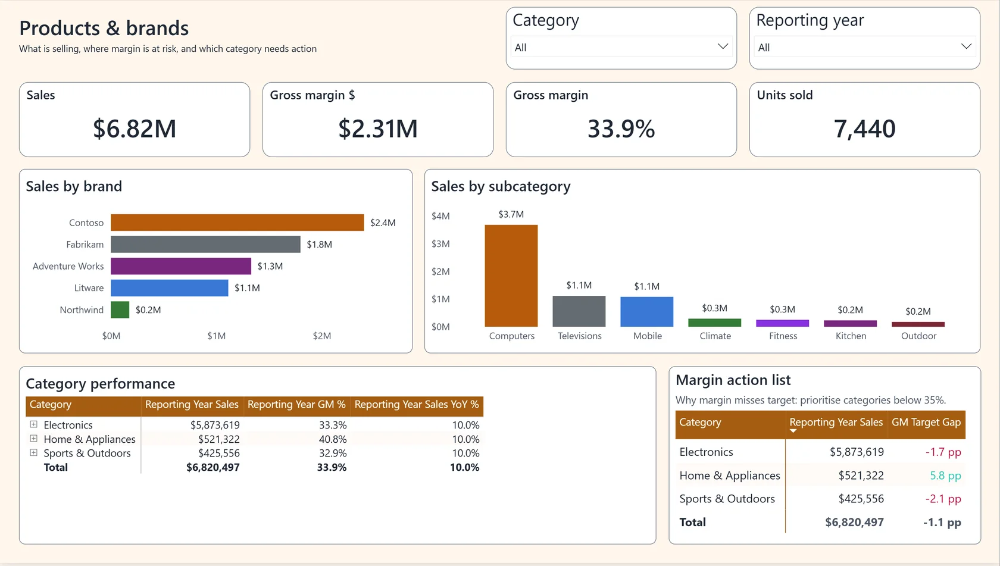](images/adaptive-showcase/sunny-palette-light/products-and-brands.webp) | [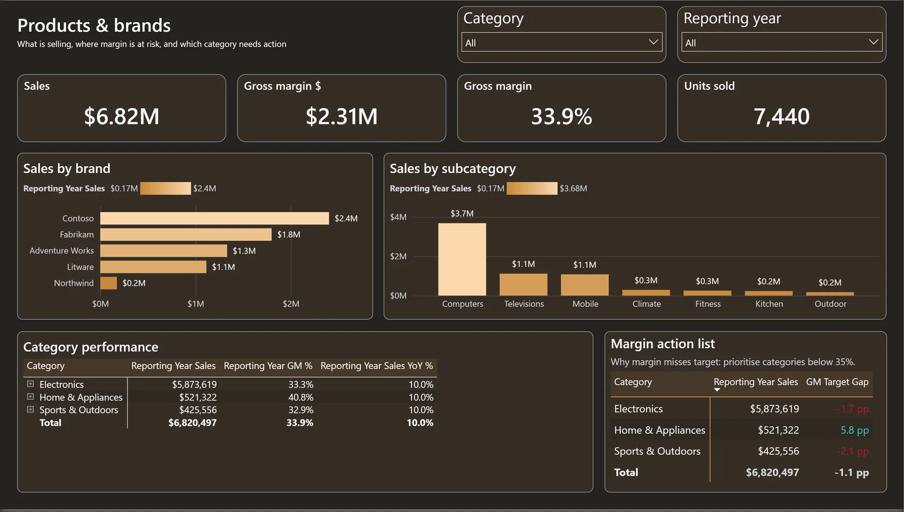](images/adaptive-showcase/sunny-palette-dark/products-and-brands.webp) |

### Deep-dive insights

| Light | Dark |
| :--- | :--- |
| [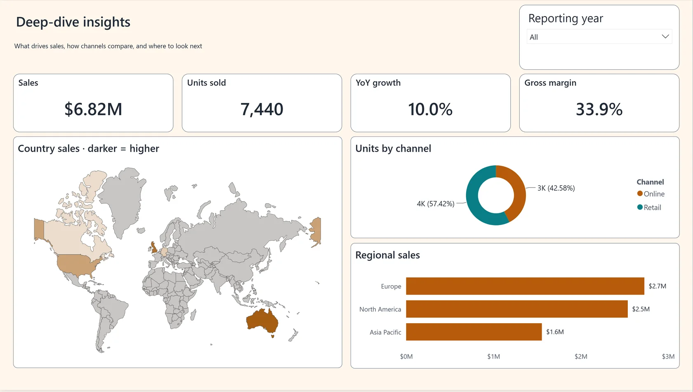](images/adaptive-showcase/sunny-palette-light/deep-dive-insights.webp) | [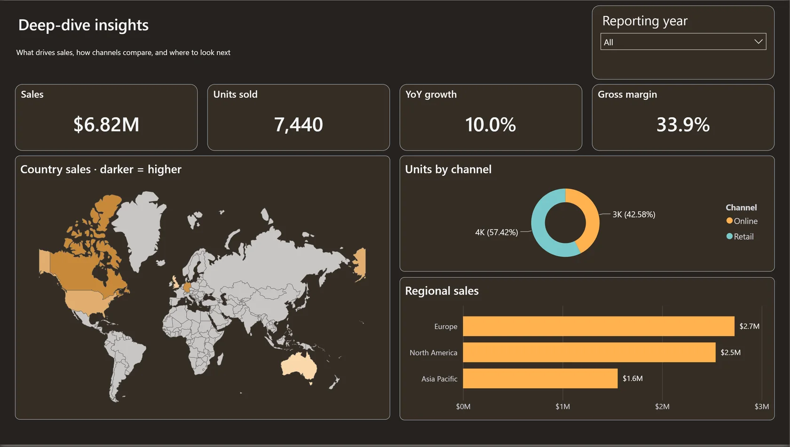](images/adaptive-showcase/sunny-palette-dark/deep-dive-insights.webp) |

## Organic Palette

### Executive overview

| Light | Dark |
| :--- | :--- |
|  |  |

### Products & brands

| Light | Dark |
| :--- | :--- |
| [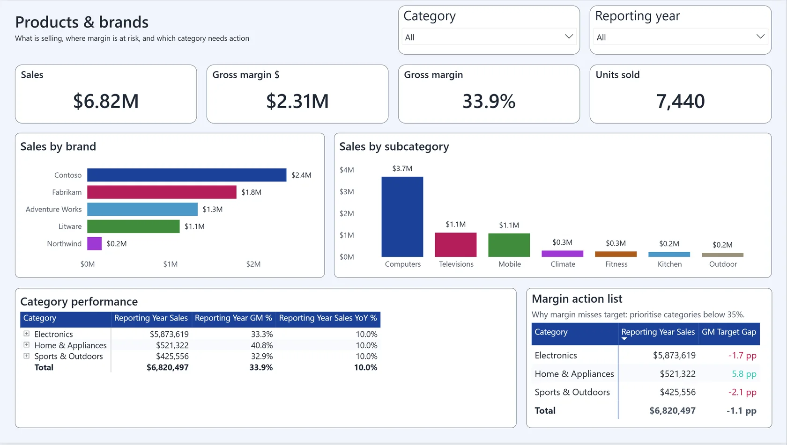](images/adaptive-showcase/organic-palette-light/products-and-brands.webp) | [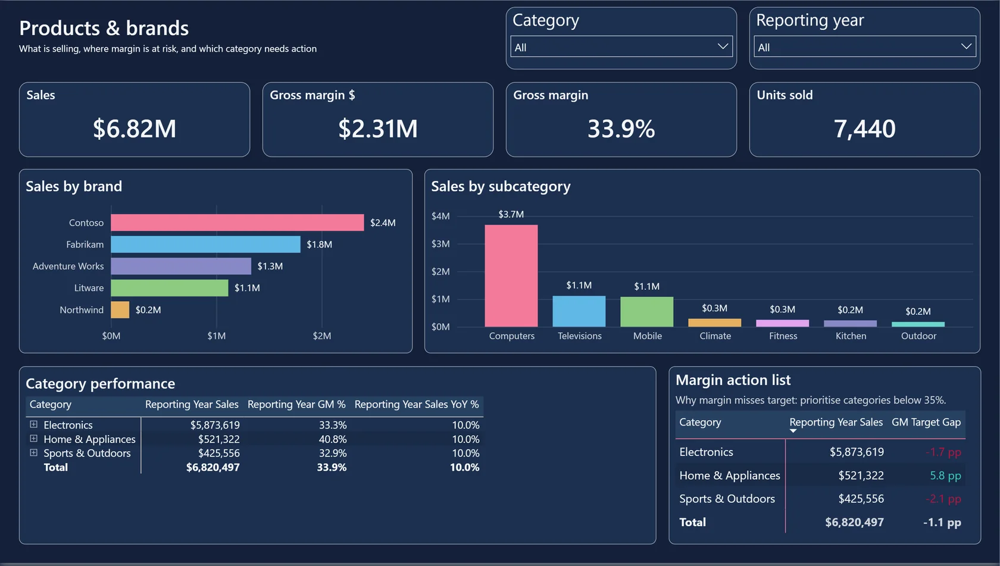](images/adaptive-showcase/organic-palette-dark/products-and-brands.webp) |

### Deep-dive insights

| Light | Dark |
| :--- | :--- |
| [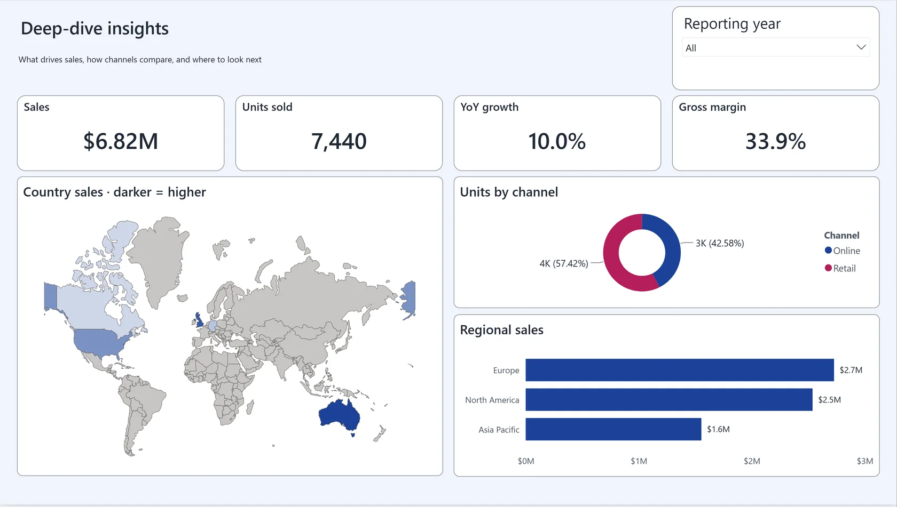](images/adaptive-showcase/organic-palette-light/deep-dive-insights.webp) | [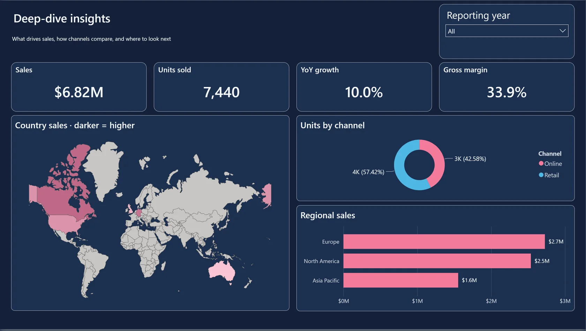](images/adaptive-showcase/organic-palette-dark/deep-dive-insights.webp) |

## Graphite Red

### Executive overview

| Light | Dark |
| :--- | :--- |
|  |  |

### Products & brands

| Light | Dark |
| :--- | :--- |
| [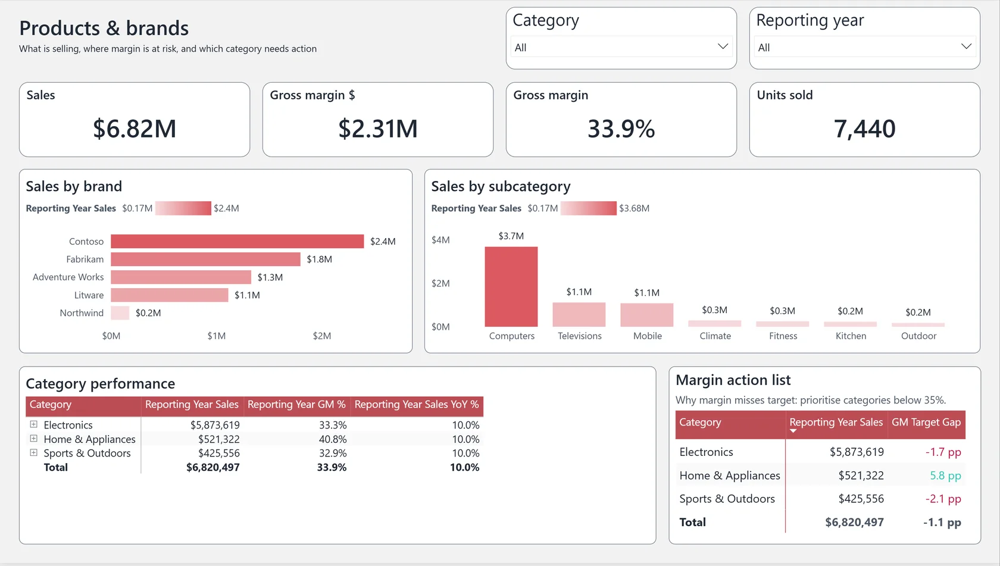](images/adaptive-showcase/graphite-red-light/products-and-brands.webp) | [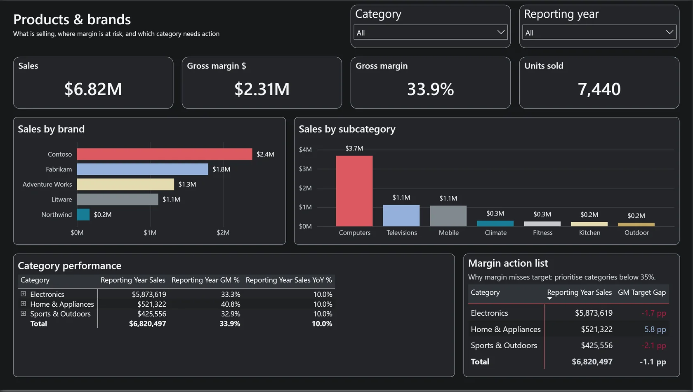](images/adaptive-showcase/graphite-red-dark/products-and-brands.webp) |

### Deep-dive insights

| Light | Dark |
| :--- | :--- |
| [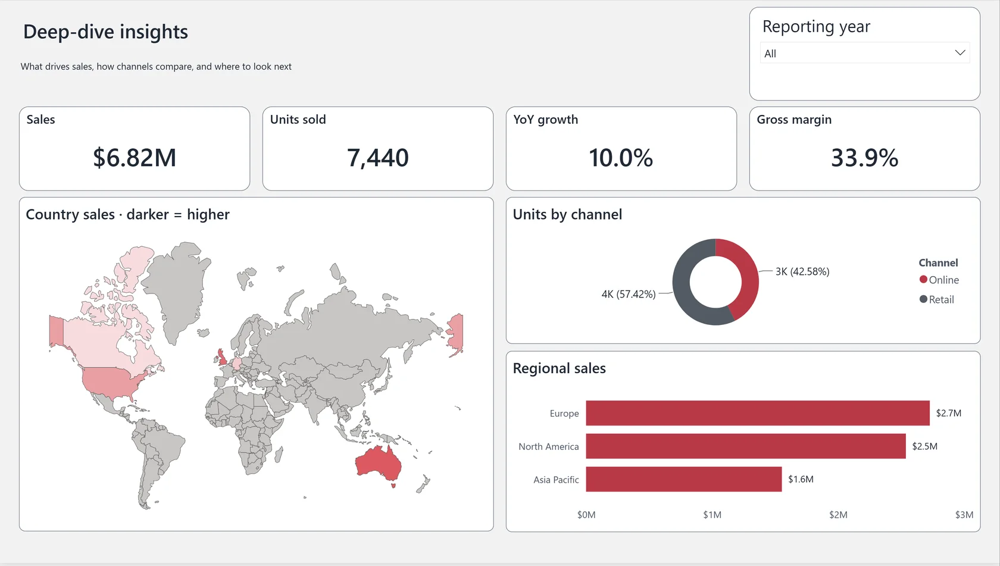](images/adaptive-showcase/graphite-red-light/deep-dive-insights.webp) | [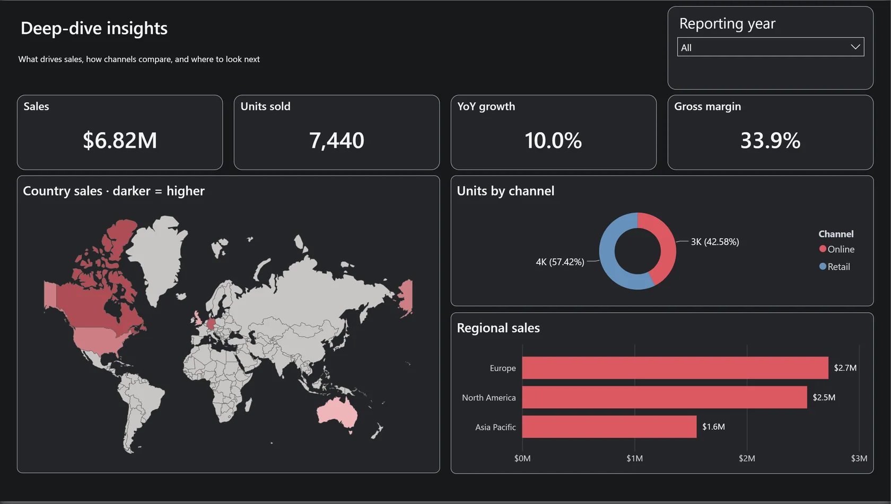](images/adaptive-showcase/graphite-red-dark/deep-dive-insights.webp) |

## Evidence boundaries

Microsoft report authoring/schema validation applies to all 28 modes.
Native screenshot evidence here applies **only** to these three selected
families and the depicted default-page states. Filter dropdown flyouts,
country-shape selection, other palettes' live rendering, and separate
independent G2/G6 acceptance are not certified by these images.
The historical five-colorway [Desktop gallery](THEME_GALLERY.md) remains available.
