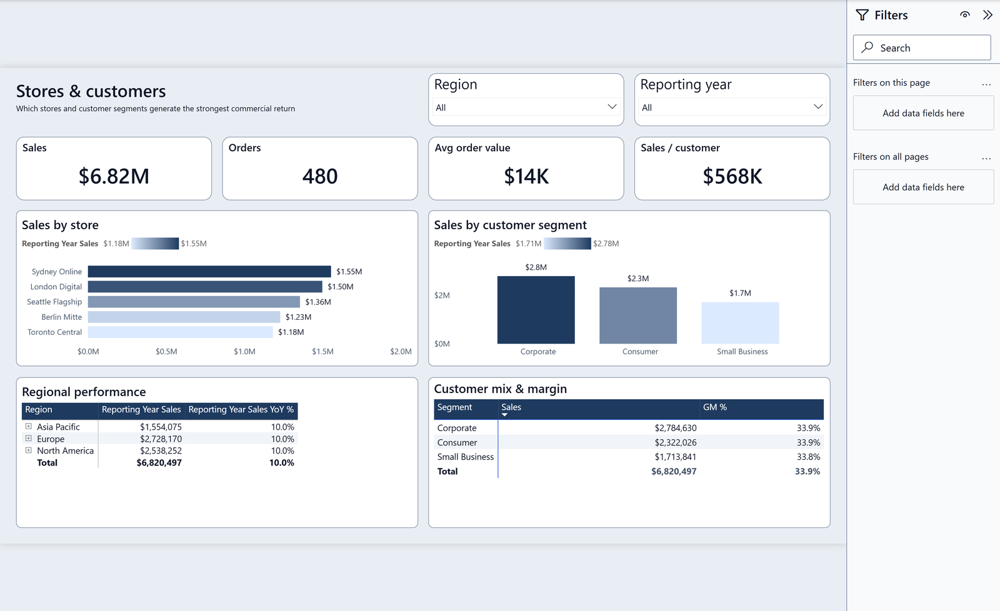
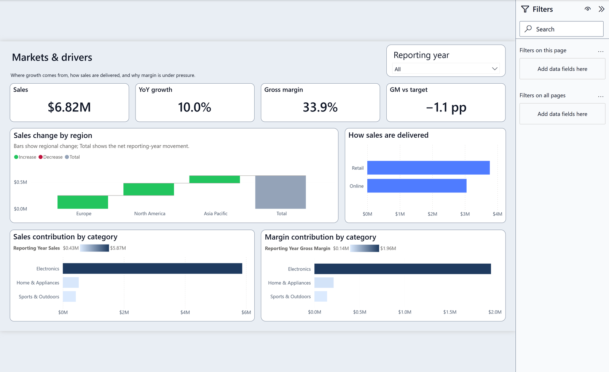
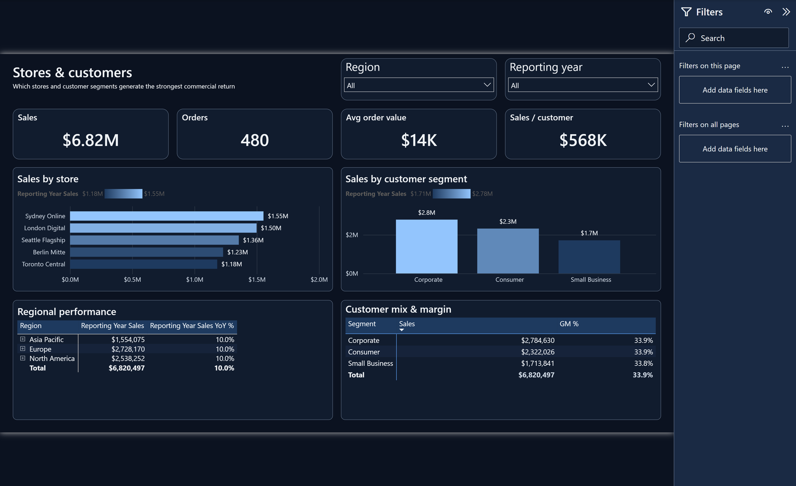
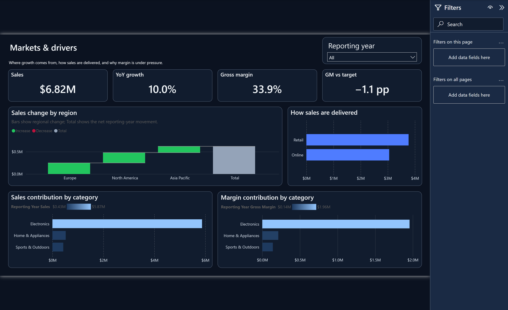
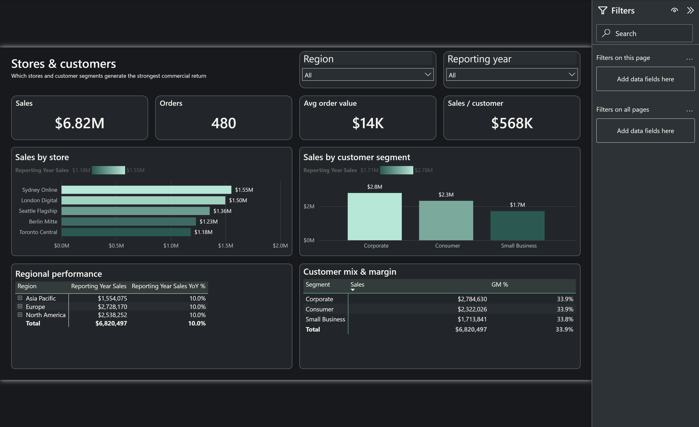
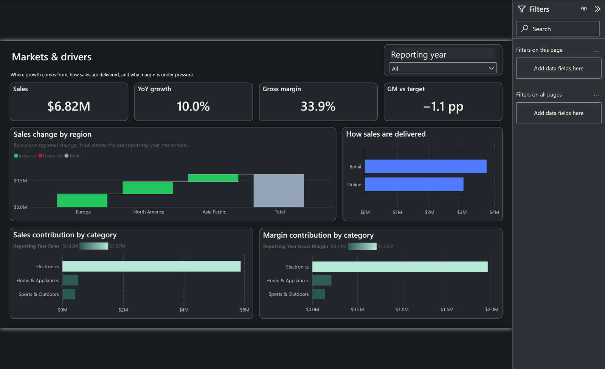
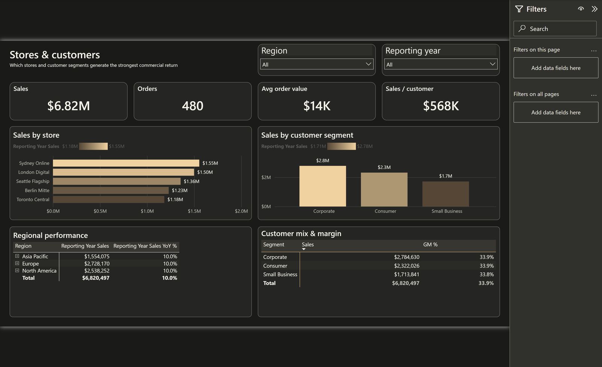
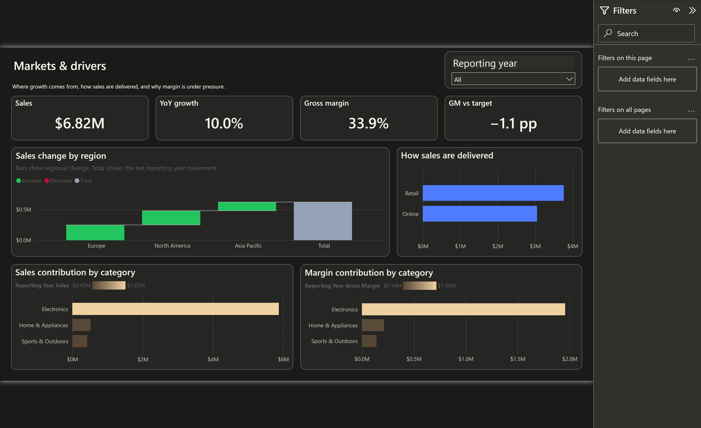
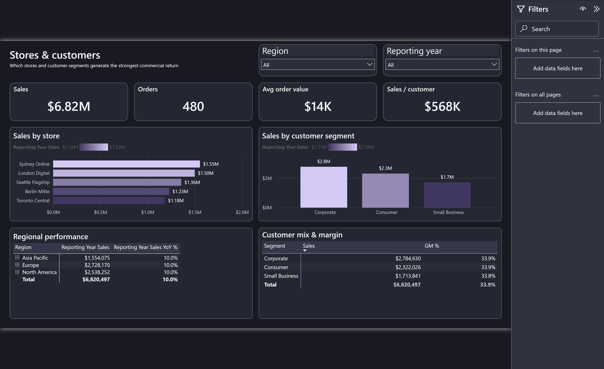
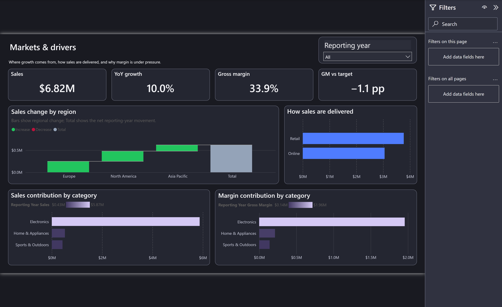

# Power BI Theme Gallery — five colorways

**25 real Contoso report-page screenshot previews, five selectable themes.**
Every image derives from an actual Power BI Desktop capture of the same
five-page synthetic Contoso Retail PBIP with locally generated fictional data.
No UI mockups, customer data or AI-generated dashboards are used. The 1600px
public previews are resized from original 3915px Desktop captures retained
outside Git; both public and original SHA-256 hashes are in manifests.

## Compare the same report across five themes

| **Executive Blue Light** | **Executive Blue Dark** |
| :--- | :--- |
| [](images/themes/light/executive-overview.png) | [](images/themes/blue-dark/executive-overview.png) |

| **Graphite Mint** | **Warm Basalt** |
| :--- | :--- |
| [](images/themes/graphite-mint/executive-overview.png) | [](images/themes/warm-basalt/executive-overview.png) |

**Slate Lavender**

[](images/themes/slate-lavender/executive-overview.png)

## All five report pages per theme

Each theme is represented by its actual Executive, Product, Store, Market and Deep-dive pages. Click a preview for the full public-resolution native capture.

### Executive Blue · Light

| **Executive overview** | **Products & brands** |
| :--- | :--- |
| [](images/themes/light/executive-overview.png) | [](images/themes/light/products-and-brands.png) |

| **Stores & customers** | **Markets & drivers** |
| :--- | :--- |
| [](images/themes/light/stores-and-customers.png) | [](images/themes/light/markets-and-drivers.png) |

**Deep-dive insights**

[](images/themes/light/deep-dive-insights.png)

### Executive Blue · Dark

| **Executive overview** | **Products & brands** |
| :--- | :--- |
| [](images/themes/blue-dark/executive-overview.png) | [](images/themes/blue-dark/products-and-brands.png) |

| **Stores & customers** | **Markets & drivers** |
| :--- | :--- |
| [](images/themes/blue-dark/stores-and-customers.png) | [](images/themes/blue-dark/markets-and-drivers.png) |

**Deep-dive insights**

[](images/themes/blue-dark/deep-dive-insights.png)

### Graphite Mint

| **Executive overview** | **Products & brands** |
| :--- | :--- |
| [](images/themes/graphite-mint/executive-overview.png) | [](images/themes/graphite-mint/products-and-brands.png) |

| **Stores & customers** | **Markets & drivers** |
| :--- | :--- |
| [](images/themes/graphite-mint/stores-and-customers.png) | [](images/themes/graphite-mint/markets-and-drivers.png) |

**Deep-dive insights**

[](images/themes/graphite-mint/deep-dive-insights.png)

### Warm Basalt

| **Executive overview** | **Products & brands** |
| :--- | :--- |
| [](images/themes/warm-basalt/executive-overview.png) | [](images/themes/warm-basalt/products-and-brands.png) |

| **Stores & customers** | **Markets & drivers** |
| :--- | :--- |
| [](images/themes/warm-basalt/stores-and-customers.png) | [](images/themes/warm-basalt/markets-and-drivers.png) |

**Deep-dive insights**

[](images/themes/warm-basalt/deep-dive-insights.png)

### Slate Lavender

| **Executive overview** | **Products & brands** |
| :--- | :--- |
| [](images/themes/slate-lavender/executive-overview.png) | [](images/themes/slate-lavender/products-and-brands.png) |

| **Stores & customers** | **Markets & drivers** |
| :--- | :--- |
| [](images/themes/slate-lavender/stores-and-customers.png) | [](images/themes/slate-lavender/markets-and-drivers.png) |

**Deep-dive insights**

[](images/themes/slate-lavender/deep-dive-insights.png)

## Select a palette

| Mode | CLI preset | Design |
| :--- | :--- | :--- |
| light | `executive-blue` | Bright corporate |
| dark | `executive-blue` | Deep navy |
| dark | `graphite-mint` | Graphite / jade |
| dark | `warm-basalt` | Charcoal / gold |
| dark | `slate-lavender` | Slate / violet |

```console
vqs theme presets
vqs theme preview REPORT --mode dark --palette-preset graphite-mint --out theme-plan.json
vqs theme apply REPORT --mode dark --palette-preset graphite-mint --candidate-root ./candidate-graphite
vqs theme audit ./candidate-graphite
```

Custom palette JSON is also supported using `--palette`.

## Chart colors: categorical series, gradients and semantic overrides

The applied palette defines at least eight data-series colors for line,
bar, column, donut and other supported charts. Existing explicitly
formatted chart line/marker colors map to deterministic series positions
or registered source-theme palette indices. Numeric measure-driven
bar/column and shape-map ramps recolor their **min/max stops** from the
selected preset's semantic gradient tokens while retaining the original
measure, numeric thresholds, selectors and conditional structure.
Waterfall increase/decrease/total and true business-rule conditional
colors are intentionally protected from automatic recoloring.

The public screenshot previews **were re-captured after the chart-color
implementation** on exact candidate revision 92e40b1, so bars, maps and
numeric gradients visibly follow their chosen semantic palette.

## Filter-pane, slicer and dropdown behavior

The image captures show the dark or light report canvas, closed in-report
slicers, and the native filter pane. The engine styles page-level
outspacePane and filterCard, including Available/Applied card roles, and
supported slicer header/items/searchBox colors without modifying
filter definitions, selectors or the semantic model.

**The expanded slicer dropdown, selected-card popovers, filter flyouts,
and user interaction states have not received independent screenshot
review.** A screenshot with a closed dropdown is not proof of its expanded
colors or behavior.

## Capture provenance and acceptance boundaries

These are genuine synthetic-demo presentation previews, not raw G2 runtime
evidence. Each page was captured via the official Power BI Desktop authoring
interface after Microsoft Modeling MCP Full processing. Every palette is
sourced from the identical five-page Contoso report and Git revision
[92e40b1](https://github.com/analienx/visual-quality-system/commit/92e40b1097bf124c64a257a4db63f1d653e03f58),
and passed [official Microsoft authoring validation](https://github.com/analienx/visual-quality-system/actions/runs/40038410291).

- [Executive Blue Light public-preview and source-capture hash manifest](images/themes/light/manifest.json)
- [Executive Blue Dark public-preview and source-capture hash manifest](images/themes/blue-dark/manifest.json)
- [Graphite Mint public-preview and source-capture hash manifest](images/themes/graphite-mint/manifest.json)
- [Warm Basalt public-preview and source-capture hash manifest](images/themes/warm-basalt/manifest.json)
- [Slate Lavender public-preview and source-capture hash manifest](images/themes/slate-lavender/manifest.json)

Structural validity and beautiful captures do not replace G2 independent
visual acceptance and G6 owner release approval. The PR remains a draft
until those checks are signed off. These demo screenshots are safe for the
public project because all report values are generated fictional data.

See [Theme Engine](THEME_ENGINE.md) and
[Colorway Design Rationale](THEME_COLORWAYS.md).
