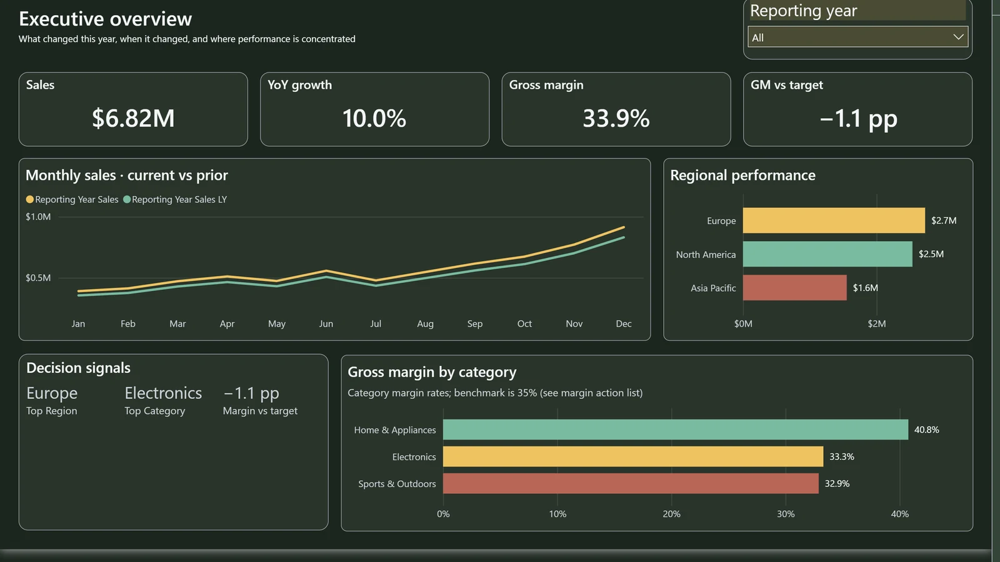
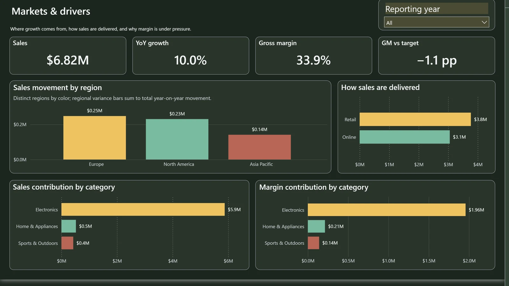
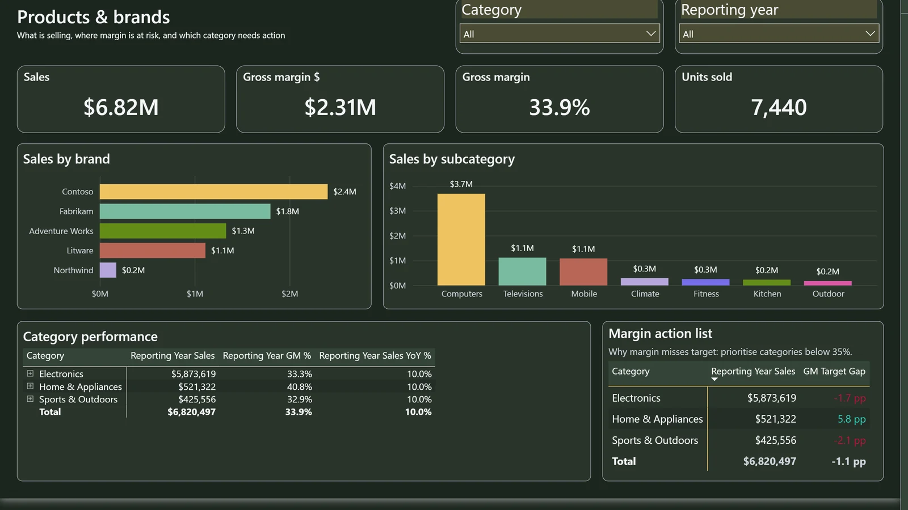
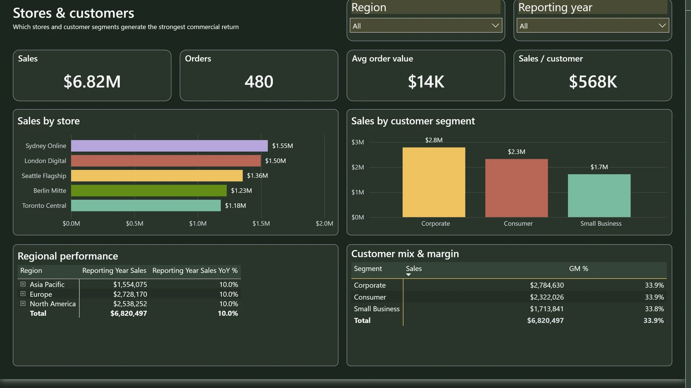
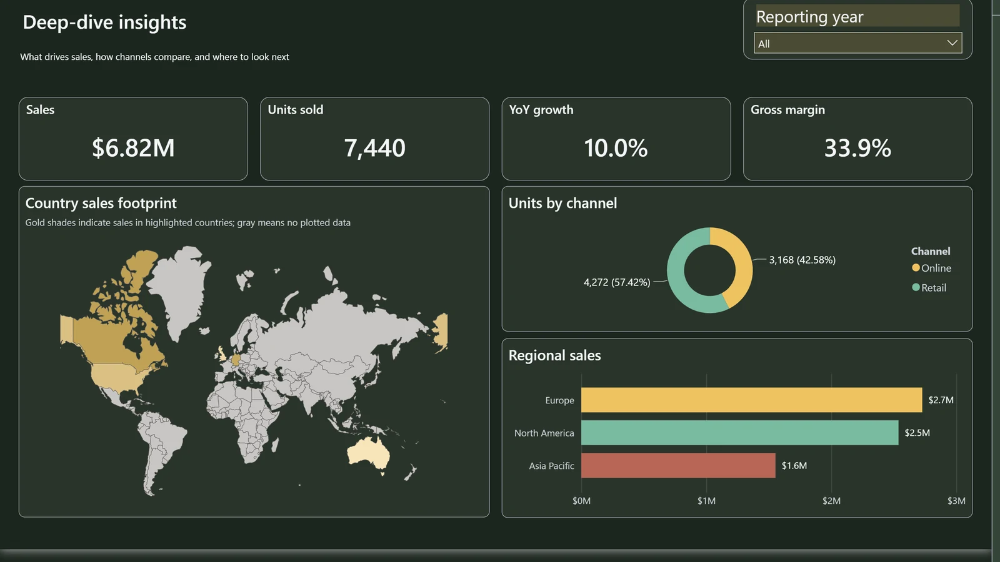

# Contoso Retail · verified native Power BI showcase

**A real five-page Power BI Desktop dashboard, backed by a complete, downloadable fictional PBIP.** Not an HTML rendering or a Power BI UI concept. Each image below is a report-only crop of a full native Desktop screenshot, linked to the real source and a file-level SHA-256 manifest.

[**Open the public PBIP**](../examples/contoso-retail-verified/Contoso%20Retail.pbip) ·
[Source and reproduction instructions](../examples/contoso-retail-verified/README.md) ·
[Full native screenshots](media/contoso-verified/native/) ·
[Immutable evidence manifest](media/contoso-verified/PROVENANCE.json)

## Executive overview

**Read the business story first.** Sales, YoY growth, gross margin, the margin-to-target gap, trend versus prior year, regional rankings and differentiated category margins all share an aligned visual hierarchy. The report says **Gross margin by category** and references the 35% benchmark in explanatory copy; it does **not** falsely claim a reference line that Power BI failed to render.

## Markets & drivers

The four categorical/region comparisons display useful data values without forcing the reader to infer magnitudes. Separate retail, regional and product identities have distinguishable colors. No same-color category ambiguity.

## Products & brands

Source-bound category and brand data, readable action lists and their **Total** rows. Displayed numbers come from the actual imported fictional model, not values drawn into a picture.

## Stores & customers

Store and customer segmentation with visible matrix category/Total rows, balanced whitespace and consistent typography; the source queries remain tied to the same synthetic model.

## Deep-dive insights

The native Shape Map is **populated without Azure Maps sign-in**. The legend copy accurately explains **shades of gold for sales-covered countries** and gray where no data was plotted, without claiming a visible numeric scale. Channel labels show exact **3,168 and 4,272 units**, with readable percentages.

## How this was verified

| Claim | Genuine observed evidence | Boundary |
| --- | --- | --- |
| Source and image identity | Exact saved PBIP / Report and semantic model witness; all 5 native Desktop page PNGs hashed | Metadata-normalized public project is a separate hash, differing in exactly 2 schema declarations |
| BI calculations | Four-KPI separately executed Year + Europe DAX oracle | Not a guarantee for arbitrary measures or other tenants |
| User interaction | **8 actual Year/Region UIA actions + 1 read-only baseline**, matching four KPI DAX outputs | No native country-click or hidden Tooltip hover certification |
| Visual quality | Separate automated image reviewer: **no P1/P2 defects observed** on these exact 5 pages | Not an independent authorized human release reviewer |
| Microsoft authoring | 0 PBIR errors, 0 warnings on the public normalized PBIP | Structural validity isn't full production acceptance |
| Public source safety | Fictional 12-partition in-memory M data; no local Desktop settings or private Corporate Spend model; snapshot is synthetic | The synthetic cache is published intentionally for out-of-box demo |

The evidence bundle's **exact saved-native source ZIP** and the **metadata-normalized authoring project** are both in [the same public example](../examples/contoso-retail-verified/README.md). This avoids a very common provenance error: binding screenshots from an older report to a newer file and calling them verified.

**Separate exhibit:** The [14-family gallery](REAL_THEME_SHOWCASE.md) continues to show 56 real theme variation images, each with its **own historical candidate/source identity**. This finished reference report does **not** retroactively alter those captures.

The VQS engine performs deterministic PBIR/TMDL checks, bounded source-safe candidate auto-repairs and native validation when a Windows Desktop is available. Learn [how an AI agent actually uses the components](AGENT_AUTOFIX_ARCHITECTURE.md) or [start with the five-minute guide](AI_AGENT_QUICKSTART.md).

*Engineering-quality reference, not a signed production release. Formal distinct-authority G2/G4 review and owner G6 promotion remain explicit separate gates.*
