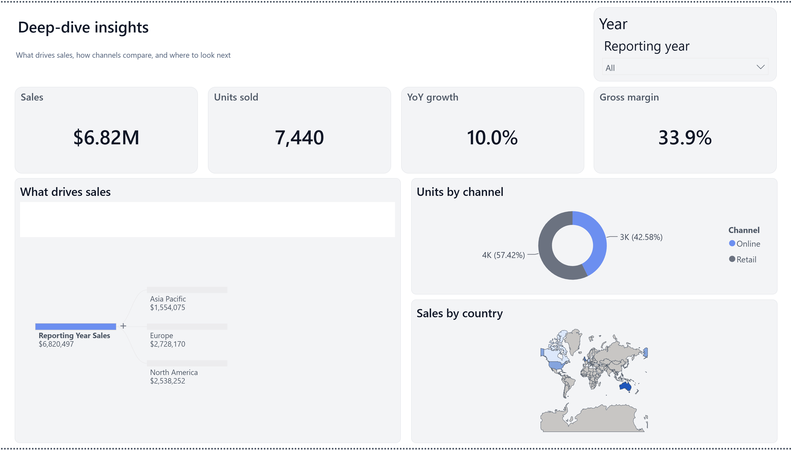
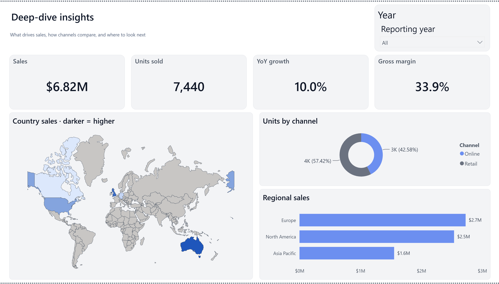

# P10 — Report-first Contoso Insights visual redesign

**2026-10-18 · Draft / independent release acceptance still required**

## Before and after — genuine Power BI Desktop screenshots

These are **cropped-only** from actual 3915×2394 run-owned Power BI Desktop
captures with populated local Contoso data. The crop is exactly
`[left=0, top=324, right=3070, bottom=2070]`, excluding Power BI's authoring
Filters sidebar and exterior whitespace. We did not retouch or generate pixels.

| Before — P9 Shape Map + decomposition tree | After — P10 redesigned page |
|:--:|:--:|
|  |  |

Receipts and image SHA-256: `docs/assets/p10-screenshot-provenance.json`.

## Why the design now works better

1. **The map gets the main stage.** The Shape Map sits at `x24 y284
   width624 height428` instead of an undersized `592×232` bottom-right
   panel. The 176-country, 110m-resolution TopoJSON drops Antarctica, which
   previously absorbed much of the map canvas. All five exact Contoso
   countries still match: United States, Canada, United Kingdom, Germany,
   Australia.
2. **Actual business meaning is readable.** Country shade corresponds to
   `Dim Store.Country` + `Fact Sales.Reporting Year Sales` and the title
   explains **darker = higher**. Geography lives on immutable public map
   commit `eb172bc4bbfaea2f072fdecc8c1fe74851390bf4`, not a local
   HTTP server, Microsoft account or API key.
3. **The page's giant unused decomposition tree is replaced with useful
   comparison.** A native `clusteredBarChart` at `x664 y480
   width592 height232` shows Europe **$2.7M**, North America **$2.5M**,
   and Asia Pacific **$1.6M**. Bars share a consistent accent color,
   actual values display at their ends, and the old unnecessary gradient
   legend is removed. KPI, year slicer, and channel donut remain untouched.
4. **No overlapping or clipped objects in the accepted screenshot.** The
   two tiles align with the original 24px page margin and 16px column gap.
   Entire dashboard canvas is visible on the capture. This is a substantial
   improvement over both the tiny P9 map and the earlier swapped layout.

## Explicit alternatives rejected by fresh screenshot review

- **Native Deneb certified 2.0**: certification registration and a valid
  Vega-Lite JSON were not sufficient. Multiple real Desktop captures
  rendered a fully blank map tile. Rejected.
- **Small decomposition tree**: simply swapping map/tree positions improved
  the map but caused *clipped* decomposition-tree labels. Rejected.
- **Naively adding Region → Product Category → Year to the regional bar
  axes**: although valid PBIR, Desktop flattened the hierarchy into
  repeated years, truncated labels and a scrollbar. Rejected. The polished
  chart intentionally uses **Region only**.
- **P9 tiny Shape Map**: technically functional, but too small to be an
  acceptable dashboard map. Superseded.

## Reproducible candidate and verification

- **Complete 86-file PBIP fixture with model cache**:
  `tests/fixtures/contoso-retail-polished-insights-p10.zip`
- **Full-source acceptance receipt**:
  `tests/fixtures/contoso-retail-polished-insights-p10.manifest.json`
- **Deterministic migration**:
  `python scripts/migrate_contoso_insights_page.py <P9_PBIP_PROJECT_DIR> <FRESH_P10_CANDIDATE_DIR>`
- **Exact visual templates**:
  `assets/pbir/p10-country-sales-shapemap.json` and
  `assets/pbir/p10-regional-sales-bar.json`
- **Actual report-and-model SHA-256**:
  `0aabd401d0fb2973263a77faa8349b552e7a74325b3154499c0aeef40d29bdc3`,
  identical for the newly generated 86-file candidate and independently
  captured real Desktop variant.
- Real Microsoft `powerbi-report-author` **0 structural errors / 0 warnings**;
  5 pages, 54 visuals, 84 unchanged files and 2 changed report JSONs;
  semantic model bytes preserved.
- Dedicated negative tests reject changed input mappings, altered tree,
  country keys, pre-existing outputs and unsupported source files.
- A second decomposition-tree visual remains on `Markets_drivers`, so
  the *report* retains this visual type. This page's original decomposition
  feature is intentionally replaced and is **not functionally identical**.

## Remaining known constraints

- **Shape Map is a Microsoft preview visual.** User has explicitly
  approved its use provided its real appearance is good. No organizational
  login or Azure subscription is needed, but the fixed public
  `raw.githubusercontent.com` geography URL requires internet access.
- Model-source equality and the twelve-row Modeling MCP readiness probe
  do **not** prove interactive slicer/filter/DAX answer parity, map tooltips,
  or cross-highlighting. Those remain explicit release QA gates.
- The year slicer and the original KPIs/donut have unchanged PBIR metadata;
  screenshot evidence shows the same default-view KPI values, not every
  selection state.
- Source project stays unchanged, **draft PR only**, no merge/promotion.

**Product lesson:** always reject tiny, blank, overflowing or
unreadable visual outcomes on actual full-page screenshots, even if every
schema and CI test is green. Code correctness is necessary, not sufficient.
