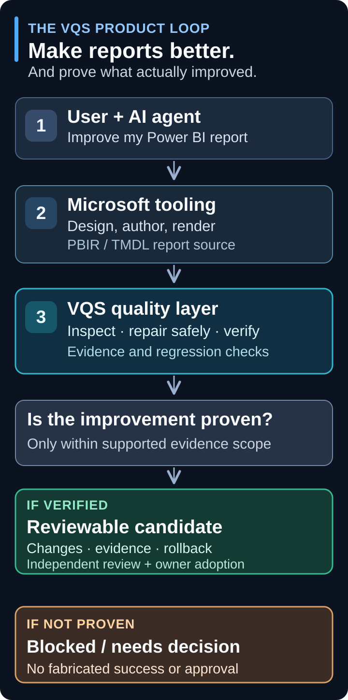

# Product roadmap

**Build with Microsoft tooling. Verify with VQS.**

VQS is the evidence-driven quality and safe-repair layer for AI-authored Power BI reports—not a competing general-purpose report authoring agent. The goal is a *useful, demonstrably improved report*, not a longer list of findings.

[Start with an AI agent](../docs/AI_AGENT_QUICKSTART.md) · [Architecture and current implementation](../docs/AGENT_AUTOFIX_ARCHITECTURE.md) · [Latest published release](https://github.com/analienx/visual-quality-system/releases/latest) · [Acceptance gates](../docs/ACCEPTANCE_MATRIX.md)

> **Release scope, 7 November 2026.** v0.1.2 packages source-only owner decisions,
> candidate repairs, adoption commands and regression gates. Download availability
> is authoritative on the [GitHub release](https://github.com/analienx/visual-quality-system/releases/tag/v0.1.2).
> The reviewed v0.2 work remains a separate draft integration (#160), with data
> parity and native acceptance still unresolved.

## Product direction

_Designed for phone-width viewing. [Open the vector diagram](../docs/diagrams/vqs-product-loop-mobile.svg) or read the [accessible text explanation](../docs/AGENT_AUTOFIX_ARCHITECTURE.md). The SVG source remains editable in Git._

**Why this separation exists:** Microsoft tooling supplies supported report authoring and structural checks, while VQS detects defects, constrains changes to disposable candidates, measures regressions and records what is—and is not—proven. A source-verified candidate is **not** a report-level G2/G4/G6 signoff. Native captures, interactions and live data are available only when the relevant host, report and evidence gates are satisfied.

## Release path

| Milestone | Status | Outcome | Grounding |
| :--- | :--- | :--- | :--- |
| **v0.1.1 — Agent-first repairs** | **Published** · 30 Oct 2026 | Installable CLI/MCP, safe candidate repairs, theme workflow, six-platform installed-wheel proof | [Release notes](../docs/RELEASE_NOTES_v0.1.1.md) |
| **Post-v0.1.1 on `main`** | **Merged, unreleased** | Answerable owner decisions, `vqs gate` + SARIF, readable changes/adopt command, enhanced native provenance and bounded Region UIA | [Changelog](../CHANGELOG.md) · [PR #122](https://github.com/analienx/visual-quality-system/pull/122) · [#123](https://github.com/analienx/visual-quality-system/pull/123) · [#124](https://github.com/analienx/visual-quality-system/pull/124) |
| **v0.1.2 — Verifiable decisions and regression gates** | **Source-only distribution** · see release assets for availability | Package the merged functionality, fix what the delta review found, verify the installed wheel on Linux and Windows, reconcile the open engineering issues and preserve every native exclusion | [Release notes](../docs/RELEASE_NOTES_v0.1.2.md) · [Issue reconciliation](../docs/V012_ISSUE_RECONCILIATION.md) · [Acceptance evidence](../docs/V012_NATIVE_G_ACCEPTANCE.md) · [Gate #16](https://github.com/analienx/visual-quality-system/issues/16) |
| **v0.2.0 — Intelligent repair workflow** | **Proposed product milestone** | Guided agent decisions, rendered before/after quality evidence, data-aware validation and higher-value analytical design critique | [Product/design contract](../docs/PRODUCT_AND_DESIGN_CONTRACT.md) · [Contoso quality findings #118](https://github.com/analienx/visual-quality-system/issues/118) |

### v0.1.2 distribution and remaining evidence

**Primary objective:** turn the unreleased `main` improvements into one coherent, trustworthy experience. This is release integration and acceptance work, **not a rewrite**.

1. Verify installed-wheel `fix → decision template → answered fix → changes → explicit adoption` and `gate → SARIF` on supported Linux/Windows environments. Assert original preservation, backups, stale-answer rejection and fail-closed behavior.
2. Reconcile [native Save #115](https://github.com/analienx/visual-quality-system/issues/115), [source/capture provenance #116](https://github.com/analienx/visual-quality-system/issues/116) and [Region UIA #120](https://github.com/analienx/visual-quality-system/issues/120) against merged evidence. Close only when their stated acceptance criteria are actually met. **Done, as a reconciliation that closes nothing:** [docs/V012_ISSUE_RECONCILIATION.md](../docs/V012_ISSUE_RECONCILIATION.md) maps every stated criterion to the evidence that exists, separates publicly verifiable from private-host claims, and names the remaining public work (a two-subject approval manifest for #116, Save-layer adversarial tests for #115, a stale-model negative control for #120).
3. Preserve [native feature-scope #117](https://github.com/analienx/visual-quality-system/issues/117) and [independent report release gate #16](https://github.com/analienx/visual-quality-system/issues/16) until proven or explicitly scoped out by the authorized owner; a successful source-only distribution does not resolve them.
4. Align the README, five-minute quickstart, CLI guidance, changelog and release notes to the *published* feature set, with a separate clearly labeled account of unreleased `main` functionality.
5. Tag and distribute only after exact-commit CI, fresh-install end-to-end checks, integrity artifacts and independent release review. Do not pre-label `main` as v0.1.2.

**Exit gate:** a new user can install the published wheel, invoke the supported workflow, understand each edit and blocked decision, and independently reproduce its **supported-scope** claims.

### Next product milestone: v0.2.0 — prove better outcomes

| Priority | Capability to build | User-visible acceptance |
| :--- | :--- | :--- |
| P0 | **Guided fix/decision loop** | Agent asks only real owner-dependent questions, applies approved typed edits in a disposable candidate and summarizes changed/remaining issues without manual run-ID archaeology |
| P0 | **Rendered before/after regression review** | Exact-source, populated captures of affected pages and relevant interactive states where supported; independently checkable comparison, no undocumented visual regressions |
| P0 | **Data-aware quality gate** | Blank/unpopulated reports do not pass a data-readiness requirement; relevant DAX/filter claims are proven under the same model and source identity or marked blocked |
| P1 | **Analytical design critique** | Finds unsupported stories, weak comparison context, wasteful density and confusing labels using declared audience/intent; never fabricates findings or business causality |
| P1 | **Agent/CI adoption kit** | Reproducible installation, example MCP/CLI setup and a copyable PR quality gate with exact scope and exit-code semantics |
| P2 | **Reviewable evidence presentation** | A concise, human-readable report of before/after, corrected findings, unresolved gates and promotion options; full sealed evidence remains accessible |

**Demonstration bar:** evaluate on at least two genuinely unrelated PBIP projects, test meaningful negative controls (wrong source/PID, stale screenshots, missing data, uncommitted UIA action, unauthorized edit), and explicitly separate automated checks from independent human G2/G4 and owner G6 acceptance. For the published fictional Contoso report, use [issue #118](https://github.com/analienx/visual-quality-system/issues/118) as a real analytical/design improvement benchmark rather than adding decorative visuals.

### What we are deliberately not doing

No new theme-family expansion, hosted service, broad Fabric administration, unrestricted autonomous report authoring, or Word/DOCX certification as a dependency of these **Power BI** releases. Shape Map country clicking and actual contextual tooltip hover remain unsupported unless separately proven or excluded in the release contract.

## How progress is tracked

- **Published** means an actual GitHub Release tag and installable artifacts.
- **Merged** means code is on `main`, **not** necessarily available in the published wheel or independently report-certified.
- **Proposed** means no claimed implementation, date or promotion authorization.
- Use [open issues](https://github.com/analienx/visual-quality-system/issues) and the [acceptance matrix](../docs/ACCEPTANCE_MATRIX.md) for current unresolved evidence. The legacy [work-package status ledger](STATUS.md) is an **archived 3 October snapshot**, not today's delivery dashboard.
- Update this page when an actual PR is merged or a release is published. Keep the roadmap short; move implementation records, raw evidence and dated investigations to their existing documentation locations.

**Success metric:** verified *useful improvements per report*, not sheer findings, rules or test counts. Track adoption friction, false-positive rate, blocked-decision resolution, rendered regressions and evidence coverage before optimizing for more features.
