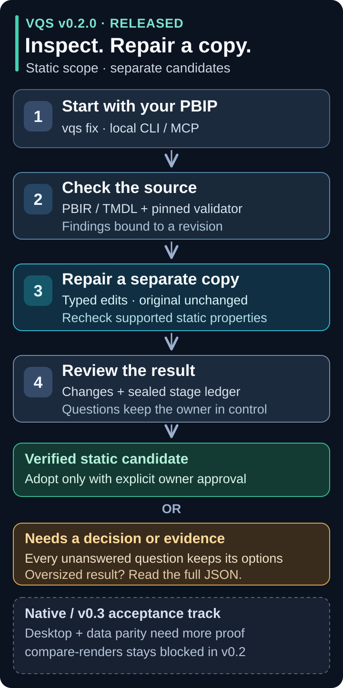

# Product roadmap

VQS helps people and their agents improve Power BI reports with source-grounded checks, bounded candidate repairs and reviewable evidence. Microsoft tools supply authoring and structural validation. [Start with an AI agent](../docs/AI_AGENT_QUICKSTART.md) · [Capabilities and limits](../docs/CAPABILITIES.md) · [Architecture](../docs/ARCHITECTURE.md)

## Release path

### v0.2.0 — current release

**Published 18 November 2026**, from tag `v0.2.0` at
[`af146ef`](https://github.com/analienx/visual-quality-system/commit/af146efce3a9d9fd6c9894f7f3e6f2c1cbe53d37).
Experimental rendered pixel observations (overall verdict always blocked),
a stage-ledger evidence report, a copyable agent/CI quality gate, and
capture-readiness and guided-adoption hardening are shipped.
[Download](https://github.com/analienx/visual-quality-system/releases/tag/v0.2.0)
· [SHA-256 checksums](https://github.com/analienx/visual-quality-system/releases/download/v0.2.0/SHA256SUMS)
· [Release notes and verification](../docs/RELEASE_NOTES_v0.2.0.md#published-source-and-verification).

The candidate and hardening PRs [#160](https://github.com/analienx/visual-quality-system/pull/160)
and [#167](https://github.com/analienx/visual-quality-system/pull/167) are merged;
integration issue [#159](https://github.com/analienx/visual-quality-system/issues/159)
is closed. Its owner-approved scope freeze keeps the work below separate
from the published version.

### v0.1.2 — previous release

**Published 7 November 2026.** Source-only Power BI review, owner decisions, explicit candidate adoption and static pull-request gates. [Release notes](../docs/RELEASE_NOTES_v0.1.2.md).

### v0.1.1 — earlier release

**Published 30 October 2026.** Local CLI/MCP and candidate repairs. [Release notes](../docs/RELEASE_NOTES_v0.1.1.md).

The source-only v0.2.0 release does not certify native Desktop rendering, live-data parity or a whole report. Those claims require separate evidence and acceptance; see the [acceptance matrix](../docs/ACCEPTANCE_MATRIX.md).

## Product direction

[**Open the diagram full size**](../docs/diagrams/vqs-product-loop-mobile.svg) · [Accessible text explanation](../docs/AGENT_AUTOFIX_ARCHITECTURE.md)

VQS inspects source, proposes bounded changes, repairs a copy and verifies what it can. The owner answers design questions and decides whether to adopt. An independent reviewer assesses the evidence for acceptance. Missing evidence is blocked, not a pass.

### Next product milestone: v0.3 / acceptance track — prove better outcomes

**Status checked 18 November 2026.** The work below is the remaining v0.3 /
acceptance track, excluded from the shipped v0.2.0 by
[owner decision #159](https://github.com/analienx/visual-quality-system/issues/159).
The linked interface and native-acceptance issues remain open. Their titles
may still refer to earlier versions; this roadmap records the current scope.
GitHub issues and review evidence govern each bounded work package. No dates,
completion percentages or independent acceptance are inferred from a closed
integration issue or passing source tests.

**Status words:** *Released* means a published distribution; *draft implementation* means proposed code not integrated into a release; *blocked* means required evidence or capability is missing; *not started* means no implementation evidence has been identified; *independently verified* requires the applicable separate reviewer and proof. These describe different things and must not be inferred from a closed issue alone.

1. **Review the data/answer contract first — proposal awaiting independent contract review.**
   [#131](https://github.com/analienx/visual-quality-system/issues/131) must define
   source, loaded model, Desktop process, data snapshot, query and filter/role
   bindings before a producer and consumer can claim data-bound equality.
   Then implement positive and negative controls for wrong source/PID/model,
   changed values with equal row counts, roles/filters, truncation and missing
   coverage. Unsupported contexts remain blocked. This is the prerequisite
   for verified answer and rendered regressions.

2. **Review intent and complete-evidence contracts in parallel — separate proposals.**
   [#142](https://github.com/analienx/visual-quality-system/issues/142) defines
   owner-declared audience, questions and context, with source mappings and
   controls against invented business intent or causality.
   [#149](https://github.com/analienx/visual-quality-system/issues/149) defines
   compatible sealing of the full returned envelope and actual change
   evidence, including tamper/stale/partial-write controls. These reviews can
   proceed alongside #131 and each other; their implementations must agree
   on data and scope bindings. The shipped stage-ledger report is retained
   for historical runs, without upgrading it to complete-envelope proof.

3. **Implement verified answer and rendered regressions — depends on the reviewed data contract.**
   Extend the producer/consumer path from step 1 and verify current before/after
   answers and supported interaction states. Include stale captures, changed
   answers and scope mismatches as negative controls. The shipped
   `vqs compare-renders` remains experimental pixel-containment observation
   with overall `blocked` / exit 2 until that evidence exists.
   [Render integrity #130](https://github.com/analienx/visual-quality-system/issues/130)
   · [Answer regression #133](https://github.com/analienx/visual-quality-system/issues/133)

4. **Run the native two-report demonstration — depends on supported evidence paths and host authorization.**
   Two unrelated fictional PBIP sources have been inspected, but current
   populated native captures, interactions and independent acceptance remain
   incomplete. Pin each source, model, data and scope; exercise the supported
   actions, rerender affected pages and compare answers and neighboring
   visuals. [#152](https://github.com/analienx/visual-quality-system/issues/152)
   tracks the unrelated-report evidence. Country-click and contextual tooltip
   coverage [#117](https://github.com/analienx/visual-quality-system/issues/117)
   remain open; unsupported actions must stay blocked or receive a separately
   authorized report-specific scope exclusion.

5. **Obtain independent report acceptance — after the two-report evidence is complete.**
   A separate reviewer assesses the applicable G0–G4 evidence and negative
   corpus for both reports; owner-controlled G6 authorization remains a
   separate final decision under
   [#16](https://github.com/analienx/visual-quality-system/issues/16).
   Neither the v0.2.0 package release nor a future source-test pass satisfies
   those report-level gates.

**Success metric (retained planning goal):** verified **useful improvements per report**, not raw counts of findings, rules, tests or features. Measure adoption friction, false-positive rate, blocked-decision resolution, rendered regressions and evidence coverage so a green test suite is never mistaken for better user outcomes.

**Demonstration bar (not yet met):** validate at least **two genuinely unrelated PBIP projects** with meaningful negative controls for wrong source/Desktop PID, stale screenshots, missing data, uncommitted UIA actions and unauthorized edits. Demonstrate populated native page renders, supported interactions and relevant DAX/filter parity where available, and distinguish synthetic/source checks from independent human G2/G4 review and explicit owner G6 authorization. Use the [Contoso design findings #118](https://github.com/analienx/visual-quality-system/issues/118) to measure substantive analytical improvements rather than adding decorative visuals.

**Already shipped in v0.2.0:** owner-answerable decisions, explicit adoption,
the copyable agent/CI workflow, capture-readiness hardening, pixel observations
and the stage-ledger report. Actual consumer-workflow annotation placement
has not been independently observed; it is a documented limit rather than an
unmet condition of this release. An echoed model name remains a consistency
check, not independent proof of the model loaded by Desktop. Read the
[published release record](https://github.com/analienx/visual-quality-system/releases/tag/v0.2.0)
for source, cross-review and distribution evidence.

### What the acceptance gates mean

The engineering matrix labels source/contracts **G0**, actual data/renderer readiness **G1**, independently reviewed design evidence **G2**, candidate repair safety **G3**, same-task regression **G4**, Word consistency **G5**, and separate suite acceptance **G6**. The Power BI core profile requires two unrelated PBIPs, applicable G0–G4 for each and independent G6; Word G5 belongs to its own optional profile. See the [full definitions](../docs/ACCEPTANCE_MATRIX.md).

A version release and a report's acceptance are different decisions. An owner can adopt only after reviewing the relevant candidate and evidence. Neither a source-only pass nor a published wheel certifies an arbitrary report.

## What is outside the current claim

**Retained planning non-goals (unless the owner explicitly changes scope):** no new theme-family expansion, hosted service, broad Fabric administration, unrestricted autonomous report authoring, or Word/DOCX certification as a dependency of the Power BI releases. These are scope constraints, not assertions that the product already implements or verifies those capabilities.

Word/DOCX remains separately scoped; Fabric Apps [#18](https://github.com/analienx/visual-quality-system/issues/18) is deferred. Shape Map country-specific clicking and hidden tooltip hover are not claimed as supported without separate proof. Do not upload private report data or screenshots to the public repository. Native work requires the appropriate host, evidence and permissions.

## How progress is tracked

- The [open issues](https://github.com/analienx/visual-quality-system/issues) and bounded work packages carry implementation ownership, blockers and review evidence.
- The [machine ledger](work_packages.json) records package state and dependencies. A closed issue or model's claim is not independent verification.
- The old [status snapshot](STATUS.md) is archived historical context, not a current release dashboard.
- [Release history](../docs/RELEASES.md) separates published distributions from engineering records.

Update this page when an actual capability, evidence gate or release state changes; retain the underlying historical records.
